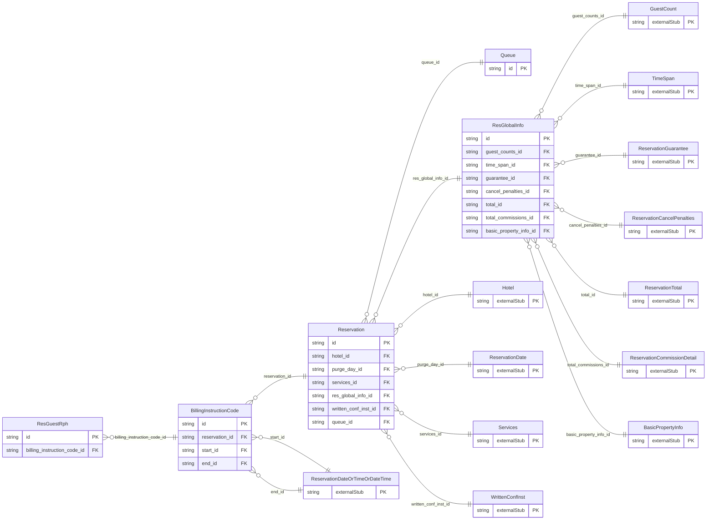

<!-- Code generated by protoc-gen-store. DO NOT EDIT. -->

# `ota/opentravel/hotel/booking/reservation/reservation/` — Prisma schema

Generated from Protobuf by protoc-gen-store. Source of truth is the `.proto` files — regenerate rather than editing.

| Models | Enums |
| ---: | ---: |
| 5 | 2 |

## Entity relationships

Schema file: [`reservation.postgres.prisma`](./reservation.postgres.prisma)

### `Reservation` → `resource`

Contains a hotel reservation. A collection resource, named "hotels/{hotel}/reservations/{reservation}". OTA: OTA_HotelResRQ/HotelReservations/HotelReservation.

| Column | Type | Null |
| --- | --- | --- |
| `id` | `CHAR(26)` | not null |
| `name` | `VARCHAR(255)` | not null |
| `uid` | `VARCHAR(255)` | nullable |
| `etag` | `VARCHAR(255)` | nullable |
| `delete_time` | `TIMESTAMPTZ` | nullable |
| `expire_time` | `TIMESTAMPTZ` | nullable |
| `create_time` | `TIMESTAMPTZ` | not null |
| `update_time` | `TIMESTAMPTZ` | not null |
| `room_stay_reservation` | `BOOLEAN` | nullable |
| `creator_id` | `VARCHAR(255)` | nullable |
| `last_modifier_id` | `VARCHAR(255)` | nullable |
| `state` | `State` | nullable |
| `gds_status_code` | `VARCHAR(255)` | nullable |
| `forced_sell_indicator` | `BOOLEAN` | nullable |
| `service_override_indicator` | `BOOLEAN` | nullable |
| `rate_override_indicator` | `BOOLEAN` | nullable |
| `walkin_indicator` | `BOOLEAN` | nullable |
| `room_number_locked_indicator` | `BOOLEAN` | nullable |
| `original_delivery_method_code` | `ReservationDistributionType` | nullable |
| `passive_indicator` | `BOOLEAN` | nullable |
| `lifecycle_case` | `ReservationLifecycleCase` | nullable |
| `hotel_id` | `CHAR(26)` | not null |
| `purge_day_id` | `CHAR(26)` | nullable |
| `services_id` | `CHAR(26)` | nullable |
| `res_global_info_id` | `CHAR(26)` | nullable |
| `written_conf_inst_id` | `CHAR(26)` | nullable |
| `queue_id` | `CHAR(26)` | nullable |

### `BillingInstructionCode` → `billing_instruction_codes`

Billing codes that apply to a set of instructions for a set of transactions that are routed to a designated folio.

| Column | Type | Null |
| --- | --- | --- |
| `id` | `CHAR(26)` | not null |
| `billing_code` | `VARCHAR(255)` | not null |
| `billing_type` | `ReservationBillingType` | nullable |
| `authorization_code` | `VARCHAR(255)` | nullable |
| `description` | `VARCHAR(255)` | nullable |
| `duration` | `VARCHAR(255)` | nullable |
| `account_number` | `VARCHAR(255)` | nullable |
| `reservation_id` | `CHAR(26)` | not null |
| `start_id` | `CHAR(26)` | nullable |
| `end_id` | `CHAR(26)` | nullable |

### `ResGlobalInfo` → `res_global_infos`

ResGlobalInfo is a container for various information that affects the Reservation as a whole. These include global comments, counts, reservation IDs, loyalty programs, and payment methods.

| Column | Type | Null |
| --- | --- | --- |
| `id` | `CHAR(26)` | not null |
| `res_guest_rphs` | `VARCHAR(255)[]` | nullable |
| `guest_counts_id` | `CHAR(26)` | nullable |
| `time_span_id` | `CHAR(26)` | nullable |
| `guarantee_id` | `CHAR(26)` | nullable |
| `cancel_penalties_id` | `CHAR(26)` | nullable |
| `total_id` | `CHAR(26)` | nullable |
| `total_commissions_id` | `CHAR(26)` | nullable |
| `basic_property_info_id` | `CHAR(26)` | not null |

### `Queue` → `queues`

Information to specify the queue on which the reservation should be placed.

| Column | Type | Null |
| --- | --- | --- |
| `id` | `CHAR(26)` | not null |
| `pseudo_city_code` | `VARCHAR(255)` | nullable |
| `queue_number` | `VARCHAR(255)` | nullable |
| `queue_category` | `VARCHAR(255)` | nullable |
| `system_code` | `VARCHAR(255)` | nullable |
| `queue_id` | `VARCHAR(255)` | nullable |

### `ResGuestRph` → `res_guest_rphs`

A reference to a guest ID object that may be defined in ResGuests/ResGuest

| Column | Type | Null |
| --- | --- | --- |
| `id` | `CHAR(26)` | not null |
| `rph` | `VARCHAR(255)` | not null |
| `billing_instruction_code_id` | `CHAR(26)` | not null |

### Enums

- `State`: RESERVED, REQUESTED, REQUEST_DENIED, NO_SHOW, CANCELLED, IN_HOUSE, CHECKED_OUT, WAITLISTED
- `ReservationLifecycleCase`: STATE, GDS_STATUS_CODE
