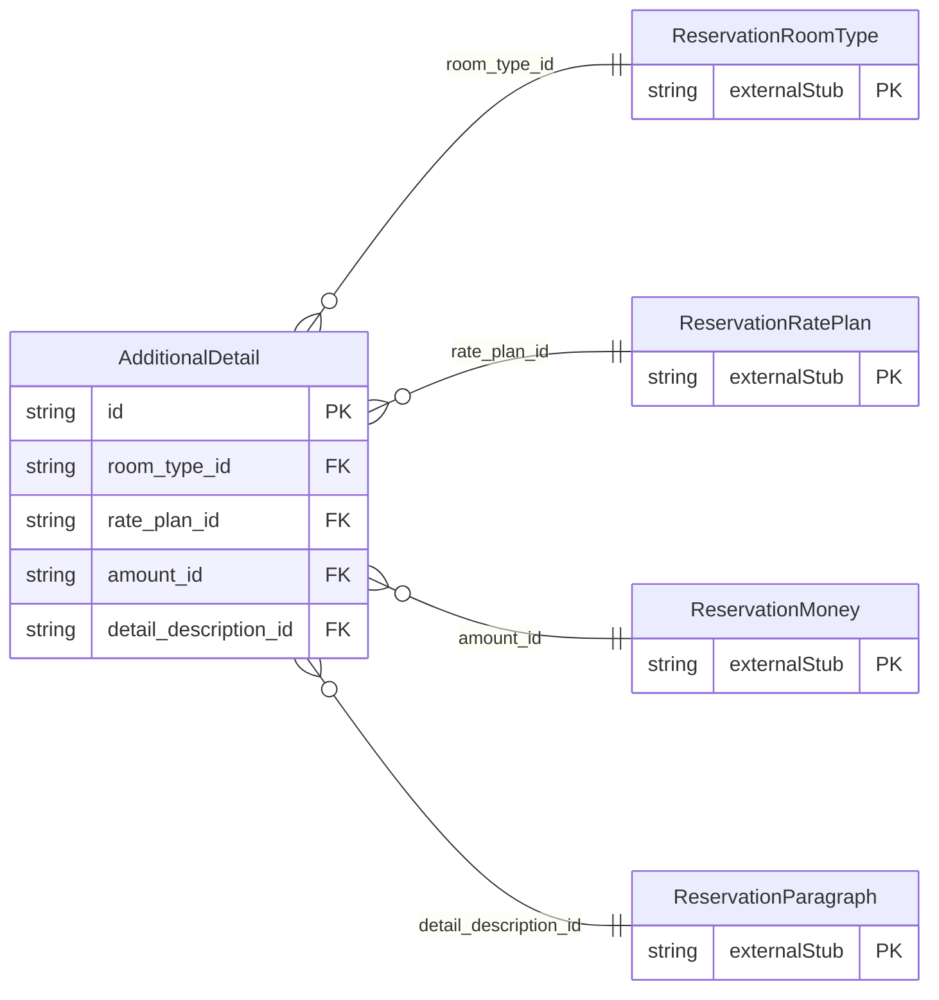

<!-- Code generated by protoc-gen-store. DO NOT EDIT. -->

# `ota/opentravel/hotel/booking/reservation/v1/types/additional_detail/` — Prisma schema

Generated from Protobuf by protoc-gen-store. Source of truth is the `.proto` files — regenerate rather than editing.

| Models | Enums |
| ---: | ---: |
| 1 | 0 |

## Entity relationships

Schema file: [`additional_detail.postgres.prisma`](./additional_detail.postgres.prisma)

### `AdditionalDetail` → `additional_details`

Used to send additional information.

| Column | Type | Null |
| --- | --- | --- |
| `id` | `CHAR(26)` | not null |
| `type` | `ReservationAdditionalDetailType` | nullable |
| `code` | `VARCHAR(255)` | nullable |
| `room_type_id` | `CHAR(26)` | not null |
| `rate_plan_id` | `CHAR(26)` | not null |
| `amount_id` | `CHAR(26)` | nullable |
| `detail_description_id` | `CHAR(26)` | nullable |
