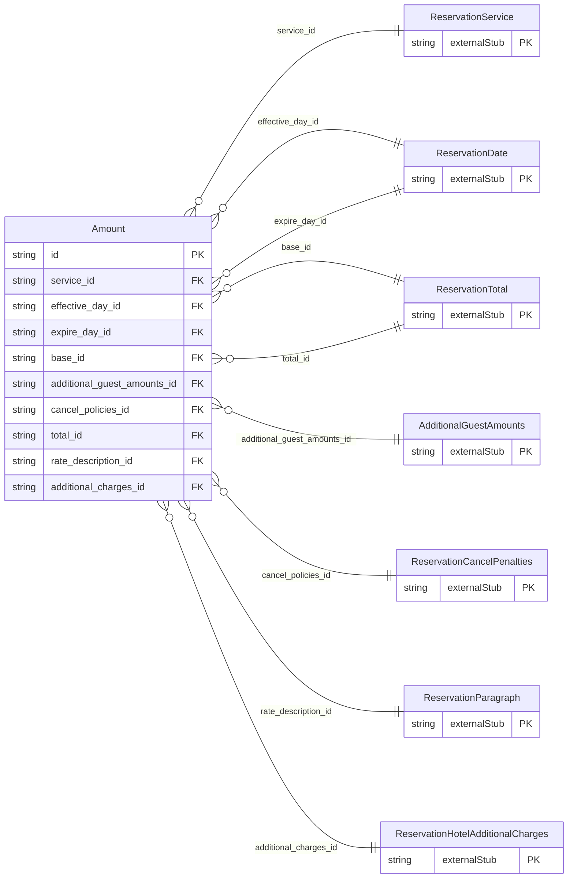

<!-- Code generated by protoc-gen-store. DO NOT EDIT. -->

# `ota/opentravel/hotel/booking/reservation/v1/types/amount/` — Prisma schema

Generated from Protobuf by protoc-gen-store. Source of truth is the `.proto` files — regenerate rather than editing.

| Models | Enums |
| ---: | ---: |
| 1 | 0 |

## Entity relationships

Schema file: [`amount.postgres.prisma`](./amount.postgres.prisma)

### `Amount` → `amounts`

Base charge and additional charges related to a room that includes such things as additional guest amounts, cancel fees, etc. Also includes Discount percentages, total amount, and the rate description.

| Column | Type | Null |
| --- | --- | --- |
| `id` | `CHAR(26)` | not null |
| `expire_date_exclusive` | `BOOLEAN` | nullable |
| `age_qualifying_code` | `ReservationAgeQualifyingCode` | nullable |
| `min_age` | `INTEGER` | nullable |
| `max_age` | `INTEGER` | nullable |
| `age_time_unit` | `ReservationTimeUnit` | nullable |
| `age_bucket` | `VARCHAR(255)` | nullable |
| `guaranteed` | `BOOLEAN` | nullable |
| `unit_count` | `INTEGER` | nullable |
| `rate_time_unit` | `ReservationTimeUnit` | nullable |
| `unit_multiplier` | `INTEGER` | nullable |
| `min_guest_applicable` | `INTEGER` | nullable |
| `max_guest_applicable` | `INTEGER` | nullable |
| `min_los` | `INTEGER` | nullable |
| `max_los` | `INTEGER` | nullable |
| `stayover_weekday` | `ReservationDayOfWeek` | nullable |
| `alternate_currency` | `BOOLEAN` | nullable |
| `charge_type` | `ReservationChargeType` | nullable |
| `quote_id` | `VARCHAR(255)` | nullable |
| `service_id` | `VARCHAR(255)` | not null |
| `effective_day_id` | `CHAR(26)` | nullable |
| `expire_day_id` | `CHAR(26)` | nullable |
| `base_id` | `CHAR(26)` | nullable |
| `additional_guest_amounts_id` | `CHAR(26)` | nullable |
| `cancel_policies_id` | `CHAR(26)` | nullable |
| `total_id` | `CHAR(26)` | nullable |
| `rate_description_id` | `CHAR(26)` | nullable |
| `additional_charges_id` | `CHAR(26)` | nullable |
