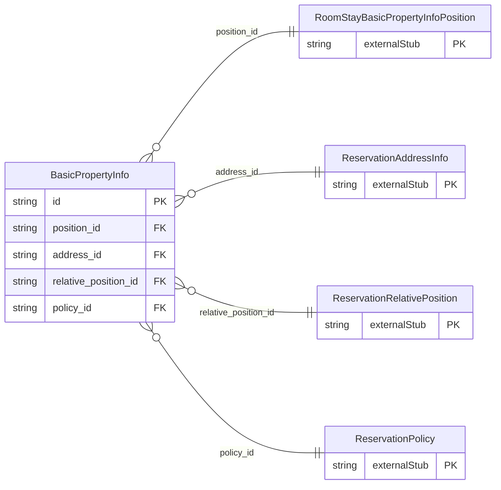

<!-- Code generated by protoc-gen-store. DO NOT EDIT. -->

# `ota/opentravel/hotel/booking/reservation/v1/types/basic_property_info/` — Prisma schema

Generated from Protobuf by protoc-gen-store. Source of truth is the `.proto` files — regenerate rather than editing.

| Models | Enums |
| ---: | ---: |
| 1 | 0 |

## Entity relationships

Schema file: [`basic_property_info.postgres.prisma`](./basic_property_info.postgres.prisma)

### `BasicPropertyInfo` → `basic_property_infos`

An abbreviated short summary of hotel descriptive information.

| Column | Type | Null |
| --- | --- | --- |
| `id` | `CHAR(26)` | not null |
| `chain_code` | `VARCHAR(255)` | nullable |
| `brand_code` | `VARCHAR(255)` | nullable |
| `hotel_code` | `VARCHAR(255)` | nullable |
| `hotel_city_code` | `VARCHAR(255)` | nullable |
| `hotel_display_name` | `VARCHAR(255)` | nullable |
| `hotel_code_context` | `VARCHAR(255)` | nullable |
| `chain_display_name` | `VARCHAR(255)` | nullable |
| `brand_display_name` | `VARCHAR(255)` | nullable |
| `area_id` | `VARCHAR(255)` | nullable |
| `tt_icode` | `INTEGER` | nullable |
| `hotel_segment_category_code` | `ReservationSegmentCategoryCode` | nullable |
| `supplier_integration_level` | `INTEGER` | nullable |
| `max_group_room_quantity` | `INTEGER` | nullable |
| `currency_code` | `VARCHAR(255)` | nullable |
| `master_chain_code` | `VARCHAR(255)` | nullable |
| `position_id` | `CHAR(26)` | nullable |
| `address_id` | `CHAR(26)` | nullable |
| `relative_position_id` | `CHAR(26)` | nullable |
| `policy_id` | `CHAR(26)` | nullable |
