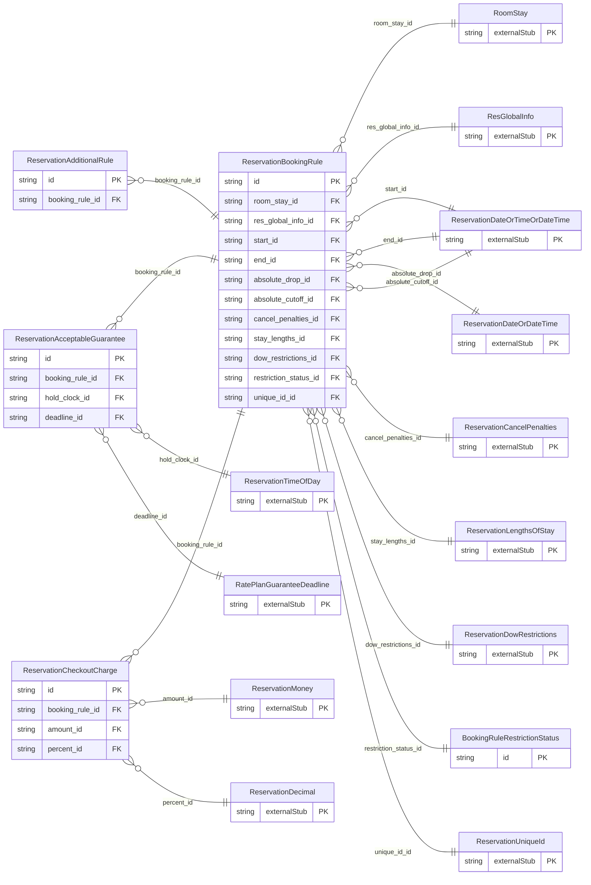

<!-- Code generated by protoc-gen-store. DO NOT EDIT. -->

# `ota/opentravel/hotel/booking/reservation/v1/types/booking_rule/` — Prisma schema

Generated from Protobuf by protoc-gen-store. Source of truth is the `.proto` files — regenerate rather than editing.

| Models | Enums |
| ---: | ---: |
| 5 | 4 |

## Entity relationships

Schema file: [`booking_rule.postgres.prisma`](./booking_rule.postgres.prisma)

### `ReservationBookingRule` → `booking_rules`

The BookingRule element defines restrictions to rates and stays at the hotel for a given rate plan, room type or rate plan/room type combination.

| Column | Type | Null |
| --- | --- | --- |
| `id` | `CHAR(26)` | not null |
| `code` | `VARCHAR(255)` | nullable |
| `code_context` | `VARCHAR(255)` | nullable |
| `quantity` | `INTEGER` | nullable |
| `uri` | `VARCHAR(255)` | nullable |
| `duration` | `VARCHAR(255)` | nullable |
| `max_advanced_booking_offset` | `VARCHAR(255)` | nullable |
| `min_advanced_booking_offset` | `VARCHAR(255)` | nullable |
| `force_guarantee_offset` | `VARCHAR(255)` | nullable |
| `deposit_waiver_offset` | `VARCHAR(255)` | nullable |
| `min_total_occupancy` | `INTEGER` | nullable |
| `max_total_occupancy` | `INTEGER` | nullable |
| `generally_bookable` | `BOOLEAN` | nullable |
| `price_viewable` | `BOOLEAN` | nullable |
| `qualified_rate_yn` | `BOOLEAN` | nullable |
| `address_required` | `BOOLEAN` | nullable |
| `offset_duration` | `VARCHAR(255)` | nullable |
| `offset_calculation_mode` | `ReservationOffsetCalculationMode` | nullable |
| `max_contiguous_bookings` | `INTEGER` | nullable |
| `room_stay_id` | `CHAR(26)` | not null |
| `res_global_info_id` | `CHAR(26)` | not null |
| `start_id` | `CHAR(26)` | nullable |
| `end_id` | `CHAR(26)` | nullable |
| `absolute_drop_id` | `CHAR(26)` | nullable |
| `absolute_cutoff_id` | `CHAR(26)` | nullable |
| `cancel_penalties_id` | `CHAR(26)` | nullable |
| `stay_lengths_id` | `CHAR(26)` | nullable |
| `dow_restrictions_id` | `CHAR(26)` | nullable |
| `restriction_status_id` | `CHAR(26)` | nullable |
| `unique_id_id` | `VARCHAR(255)` | nullable |

### `ReservationAcceptableGuarantee` → `acceptable_guarantees`

The guarantee information.

| Column | Type | Null |
| --- | --- | --- |
| `id` | `CHAR(26)` | not null |
| `retribution_type` | `RatePlanGuaranteeRetributionType` | nullable |
| `guarantee_code` | `VARCHAR(255)` | nullable |
| `guarantee_type` | `RatePlanGuaranteeGuaranteeType` | nullable |
| `guarantee_policy_type` | `ReservationGuaranteePolicyType` | nullable |
| `payment_type` | `ReservationPaymentType` | nullable |
| `currency_code` | `VARCHAR(255)` | nullable |
| `decimal_places` | `INTEGER` | nullable |
| `unacceptable_payment_type` | `ReservationPaymentType` | nullable |
| `booking_rule_id` | `CHAR(26)` | not null |
| `hold_clock_id` | `CHAR(26)` | nullable |
| `deadline_id` | `CHAR(26)` | nullable |

### `BookingRuleRestrictionStatus` → `booking_rule_restriction_status`

Availability status assigned to the room rate combination for this booking rule.

| Column | Type | Null |
| --- | --- | --- |
| `id` | `CHAR(26)` | not null |
| `restriction` | `RatePlanRestrictionStatusRestriction` | nullable |
| `status` | `EnumsAvailability` | nullable |
| `sell_through_open_indicator` | `BOOLEAN` | nullable |

### `ReservationAdditionalRule` → `additional_rules`

Indicates an additional rule for the reservation (e.g., cancelable, modifiable or refundable).

| Column | Type | Null |
| --- | --- | --- |
| `id` | `CHAR(26)` | not null |
| `additional_rule` | `BookingRuleAdditionalRuleAdditionalRule` | nullable |
| `booking_rule_id` | `CHAR(26)` | not null |

### `ReservationCheckoutCharge` → `checkout_charges`

The charges that may apply to an early or late checkout.

| Column | Type | Null |
| --- | --- | --- |
| `id` | `CHAR(26)` | not null |
| `type` | `BookingRuleCheckoutChargeType` | nullable |
| `code_detail` | `VARCHAR(255)` | nullable |
| `night_count` | `INTEGER` | nullable |
| `exists_code` | `ReservationOptionTypeCode` | nullable |
| `stay_balance` | `BOOLEAN` | nullable |
| `booking_rule_id` | `CHAR(26)` | not null |
| `amount_id` | `CHAR(26)` | nullable |
| `percent_id` | `CHAR(26)` | nullable |

### Enums

- `ReservationOffsetCalculationMode`: BEFORE_BLOCK_START_DATE, AFTER_BLOCK_CREATION
- `ReservationGuaranteePolicyType`: NO_GUARANTEES_ACCEPTED, GUARANTEES_ACCEPTED, GUARANTEES_REQUIRED, DEPOSIT_REQUIRED, GUARANTEES_NOT_REQUIRED, DEPOSIT_NOT_REQUIRED, PREPAY_REQUIRED, PREPAY_NOT_REQUIRED, NO_DEPOSITS_ACCEPTED
- `BookingRuleAdditionalRuleAdditionalRule`: IS_CANCELABLE, IS_MODIFIABLE, IS_REFUNDABLE, NOT_CANCELABLE, NOT_MODIFIABLE, NOT_REFUNDABLE, IS_COMMISSIONABLE, NOT_COMMISSIONABLE, CERTIFICATE_REQUIRED, ID_REQUIRED
- `BookingRuleCheckoutChargeType`: EARLY, LATE
