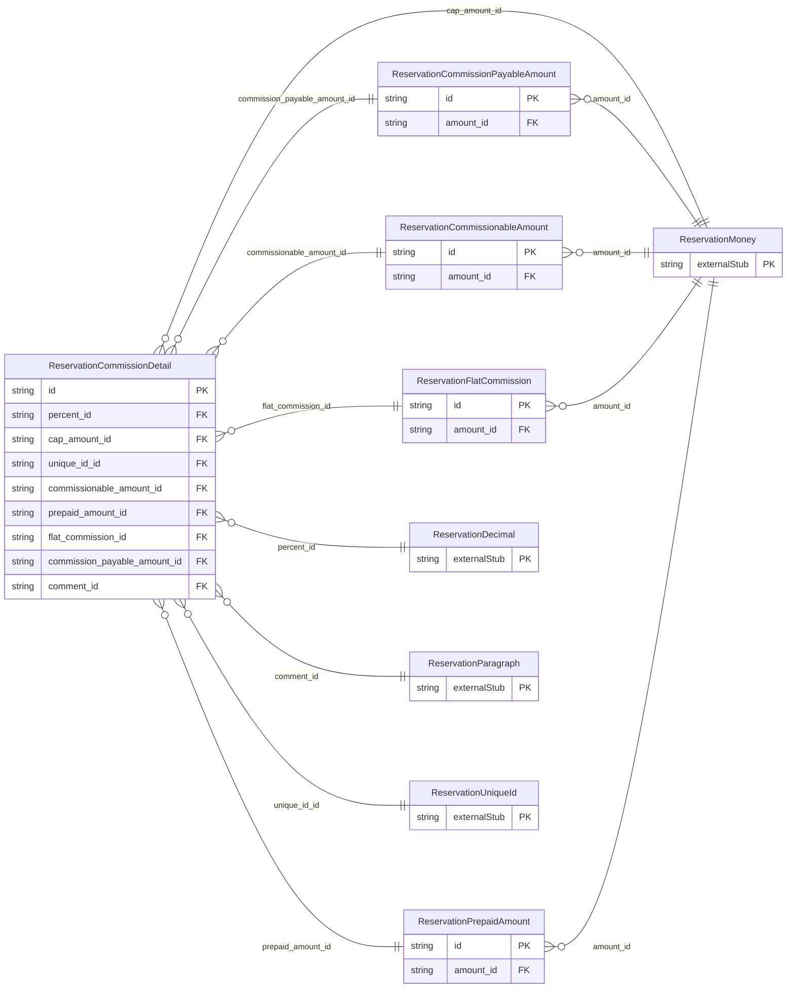

<!-- Code generated by protoc-gen-store. DO NOT EDIT. -->

# `ota/opentravel/hotel/booking/reservation/v1/types/commission_detail/` — Prisma schema

Generated from Protobuf by protoc-gen-store. Source of truth is the `.proto` files — regenerate rather than editing.

| Models | Enums |
| ---: | ---: |
| 5 | 1 |

## Entity relationships

Schema file: [`commission_detail.postgres.prisma`](./commission_detail.postgres.prisma)

### `ReservationCommissionDetail` → `commission_details`

Contains details pertaining to commissions.

| Column | Type | Null |
| --- | --- | --- |
| `id` | `CHAR(26)` | not null |
| `status_type` | `ReservationStatusType` | nullable |
| `reason_code` | `VARCHAR(255)` | nullable |
| `billing_id` | `VARCHAR(255)` | nullable |
| `frequency` | `ReservationChargeType` | nullable |
| `max_commission_unit_applies` | `INTEGER` | nullable |
| `percent_id` | `CHAR(26)` | nullable |
| `cap_amount_id` | `CHAR(26)` | nullable |
| `unique_id_id` | `VARCHAR(255)` | nullable |
| `commissionable_amount_id` | `CHAR(26)` | nullable |
| `prepaid_amount_id` | `CHAR(26)` | nullable |
| `flat_commission_id` | `CHAR(26)` | nullable |
| `commission_payable_amount_id` | `CHAR(26)` | nullable |
| `comment_id` | `CHAR(26)` | nullable |

### `ReservationCommissionableAmount` → `commissionable_amounts`

The amount on which commission is calculated.

| Column | Type | Null |
| --- | --- | --- |
| `id` | `CHAR(26)` | not null |
| `tax_inclusive_indicator` | `BOOLEAN` | nullable |
| `amount_id` | `CHAR(26)` | nullable |

### `ReservationPrepaidAmount` → `prepaid_amounts`

The amount of commission paid to the agency prior to the service being rendered.

| Column | Type | Null |
| --- | --- | --- |
| `id` | `CHAR(26)` | not null |
| `amount_id` | `CHAR(26)` | nullable |

### `ReservationFlatCommission` → `flat_commissions`

A fixed commission amount.

| Column | Type | Null |
| --- | --- | --- |
| `id` | `CHAR(26)` | not null |
| `amount_id` | `CHAR(26)` | nullable |

### `ReservationCommissionPayableAmount` → `commission_payable_amounts`

The amount of commission to be paid.

| Column | Type | Null |
| --- | --- | --- |
| `id` | `CHAR(26)` | not null |
| `amount_id` | `CHAR(26)` | nullable |

### Enums

- `ReservationStatusType`: FULL, PARTIAL, NON_PAYING, NO_SHOW, ADJUSTMENT, COMMISSIONABLE
