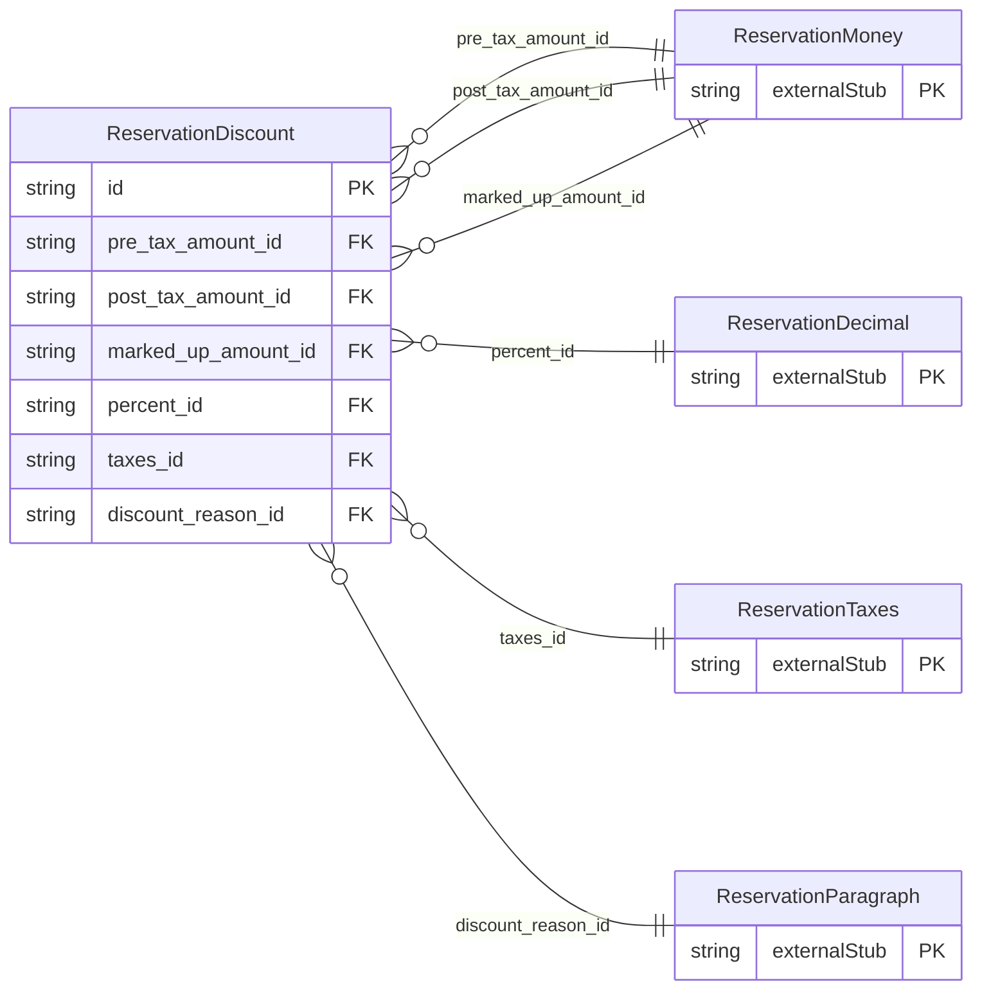

<!-- Code generated by protoc-gen-store. DO NOT EDIT. -->

# `ota/opentravel/hotel/booking/reservation/v1/types/discount/` — Prisma schema

Generated from Protobuf by protoc-gen-store. Source of truth is the `.proto` files — regenerate rather than editing.

| Models | Enums |
| ---: | ---: |
| 1 | 0 |

## Entity relationships

Schema file: [`discount.postgres.prisma`](./discount.postgres.prisma)

### `ReservationDiscount` → `discounts`

Identifies and provides details about the discount.

| Column | Type | Null |
| --- | --- | --- |
| `id` | `CHAR(26)` | not null |
| `additional_fees_excluded_indicator` | `BOOLEAN` | nullable |
| `type` | `ReservationChargeType` | nullable |
| `service_override_indicator` | `BOOLEAN` | nullable |
| `rate_override_indicator` | `BOOLEAN` | nullable |
| `tax_inclusive` | `BOOLEAN` | nullable |
| `discount_code` | `VARCHAR(255)` | nullable |
| `restricted_display_indicator` | `BOOLEAN` | nullable |
| `pre_tax_amount_id` | `CHAR(26)` | nullable |
| `post_tax_amount_id` | `CHAR(26)` | nullable |
| `marked_up_amount_id` | `CHAR(26)` | nullable |
| `percent_id` | `CHAR(26)` | nullable |
| `taxes_id` | `CHAR(26)` | nullable |
| `discount_reason_id` | `CHAR(26)` | not null |
