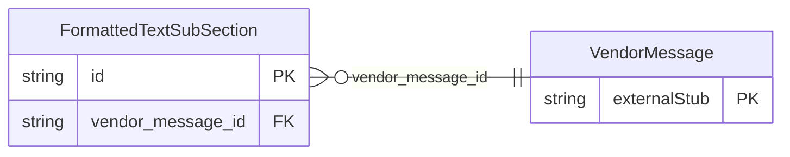

<!-- Code generated by protoc-gen-store. DO NOT EDIT. -->

# `ota/opentravel/hotel/booking/reservation/v1/types/formatted_text_sub_section/` — Prisma schema

Generated from Protobuf by protoc-gen-store. Source of truth is the `.proto` files — regenerate rather than editing.

| Models | Enums |
| ---: | ---: |
| 1 | 0 |

## Entity relationships

Schema file: [`formatted_text_sub_section.postgres.prisma`](./formatted_text_sub_section.postgres.prisma)

### `FormattedTextSubSection` → `formatted_text_sub_sections`

Used to provide subsection formatted text information.

| Column | Type | Null |
| --- | --- | --- |
| `id` | `CHAR(26)` | not null |
| `sub_title` | `VARCHAR(255)` | nullable |
| `sub_code` | `VARCHAR(255)` | nullable |
| `sub_section_number` | `INTEGER` | nullable |
| `vendor_message_id` | `CHAR(26)` | not null |
