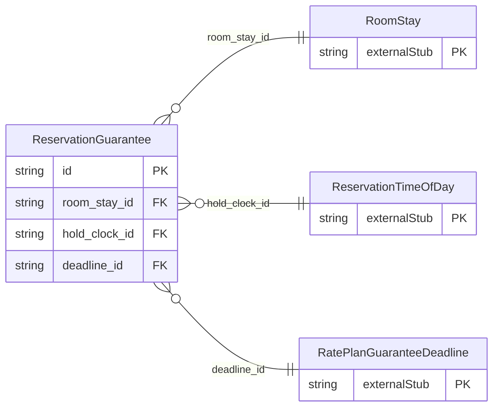

<!-- Code generated by protoc-gen-store. DO NOT EDIT. -->

# `ota/opentravel/hotel/booking/reservation/v1/types/guarantee/` — Prisma schema

Generated from Protobuf by protoc-gen-store. Source of truth is the `.proto` files — regenerate rather than editing.

| Models | Enums |
| ---: | ---: |
| 1 | 0 |

## Entity relationships

Schema file: [`guarantee.postgres.prisma`](./guarantee.postgres.prisma)

### `ReservationGuarantee` → `guarantees`

The guarantee information to hold a reservation

| Column | Type | Null |
| --- | --- | --- |
| `id` | `CHAR(26)` | not null |
| `retribution_type` | `RatePlanGuaranteeRetributionType` | nullable |
| `guarantee_code` | `VARCHAR(255)` | nullable |
| `guarantee_type` | `RatePlanGuaranteeGuaranteeType` | nullable |
| `room_stay_id` | `CHAR(26)` | not null |
| `hold_clock_id` | `CHAR(26)` | nullable |
| `deadline_id` | `CHAR(26)` | nullable |
