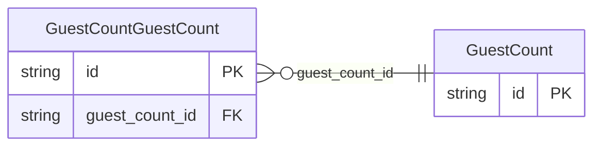

<!-- Code generated by protoc-gen-store. DO NOT EDIT. -->

# `ota/opentravel/hotel/booking/reservation/v1/types/guest_count/` — Prisma schema

Generated from Protobuf by protoc-gen-store. Source of truth is the `.proto` files — regenerate rather than editing.

| Models | Enums |
| ---: | ---: |
| 2 | 0 |

## Entity relationships

Schema file: [`guest_count.postgres.prisma`](./guest_count.postgres.prisma)

### `GuestCount` → `guest_counts`

A collection of GuestCount by age group.

| Column | Type | Null |
| --- | --- | --- |
| `id` | `CHAR(26)` | not null |
| `per_room` | `BOOLEAN` | nullable |

### `GuestCountGuestCount` → `guest_count_guest_counts`

A recurring element that identifies the number of guests and ages of the guests.

| Column | Type | Null |
| --- | --- | --- |
| `id` | `CHAR(26)` | not null |
| `age_qualifying_code` | `ReservationAgeQualifyingCode` | nullable |
| `age` | `INTEGER` | nullable |
| `count` | `INTEGER` | nullable |
| `age_bucket` | `VARCHAR(255)` | nullable |
| `res_guest_rph` | `VARCHAR(255)` | nullable |
| `guest_count_id` | `CHAR(26)` | not null |
