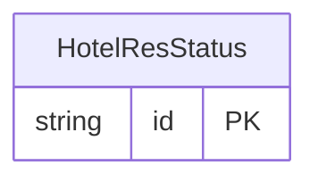

<!-- Code generated by protoc-gen-store. DO NOT EDIT. -->

# `ota/opentravel/hotel/booking/reservation/v1/types/hotel_res_status/` — Prisma schema

Generated from Protobuf by protoc-gen-store. Source of truth is the `.proto` files — regenerate rather than editing.

| Models | Enums |
| ---: | ---: |
| 1 | 1 |

## Entity relationships

Schema file: [`hotel_res_status.postgres.prisma`](./hotel_res_status.postgres.prisma)

### `HotelResStatus` → `hotel_res_status`

A union between TransactionActionType and PMS_ResStatusType. Used in messages that communicate between reservation systems as well as between a reservation and property management system. In addition to the TransactionActionType and PMS_ResStatusType, the UpperCaseAlphaLength1to2 may be used for company specific codes.

| Column | Type | Null |
| --- | --- | --- |
| `id` | `CHAR(26)` | not null |
| `pms_reservation_state` | `PmsReservationState` | nullable |
| `transaction_action` | `TransactionAction` | nullable |
| `text` | `VARCHAR(255)` | nullable |
| `value_case` | `HotelResStatusValueCase` | nullable |

### Enums

- `HotelResStatusValueCase`: PMS_RESERVATION_STATE, TRANSACTION_ACTION, TEXT
