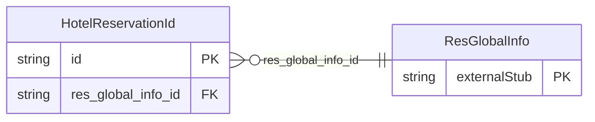

<!-- Code generated by protoc-gen-store. DO NOT EDIT. -->

# `ota/opentravel/hotel/booking/reservation/v1/types/hotel_reservation_id/` — Prisma schema

Generated from Protobuf by protoc-gen-store. Source of truth is the `.proto` files — regenerate rather than editing.

| Models | Enums |
| ---: | ---: |
| 1 | 0 |

## Entity relationships

Schema file: [`hotel_reservation_id.postgres.prisma`](./hotel_reservation_id.postgres.prisma)

### `HotelReservationId` → `hotel_reservation_ids`

The HotelReservationID object contains various unique (ReservationID) and non unique (ConfirmationID, CancellationID) identifiers that the trading partners associate with a given reservation.

| Column | Type | Null |
| --- | --- | --- |
| `id` | `CHAR(26)` | not null |
| `res_id_type` | `ReservationUniqueIdType` | nullable |
| `res_id_value` | `VARCHAR(255)` | nullable |
| `res_id_source` | `VARCHAR(255)` | nullable |
| `res_id_source_context` | `VARCHAR(255)` | nullable |
| `res_id_time` | `TIMESTAMPTZ` | nullable |
| `guest_facing` | `BOOLEAN` | nullable |
| `res_guest_rph` | `VARCHAR(255)` | nullable |
| `cancel_originator_code` | `VARCHAR(255)` | nullable |
| `cancellation_time` | `TIMESTAMPTZ` | nullable |
| `hotel_reservation_id_rph` | `VARCHAR(255)` | nullable |
| `res_global_info_id` | `CHAR(26)` | not null |
