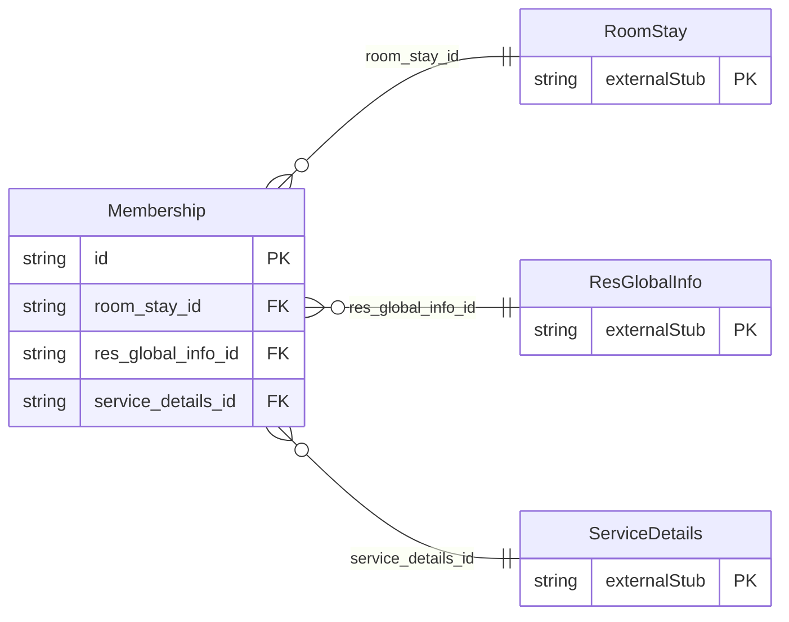

<!-- Code generated by protoc-gen-store. DO NOT EDIT. -->

# `ota/opentravel/hotel/booking/reservation/v1/types/membership/` — Prisma schema

Generated from Protobuf by protoc-gen-store. Source of truth is the `.proto` files — regenerate rather than editing.

| Models | Enums |
| ---: | ---: |
| 1 | 0 |

## Entity relationships

Schema file: [`membership.postgres.prisma`](./membership.postgres.prisma)

### `Membership` → `memberships`

The SelectedMembership object identifies the frequent customer reward program and (optionally) indicates points awarded for stay activity.

| Column | Type | Null |
| --- | --- | --- |
| `id` | `CHAR(26)` | not null |
| `program_code` | `VARCHAR(255)` | nullable |
| `bonus_code` | `VARCHAR(255)` | nullable |
| `account_id` | `VARCHAR(255)` | nullable |
| `points_earned` | `INTEGER` | nullable |
| `travel_sector` | `ReservationTravelSector` | nullable |
| `room_stay_id` | `CHAR(26)` | not null |
| `res_global_info_id` | `CHAR(26)` | not null |
| `service_details_id` | `CHAR(26)` | not null |
