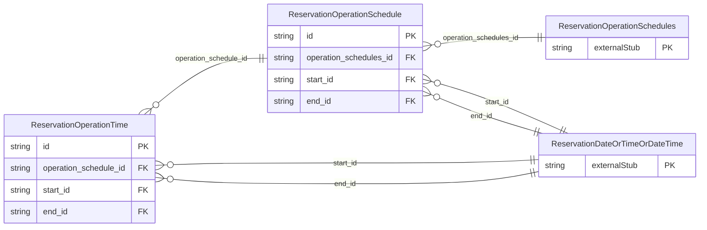

<!-- Code generated by protoc-gen-store. DO NOT EDIT. -->

# `ota/opentravel/hotel/booking/reservation/v1/types/operation_schedule/` — Prisma schema

Generated from Protobuf by protoc-gen-store. Source of truth is the `.proto` files — regenerate rather than editing.

| Models | Enums |
| ---: | ---: |
| 2 | 0 |

## Entity relationships

Schema file: [`operation_schedule.postgres.prisma`](./operation_schedule.postgres.prisma)

### `ReservationOperationSchedule` → `operation_schedule`

Details of an operating schedule (e.g. a golf tee time may be more expensive during peak hours v. off peak hours).

| Column | Type | Null |
| --- | --- | --- |
| `id` | `CHAR(26)` | not null |
| `duration` | `VARCHAR(255)` | nullable |
| `operation_schedules_id` | `CHAR(26)` | not null |
| `start_id` | `CHAR(26)` | nullable |
| `end_id` | `CHAR(26)` | nullable |

### `ReservationOperationTime` → `operation_times`

Provides operating times of a facility.

| Column | Type | Null |
| --- | --- | --- |
| `id` | `CHAR(26)` | not null |
| `weekdays` | `` | nullable |
| `duration` | `VARCHAR(255)` | nullable |
| `additional_operation_info_code` | `ReservationAdditionalOperationInfo` | nullable |
| `frequency` | `VARCHAR(255)` | nullable |
| `text` | `VARCHAR(255)` | nullable |
| `operation_schedule_id` | `CHAR(26)` | not null |
| `start_id` | `CHAR(26)` | nullable |
| `end_id` | `CHAR(26)` | nullable |
