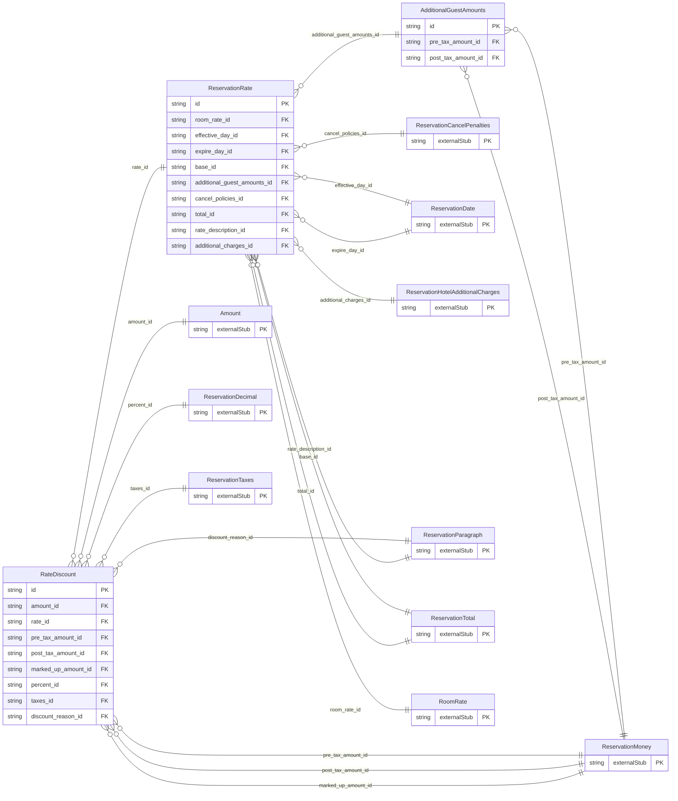

<!-- Code generated by protoc-gen-store. DO NOT EDIT. -->

# `ota/opentravel/hotel/booking/reservation/v1/types/rate/` — Prisma schema

Generated from Protobuf by protoc-gen-store. Source of truth is the `.proto` files — regenerate rather than editing.

| Models | Enums |
| ---: | ---: |
| 3 | 1 |

## Entity relationships

Schema file: [`rate.postgres.prisma`](./rate.postgres.prisma)

### `ReservationRate` → `rates`

The Rate contains a collection of elements that define the amount of the rate, associated fees, additional occupant amounts as well as payment and cancellation policies. Taxes can be broken out or included within the various amounts. A currency can be associated to each amount The applicable period of the the rate are indicated by the effective dates. Restrictions that may apply to that rate, such as the minimum or maximum length of stay, stay-over dates (such as a Saturday night), min/max guests applicable for the rate, and age group (ex Adult) are attributes of Rate. It indicates the number of units that the quoted rate is based upon, as well as the TimeUnits type used that the rate is based upon, e.g.: 3days at $100.00 per day.

| Column | Type | Null |
| --- | --- | --- |
| `id` | `CHAR(26)` | not null |
| `expire_date_exclusive` | `BOOLEAN` | nullable |
| `age_qualifying_code` | `ReservationAgeQualifyingCode` | nullable |
| `min_age` | `INTEGER` | nullable |
| `max_age` | `INTEGER` | nullable |
| `age_time_unit` | `ReservationTimeUnit` | nullable |
| `age_bucket` | `VARCHAR(255)` | nullable |
| `guaranteed` | `BOOLEAN` | nullable |
| `unit_count` | `INTEGER` | nullable |
| `rate_time_unit` | `ReservationTimeUnit` | nullable |
| `unit_multiplier` | `INTEGER` | nullable |
| `min_guest_applicable` | `INTEGER` | nullable |
| `max_guest_applicable` | `INTEGER` | nullable |
| `min_los` | `INTEGER` | nullable |
| `max_los` | `INTEGER` | nullable |
| `stayover_weekday` | `ReservationDayOfWeek` | nullable |
| `alternate_currency` | `BOOLEAN` | nullable |
| `charge_type` | `ReservationChargeType` | nullable |
| `quote_id` | `VARCHAR(255)` | nullable |
| `duration` | `VARCHAR(255)` | nullable |
| `rate_mode` | `RateMode` | nullable |
| `cached_indicator` | `BOOLEAN` | nullable |
| `rate_source` | `VARCHAR(255)` | nullable |
| `rate_type_code` | `ReservationRatePlanType` | nullable |
| `room_pricing_type` | `Pricing` | nullable |
| `room_rate_id` | `CHAR(26)` | not null |
| `effective_day_id` | `CHAR(26)` | nullable |
| `expire_day_id` | `CHAR(26)` | nullable |
| `base_id` | `CHAR(26)` | nullable |
| `additional_guest_amounts_id` | `CHAR(26)` | nullable |
| `cancel_policies_id` | `CHAR(26)` | nullable |
| `total_id` | `CHAR(26)` | nullable |
| `rate_description_id` | `CHAR(26)` | nullable |
| `additional_charges_id` | `CHAR(26)` | nullable |

### `AdditionalGuestAmounts` → `additional_guest_amounts`

A collection of charges that apply to for additional occupants, guests or service users (over and above the rate's MaxGuest Applicable).

| Column | Type | Null |
| --- | --- | --- |
| `id` | `CHAR(26)` | not null |
| `pre_tax_amount_id` | `CHAR(26)` | nullable |
| `post_tax_amount_id` | `CHAR(26)` | nullable |

### `RateDiscount` → `rate_discounts`

Discount percentage and/or Amount, code and textual reason for discount

| Column | Type | Null |
| --- | --- | --- |
| `id` | `CHAR(26)` | not null |
| `additional_fees_excluded_indicator` | `BOOLEAN` | nullable |
| `type` | `ReservationChargeType` | nullable |
| `service_override_indicator` | `BOOLEAN` | nullable |
| `rate_override_indicator` | `BOOLEAN` | nullable |
| `tax_inclusive` | `BOOLEAN` | nullable |
| `discount_code` | `VARCHAR(255)` | nullable |
| `restricted_display_indicator` | `BOOLEAN` | nullable |
| `application` | `AppliesTo` | nullable |
| `item_rph` | `VARCHAR(255)` | nullable |
| `amount_id` | `CHAR(26)` | not null |
| `rate_id` | `CHAR(26)` | not null |
| `pre_tax_amount_id` | `CHAR(26)` | nullable |
| `post_tax_amount_id` | `CHAR(26)` | nullable |
| `marked_up_amount_id` | `CHAR(26)` | nullable |
| `percent_id` | `CHAR(26)` | nullable |
| `taxes_id` | `CHAR(26)` | nullable |
| `discount_reason_id` | `CHAR(26)` | not null |

### Enums

- `AppliesTo`: BASE, ADDITIONAL_GUEST_AMOUNT, FEE
