<!-- Code generated by protoc-gen-store. DO NOT EDIT. -->

# `ota/opentravel/hotel/booking/reservation/v1/types/rate_plan/` — Prisma schema

Generated from Protobuf by protoc-gen-store. Source of truth is the `.proto` files — regenerate rather than editing.

| Models | Enums |
| ---: | ---: |
| 40 | 21 |

## Entity relationships

```mermaid
erDiagram
    direction LR
    RatePlanGuarantee {
        string id PK
        string rate_plan_id FK
        string hold_clock_id FK
        string deadline_id FK
        string amount_percent_id FK
    }
    RatePlanGuaranteeAmountPercent {
        string id PK
        string percent_id FK
        string amount_id FK
        string taxes_id FK
    }
    RatePlanGuaranteeDeadline {
        string id PK
        string absolute_deadline_id FK
    }
    RatePlanRestrictionStatus {
        string id PK
    }
    ReservationAddress {
        string id PK
        string street_nmbr_id FK
        string state_prov_id FK
        string country_display_name_id FK
    }
    ReservationAddressInfo {
        string id PK
        string street_nmbr_id FK
        string state_prov_id FK
        string country_display_name_id FK
    }
    ReservationAmountPercent {
        string id PK
        string percent_id FK
        string amount_id FK
        string taxes_id FK
    }
    ReservationAuthenticationVerificationValue {
        string id PK
        string secure_id FK
    }
    ReservationBankAcct {
        string id PK
        string bank_acct_number_id FK
        string bank_id_id FK
        string type_id FK
    }
    ReservationBillingAccountName {
        string id PK
    }
    ReservationBldgRoom {
        string id PK
        string address_id FK
        string address_info_id FK
    }
    ReservationCancelPenalties {
        string id PK
    }
    ReservationCancelPenalty {
        string id PK
        string cancel_penalties_id FK
        string start_id FK
        string end_id FK
        string deadline_id FK
        string amount_percent_id FK
    }
    ReservationCancelPenaltyDeadline {
        string id PK
        string absolute_deadline_id FK
    }
    ReservationCash {
        string id PK
    }
    ReservationConjunctionTicketNbr {
        string id PK
        string ticket_id FK
    }
    ReservationCustLoyalty {
        string id PK
        string payment_card_id FK
        string signup_day_id FK
        string effective_day_id FK
        string expire_day_id FK
    }
    ReservationDirectBill {
        string id PK
        string company_display_name_id FK
        string address_id FK
        string email_id FK
        string telephone_id FK
    }
    ReservationDirectBillCompanyName {
        string id PK
    }
    ReservationDirectBillTelephone {
        string id PK
    }
    ReservationDocument {
        string id PK
    }
    ReservationEmail {
        string id PK
        string payment_card_id FK
    }
    ReservationGateway {
        string id PK
        string authentication_verification_value_id FK
        string transaction_password_id FK
    }
    ReservationGuaranteeAccepted {
        string id PK
        string payment_card_id FK
        string bank_acct_id FK
        string direct_bill_id FK
        string voucher_id FK
        string loyalty_redemption_id FK
        string misc_charge_order_id FK
        string ticket_id FK
        string cash_id FK
        string acceptable_guarantee_id FK
    }
    ReservationIssuer {
        string id PK
    }
    ReservationLoyaltyCertificate {
        string id PK
        string loyalty_redemption_id FK
        string effective_day_id FK
        string expire_day_id FK
    }
    ReservationLoyaltyRedemption {
        string id PK
    }
    ReservationMealsIncluded {
        string id PK
    }
    ReservationMiscChargeOrder {
        string id PK
        string original_issue_day_id FK
    }
    ReservationPaymentCard {
        string id PK
        string rebate_id FK
        string card_code_id FK
        string card_type_id FK
        string issuer_id FK
        string card_holder_name_details_id FK
        string address_id FK
        string card_number_id FK
        string series_code_id FK
        string three_domain_security_id FK
        string signature_on_file_id FK
    }
    ReservationPaymentCardTelephone {
        string id PK
        string payment_card_id FK
    }
    ReservationPersonName {
        string id PK
        string document_id FK
    }
    ReservationRatePlan {
        string id PK
        string room_stay_id FK
        string effective_day_id FK
        string expire_day_id FK
        string cancel_penalties_id FK
        string rate_plan_description_id FK
        string rate_plan_inclusions_id FK
        string commission_id FK
        string meals_included_id FK
        string restriction_status_id FK
        string modification_fee_id FK
    }
    ReservationResults {
        string id PK
    }
    ReservationSignatureOnFile {
        string id PK
        string effective_day_id FK
        string expire_day_id FK
    }
    ReservationStreetNmbr {
        string id PK
    }
    ReservationThreeDomainSecurity {
        string id PK
        string gateway_id FK
        string results_id FK
    }
    ReservationTicket {
        string id PK
        string original_issue_day_id FK
    }
    ReservationTransactionPassword {
        string id PK
        string secure_id FK
    }
    ReservationVoucher {
        string id PK
        string effective_day_id FK
        string expire_day_id FK
        string billing_account_display_name_id FK
        string billing_account_address_id FK
    }
    Rebate {
        string externalStub PK
    }
    ReservationAcceptableGuarantee {
        string externalStub PK
    }
    ReservationCommissionDetail {
        string externalStub PK
    }
    ReservationCountryName {
        string externalStub PK
    }
    ReservationDate {
        string externalStub PK
    }
    ReservationDateOrTimeOrDateTime {
        string externalStub PK
    }
    ReservationDecimal {
        string externalStub PK
    }
    ReservationEncryptionToken {
        string externalStub PK
    }
    ReservationGuaranteePaymentAddress {
        string externalStub PK
    }
    ReservationListBankAccount {
        string externalStub PK
    }
    ReservationListPaymentCardIssuer {
        string externalStub PK
    }
    ReservationMoney {
        string externalStub PK
    }
    ReservationParagraph {
        string externalStub PK
    }
    ReservationPaymentCardCode {
        string externalStub PK
    }
    ReservationRatePlanInclusions {
        string externalStub PK
    }
    ReservationStateProv {
        string externalStub PK
    }
    ReservationTaxes {
        string externalStub PK
    }
    ReservationTimeOfDay {
        string externalStub PK
    }
    ReservationTimeOrDateTime {
        string externalStub PK
    }
    RoomStay {
        string externalStub PK
    }
    RatePlanGuarantee }o--|| ReservationRatePlan : "rate_plan_id"
    RatePlanGuarantee }o--|| ReservationTimeOfDay : "hold_clock_id"
    RatePlanGuarantee }o--|| RatePlanGuaranteeDeadline : "deadline_id"
    RatePlanGuarantee }o--|| RatePlanGuaranteeAmountPercent : "amount_percent_id"
    RatePlanGuaranteeAmountPercent }o--|| ReservationDecimal : "percent_id"
    RatePlanGuaranteeAmountPercent }o--|| ReservationMoney : "amount_id"
    RatePlanGuaranteeAmountPercent }o--|| ReservationTaxes : "taxes_id"
    RatePlanGuaranteeDeadline }o--|| ReservationTimeOrDateTime : "absolute_deadline_id"
    ReservationAddress }o--|| ReservationStreetNmbr : "street_nmbr_id"
    ReservationAddress }o--|| ReservationStateProv : "state_prov_id"
    ReservationAddress }o--|| ReservationCountryName : "country_display_name_id"
    ReservationAddressInfo }o--|| ReservationStreetNmbr : "street_nmbr_id"
    ReservationAddressInfo }o--|| ReservationStateProv : "state_prov_id"
    ReservationAddressInfo }o--|| ReservationCountryName : "country_display_name_id"
    ReservationAmountPercent }o--|| ReservationDecimal : "percent_id"
    ReservationAmountPercent }o--|| ReservationMoney : "amount_id"
    ReservationAmountPercent }o--|| ReservationTaxes : "taxes_id"
    ReservationAuthenticationVerificationValue }o--|| ReservationEncryptionToken : "secure_id"
    ReservationBankAcct }o--|| ReservationEncryptionToken : "bank_acct_number_id"
    ReservationBankAcct }o--|| ReservationEncryptionToken : "bank_id_id"
    ReservationBankAcct }o--|| ReservationListBankAccount : "type_id"
    ReservationBldgRoom }o--|| ReservationGuaranteePaymentAddress : "address_id"
    ReservationBldgRoom }o--|| ReservationAddressInfo : "address_info_id"
    ReservationCancelPenalty }o--|| ReservationCancelPenalties : "cancel_penalties_id"
    ReservationCancelPenalty }o--|| ReservationDateOrTimeOrDateTime : "start_id"
    ReservationCancelPenalty }o--|| ReservationDateOrTimeOrDateTime : "end_id"
    ReservationCancelPenalty }o--|| ReservationCancelPenaltyDeadline : "deadline_id"
    ReservationCancelPenalty }o--|| ReservationAmountPercent : "amount_percent_id"
    ReservationCancelPenaltyDeadline }o--|| ReservationTimeOrDateTime : "absolute_deadline_id"
    ReservationConjunctionTicketNbr }o--|| ReservationTicket : "ticket_id"
    ReservationCustLoyalty }o--|| ReservationPaymentCard : "payment_card_id"
    ReservationCustLoyalty }o--|| ReservationDate : "signup_day_id"
    ReservationCustLoyalty }o--|| ReservationDate : "effective_day_id"
    ReservationCustLoyalty }o--|| ReservationDate : "expire_day_id"
    ReservationDirectBill }o--|| ReservationDirectBillCompanyName : "company_display_name_id"
    ReservationDirectBill }o--|| ReservationAddressInfo : "address_id"
    ReservationDirectBill }o--|| ReservationEmail : "email_id"
    ReservationDirectBill }o--|| ReservationDirectBillTelephone : "telephone_id"
    ReservationEmail }o--|| ReservationPaymentCard : "payment_card_id"
    ReservationGateway }o--|| ReservationAuthenticationVerificationValue : "authentication_verification_value_id"
    ReservationGateway }o--|| ReservationTransactionPassword : "transaction_password_id"
    ReservationGuaranteeAccepted }o--|| ReservationPaymentCard : "payment_card_id"
    ReservationGuaranteeAccepted }o--|| ReservationBankAcct : "bank_acct_id"
    ReservationGuaranteeAccepted }o--|| ReservationDirectBill : "direct_bill_id"
    ReservationGuaranteeAccepted }o--|| ReservationVoucher : "voucher_id"
    ReservationGuaranteeAccepted }o--|| ReservationLoyaltyRedemption : "loyalty_redemption_id"
    ReservationGuaranteeAccepted }o--|| ReservationMiscChargeOrder : "misc_charge_order_id"
    ReservationGuaranteeAccepted }o--|| ReservationTicket : "ticket_id"
    ReservationGuaranteeAccepted }o--|| ReservationCash : "cash_id"
    ReservationGuaranteeAccepted }o--|| ReservationAcceptableGuarantee : "acceptable_guarantee_id"
    ReservationLoyaltyCertificate }o--|| ReservationLoyaltyRedemption : "loyalty_redemption_id"
    ReservationLoyaltyCertificate }o--|| ReservationDate : "effective_day_id"
    ReservationLoyaltyCertificate }o--|| ReservationDate : "expire_day_id"
    ReservationMiscChargeOrder }o--|| ReservationDate : "original_issue_day_id"
    ReservationPaymentCard }o--|| Rebate : "rebate_id"
    ReservationPaymentCard }o--|| ReservationPaymentCardCode : "card_code_id"
    ReservationPaymentCard }o--|| ReservationListPaymentCardIssuer : "card_type_id"
    ReservationPaymentCard }o--|| ReservationIssuer : "issuer_id"
    ReservationPaymentCard }o--|| ReservationPersonName : "card_holder_name_details_id"
    ReservationPaymentCard }o--|| ReservationAddress : "address_id"
    ReservationPaymentCard }o--|| ReservationEncryptionToken : "card_number_id"
    ReservationPaymentCard }o--|| ReservationEncryptionToken : "series_code_id"
    ReservationPaymentCard }o--|| ReservationThreeDomainSecurity : "three_domain_security_id"
    ReservationPaymentCard }o--|| ReservationSignatureOnFile : "signature_on_file_id"
    ReservationPaymentCardTelephone }o--|| ReservationPaymentCard : "payment_card_id"
    ReservationPersonName }o--|| ReservationDocument : "document_id"
    ReservationRatePlan }o--|| RoomStay : "room_stay_id"
    ReservationRatePlan }o--|| ReservationDate : "effective_day_id"
    ReservationRatePlan }o--|| ReservationDate : "expire_day_id"
    ReservationRatePlan }o--|| ReservationCancelPenalties : "cancel_penalties_id"
    ReservationRatePlan }o--|| ReservationParagraph : "rate_plan_description_id"
    ReservationRatePlan }o--|| ReservationRatePlanInclusions : "rate_plan_inclusions_id"
    ReservationRatePlan }o--|| ReservationCommissionDetail : "commission_id"
    ReservationRatePlan }o--|| ReservationMealsIncluded : "meals_included_id"
    ReservationRatePlan }o--|| RatePlanRestrictionStatus : "restriction_status_id"
    ReservationRatePlan }o--|| ReservationCancelPenalties : "modification_fee_id"
    ReservationSignatureOnFile }o--|| ReservationDate : "effective_day_id"
    ReservationSignatureOnFile }o--|| ReservationDate : "expire_day_id"
    ReservationThreeDomainSecurity }o--|| ReservationGateway : "gateway_id"
    ReservationThreeDomainSecurity }o--|| ReservationResults : "results_id"
    ReservationTicket }o--|| ReservationDate : "original_issue_day_id"
    ReservationTransactionPassword }o--|| ReservationEncryptionToken : "secure_id"
    ReservationVoucher }o--|| ReservationDate : "effective_day_id"
    ReservationVoucher }o--|| ReservationDate : "expire_day_id"
    ReservationVoucher }o--|| ReservationBillingAccountName : "billing_account_display_name_id"
    ReservationVoucher }o--|| ReservationAddress : "billing_account_address_id"
```

Schema file: [`rate_plan.postgres.prisma`](./rate_plan.postgres.prisma)

### `ReservationRatePlan` → `rate_plans`

Defines the details of the rate plan as used in the booking process. Policies and descriptions that apply to a rate plan. Information significant to defining a rate plan.

| Column | Type | Null |
| --- | --- | --- |
| `id` | `CHAR(26)` | not null |
| `booking_code` | `VARCHAR(255)` | nullable |
| `rate_plan_code` | `VARCHAR(255)` | nullable |
| `expire_date_exclusive` | `BOOLEAN` | nullable |
| `rate_indicator` | `RateIndicator` | nullable |
| `rate_plan_type` | `ReservationRatePlanType` | nullable |
| `rate_plan_id` | `VARCHAR(255)` | nullable |
| `rate_plan_display_name` | `VARCHAR(255)` | nullable |
| `market_code` | `VARCHAR(255)` | nullable |
| `availability_status` | `RateIndicator` | nullable |
| `id_required` | `BOOLEAN` | nullable |
| `price_viewable` | `BOOLEAN` | nullable |
| `qualification_type` | `ReservationDocumentType` | nullable |
| `available_quantity` | `INTEGER` | nullable |
| `prepaid_indicator` | `BOOLEAN` | nullable |
| `room_stay_id` | `CHAR(26)` | not null |
| `effective_day_id` | `CHAR(26)` | nullable |
| `expire_day_id` | `CHAR(26)` | nullable |
| `cancel_penalties_id` | `CHAR(26)` | nullable |
| `rate_plan_description_id` | `CHAR(26)` | nullable |
| `rate_plan_inclusions_id` | `CHAR(26)` | nullable |
| `commission_id` | `CHAR(26)` | nullable |
| `meals_included_id` | `CHAR(26)` | nullable |
| `restriction_status_id` | `CHAR(26)` | nullable |
| `modification_fee_id` | `CHAR(26)` | nullable |

### `ReservationCancelPenalties` → `cancel_penalties`

A collection of CancelPenalty.

| Column | Type | Null |
| --- | --- | --- |
| `id` | `CHAR(26)` | not null |
| `cancel_policy_indicator` | `BOOLEAN` | nullable |

### `ReservationEmail` → `emails`

Electronic email addresses, in IETF specified format.

| Column | Type | Null |
| --- | --- | --- |
| `id` | `CHAR(26)` | not null |
| `share_synch_ind` | `RatePlanGuaranteeGuaranteeAcceptedShareSynchInd` | nullable |
| `share_market_ind` | `RatePlanGuaranteeGuaranteeAcceptedShareMarketInd` | nullable |
| `default_value` | `BOOLEAN` | nullable |
| `email_type` | `ReservationEmailAddressType` | nullable |
| `rph` | `VARCHAR(255)` | nullable |
| `remark` | `VARCHAR(255)` | nullable |
| `valid` | `BOOLEAN` | nullable |
| `text_format` | `ReservationEmailTextFormat` | nullable |
| `value` | `VARCHAR(255)` | nullable |
| `payment_card_id` | `CHAR(26)` | not null |

### `ReservationPaymentCard` → `payment_cards`

Specific payment card information. OpenTravel Best Practice: Use of Encrypted, Masked or Tokenized Information: Certain OpenTravel schema may have combinations payment and/or account information with other personally identifying information, such as customer name and date of birth. For enhanced customer privacy and security, it is RECOMMENDED that the payment and account information be protected, using tokenization or some other encryption method and displayed in a masked format.

| Column | Type | Null |
| --- | --- | --- |
| `id` | `CHAR(26)` | not null |
| `extended_payment` | `BOOLEAN` | nullable |
| `secure` | `BOOLEAN` | nullable |
| `signature_on_file_held` | `BOOLEAN` | nullable |
| `share_synch_ind` | `RatePlanGuaranteeGuaranteeAcceptedShareSynchInd` | nullable |
| `share_market_ind` | `RatePlanGuaranteeGuaranteeAcceptedShareMarketInd` | nullable |
| `card_holder_rph` | `VARCHAR(255)` | nullable |
| `company_card_reference` | `VARCHAR(255)` | nullable |
| `issue_region_code` | `VARCHAR(255)` | nullable |
| `effective_month_year` | `VARCHAR(255)` | nullable |
| `expiry_month_year` | `VARCHAR(255)` | nullable |
| `remark` | `VARCHAR(255)` | nullable |
| `rph` | `VARCHAR(255)` | nullable |
| `card_holder_display_name` | `VARCHAR(255)` | nullable |
| `rebate_id` | `CHAR(26)` | not null |
| `card_code_id` | `CHAR(26)` | nullable |
| `card_type_id` | `CHAR(26)` | nullable |
| `issuer_id` | `CHAR(26)` | nullable |
| `card_holder_name_details_id` | `CHAR(26)` | nullable |
| `address_id` | `CHAR(26)` | nullable |
| `card_number_id` | `CHAR(26)` | nullable |
| `series_code_id` | `CHAR(26)` | nullable |
| `three_domain_security_id` | `CHAR(26)` | nullable |
| `signature_on_file_id` | `CHAR(26)` | nullable |

### `RatePlanGuarantee` → `rate_plan_guarantees`

Guarantee information that applies to the rate plan. A maximum of 5 occurances are available for use depending on the context.

| Column | Type | Null |
| --- | --- | --- |
| `id` | `CHAR(26)` | not null |
| `retribution_type` | `RatePlanGuaranteeRetributionType` | nullable |
| `guarantee_code` | `VARCHAR(255)` | nullable |
| `guarantee_type` | `RatePlanGuaranteeGuaranteeType` | nullable |
| `rate_plan_id` | `CHAR(26)` | not null |
| `hold_clock_id` | `CHAR(26)` | nullable |
| `deadline_id` | `CHAR(26)` | nullable |
| `amount_percent_id` | `CHAR(26)` | nullable |

### `ReservationMealsIncluded` → `meals_includeds`

Defines which meals are included with this rate program.

| Column | Type | Null |
| --- | --- | --- |
| `id` | `CHAR(26)` | not null |
| `breakfast` | `BOOLEAN` | nullable |
| `lunch` | `BOOLEAN` | nullable |
| `dinner` | `BOOLEAN` | nullable |
| `meal_plan_indicator` | `BOOLEAN` | nullable |
| `meal_plan_codes` | `` | nullable |

### `RatePlanRestrictionStatus` → `rate_plan_restriction_status`

Used to indicate whether the rate is on request or available.

| Column | Type | Null |
| --- | --- | --- |
| `id` | `CHAR(26)` | not null |
| `restriction` | `RatePlanRestrictionStatusRestriction` | nullable |
| `status` | `EnumsAvailability` | nullable |
| `sell_through_open_indicator` | `BOOLEAN` | nullable |

### `ReservationGuaranteeAccepted` → `guarantee_accepteds`

Guarantee Detail.

| Column | Type | Null |
| --- | --- | --- |
| `id` | `CHAR(26)` | not null |
| `share_synch_ind` | `RatePlanGuaranteeGuaranteeAcceptedShareSynchInd` | nullable |
| `share_market_ind` | `RatePlanGuaranteeGuaranteeAcceptedShareMarketInd` | nullable |
| `cost_center_id` | `VARCHAR(255)` | nullable |
| `rph` | `VARCHAR(255)` | nullable |
| `payment_transaction_type_code` | `ReservationPaymentTransactionTypeCode` | nullable |
| `guarantee_indicator` | `BOOLEAN` | nullable |
| `guarantee_type_code` | `ReservationPaymentType` | nullable |
| `guarantee_id` | `VARCHAR(255)` | nullable |
| `remark` | `VARCHAR(255)` | nullable |
| `default_value` | `BOOLEAN` | nullable |
| `no_card_holder_info_req` | `BOOLEAN` | nullable |
| `name_req` | `BOOLEAN` | nullable |
| `address_req` | `BOOLEAN` | nullable |
| `phone_req` | `BOOLEAN` | nullable |
| `interbank_nbr_req` | `BOOLEAN` | nullable |
| `booking_source_allowed` | `BOOLEAN` | nullable |
| `corp_discount_nbr_allowed` | `BOOLEAN` | nullable |
| `payment_card_choice_case` | `ReservationGuaranteeAcceptedPaymentCardChoiceCase` | nullable |
| `payment_card_id` | `CHAR(26)` | nullable |
| `bank_acct_id` | `CHAR(26)` | nullable |
| `direct_bill_id` | `CHAR(26)` | nullable |
| `voucher_id` | `VARCHAR(255)` | nullable |
| `loyalty_redemption_id` | `CHAR(26)` | nullable |
| `misc_charge_order_id` | `CHAR(26)` | nullable |
| `ticket_id` | `CHAR(26)` | nullable |
| `cash_id` | `CHAR(26)` | nullable |
| `acceptable_guarantee_id` | `CHAR(26)` | not null |

### `RatePlanGuaranteeDeadline` → `rate_plan_guarantee_deadlines`

Guarantee deadline, absolute or relative.

| Column | Type | Null |
| --- | --- | --- |
| `id` | `CHAR(26)` | not null |
| `offset_time_unit` | `ReservationTimeUnit` | nullable |
| `offset_unit_multiplier` | `INTEGER` | nullable |
| `offset_drop_point` | `ReservationOffsetDropTime` | nullable |
| `absolute_deadline_id` | `CHAR(26)` | nullable |

### `ReservationCancelPenalty` → `cancel_penalty`

The CancelPenalty class defines the cancellation policy of the hotel facility.

| Column | Type | Null |
| --- | --- | --- |
| `id` | `CHAR(26)` | not null |
| `confirm_class_code` | `VARCHAR(255)` | nullable |
| `policy_code` | `VARCHAR(255)` | nullable |
| `non_refundable` | `BOOLEAN` | nullable |
| `weekdays` | `` | nullable |
| `duration` | `VARCHAR(255)` | nullable |
| `room_type_code` | `VARCHAR(255)` | nullable |
| `no_cancel` | `BOOLEAN` | nullable |
| `cancel_penalties_id` | `CHAR(26)` | not null |
| `start_id` | `CHAR(26)` | nullable |
| `end_id` | `CHAR(26)` | nullable |
| `deadline_id` | `CHAR(26)` | nullable |
| `amount_percent_id` | `CHAR(26)` | nullable |

### `ReservationAddressInfo` → `address_infos`

Information about an address that identifies a location for a specific purposes.

| Column | Type | Null |
| --- | --- | --- |
| `id` | `CHAR(26)` | not null |
| `formatted` | `BOOLEAN` | nullable |
| `share_synch_ind` | `RatePlanGuaranteeGuaranteeAcceptedShareSynchInd` | nullable |
| `share_market_ind` | `RatePlanGuaranteeGuaranteeAcceptedShareMarketInd` | nullable |
| `type` | `ReservationCommunicationLocationType` | nullable |
| `remark` | `VARCHAR(255)` | nullable |
| `language_code` | `VARCHAR(255)` | nullable |
| `valid` | `BOOLEAN` | nullable |
| `default_value` | `BOOLEAN` | nullable |
| `use_type` | `ReservationAddressUseType` | nullable |
| `rph` | `VARCHAR(255)` | nullable |
| `address_lines` | `VARCHAR(255)[]` | nullable |
| `city_display_name` | `VARCHAR(255)` | nullable |
| `postal_code` | `VARCHAR(255)` | nullable |
| `county` | `VARCHAR(255)` | nullable |
| `street_nmbr_id` | `CHAR(26)` | nullable |
| `state_prov_id` | `CHAR(26)` | nullable |
| `country_display_name_id` | `CHAR(26)` | nullable |

### `ReservationIssuer` → `issuers`

Payment card issuer. Example: BritishAirwaysVisaSignatureCard

| Column | Type | Null |
| --- | --- | --- |
| `id` | `CHAR(26)` | not null |
| `removal` | `BOOLEAN` | nullable |
| `code` | `VARCHAR(255)` | nullable |
| `description` | `VARCHAR(255)` | nullable |
| `description_detail` | `VARCHAR(255)` | nullable |
| `source_display_name` | `VARCHAR(255)` | nullable |
| `source_uri` | `VARCHAR(255)` | nullable |
| `resource_display_name` | `VARCHAR(255)` | nullable |
| `resource_uri` | `VARCHAR(255)` | nullable |
| `unique_id` | `VARCHAR(255)` | nullable |
| `bank_id` | `VARCHAR(255)` | nullable |
| `value` | `ReservationListPaymentCardIssuerBase` | nullable |

### `ReservationPersonName` → `person_names`

This provides name information for a person.

| Column | Type | Null |
| --- | --- | --- |
| `id` | `CHAR(26)` | not null |
| `share_synch_ind` | `RatePlanGuaranteeGuaranteeAcceptedShareSynchInd` | nullable |
| `share_market_ind` | `RatePlanGuaranteeGuaranteeAcceptedShareMarketInd` | nullable |
| `name_type` | `ReservationNameType` | nullable |
| `language_code` | `VARCHAR(255)` | nullable |
| `default_value` | `BOOLEAN` | nullable |
| `name_prefixes` | `VARCHAR(255)[]` | nullable |
| `given_names` | `VARCHAR(255)[]` | nullable |
| `middle_names` | `VARCHAR(255)[]` | nullable |
| `surname_prefix` | `VARCHAR(255)` | nullable |
| `surname` | `VARCHAR(255)` | not null |
| `name_suffixes` | `VARCHAR(255)[]` | nullable |
| `name_titles` | `VARCHAR(255)[]` | nullable |
| `document_id` | `CHAR(26)` | nullable |

### `ReservationAddress` → `address`

Provides address information.

| Column | Type | Null |
| --- | --- | --- |
| `id` | `CHAR(26)` | not null |
| `formatted` | `BOOLEAN` | nullable |
| `share_synch_ind` | `RatePlanGuaranteeGuaranteeAcceptedShareSynchInd` | nullable |
| `share_market_ind` | `RatePlanGuaranteeGuaranteeAcceptedShareMarketInd` | nullable |
| `type` | `ReservationCommunicationLocationType` | nullable |
| `remark` | `VARCHAR(255)` | nullable |
| `language_code` | `VARCHAR(255)` | nullable |
| `valid` | `BOOLEAN` | nullable |
| `address_lines` | `VARCHAR(255)[]` | nullable |
| `city_display_name` | `VARCHAR(255)` | nullable |
| `postal_code` | `VARCHAR(255)` | nullable |
| `county` | `VARCHAR(255)` | nullable |
| `street_nmbr_id` | `CHAR(26)` | nullable |
| `state_prov_id` | `CHAR(26)` | nullable |
| `country_display_name_id` | `CHAR(26)` | nullable |

### `ReservationPaymentCardTelephone` → `payment_card_telephones`

Card holder telephone number.

| Column | Type | Null |
| --- | --- | --- |
| `id` | `CHAR(26)` | not null |
| `rph` | `VARCHAR(255)` | nullable |
| `share_synch_ind` | `ReservationPaymentCardTelephoneShareSynchInd` | nullable |
| `share_market_ind` | `ReservationPaymentCardTelephoneShareMarketInd` | nullable |
| `phone_location_type` | `ReservationPhoneLocationType` | nullable |
| `phone_tech_type` | `ReservationPhoneTechnologyType` | nullable |
| `phone_use_type` | `ReservationPhoneUseType` | nullable |
| `country_access_code` | `VARCHAR(255)` | nullable |
| `area_city_code` | `VARCHAR(255)` | nullable |
| `phone_number` | `VARCHAR(255)` | not null |
| `extension` | `VARCHAR(255)` | nullable |
| `pin` | `VARCHAR(255)` | nullable |
| `remark` | `VARCHAR(255)` | nullable |
| `formatted` | `BOOLEAN` | nullable |
| `default_value` | `BOOLEAN` | nullable |
| `payment_card_id` | `CHAR(26)` | not null |

### `ReservationCustLoyalty` → `cust_loyalties`

Card holder loyalty program.

| Column | Type | Null |
| --- | --- | --- |
| `id` | `CHAR(26)` | not null |
| `share_synch_ind` | `ReservationPaymentCardCustLoyaltyShareSynchInd` | nullable |
| `share_market_ind` | `ReservationPaymentCardCustLoyaltyShareMarketInd` | nullable |
| `program_id` | `VARCHAR(255)` | nullable |
| `membership_id` | `VARCHAR(255)` | nullable |
| `travel_sector` | `ReservationTravelSector` | nullable |
| `vendor_codes` | `VARCHAR(255)[]` | nullable |
| `primary_loyalty_indicator` | `BOOLEAN` | nullable |
| `alliance_loyalty_level_display_name` | `VARCHAR(255)` | nullable |
| `customer_type` | `VARCHAR(255)` | nullable |
| `customer_value` | `VARCHAR(255)` | nullable |
| `password` | `VARCHAR(255)` | nullable |
| `loyal_level` | `VARCHAR(255)` | nullable |
| `loyal_level_code` | `INTEGER` | nullable |
| `single_vendor_ind` | `ReservationSingleVendorInd` | nullable |
| `expire_date_exclusive_indicator` | `BOOLEAN` | nullable |
| `rph` | `VARCHAR(255)` | nullable |
| `payment_card_id` | `CHAR(26)` | not null |
| `signup_day_id` | `CHAR(26)` | nullable |
| `effective_day_id` | `CHAR(26)` | nullable |
| `expire_day_id` | `CHAR(26)` | nullable |

### `ReservationThreeDomainSecurity` → `three_domain_securities`

3-D secure financial authorization information. Note: This contains 3-D Secure protocol information for online credit and debit card transactions for programs such as Verified by Visa, MasterCard SecureCode, J/Secure and SafeKey.

| Column | Type | Null |
| --- | --- | --- |
| `id` | `CHAR(26)` | not null |
| `gateway_id` | `CHAR(26)` | nullable |
| `results_id` | `CHAR(26)` | nullable |

### `ReservationSignatureOnFile` → `signature_on_files`

Signature on file. Note: This indicates if the signature is authorized as a form of guarantee. In some countries, the customer can sign the payment card slip as a form of guarantee.

| Column | Type | Null |
| --- | --- | --- |
| `id` | `CHAR(26)` | not null |
| `signature_on_file` | `BOOLEAN` | nullable |
| `expire_date_exclusive` | `BOOLEAN` | nullable |
| `effective_day_id` | `CHAR(26)` | nullable |
| `expire_day_id` | `CHAR(26)` | nullable |

### `RatePlanGuaranteeAmountPercent` → `rate_plan_guarantee_amount_percents`

Payment expressed as a fixed amount, or a percentage of/or room nights.

| Column | Type | Null |
| --- | --- | --- |
| `id` | `CHAR(26)` | not null |
| `tax_inclusive` | `BOOLEAN` | nullable |
| `fees_inclusive` | `BOOLEAN` | nullable |
| `night_count` | `INTEGER` | nullable |
| `basis_type` | `ReservationBasisType` | nullable |
| `apply_as` | `ReservationApplyAs` | nullable |
| `overridden_amount_indicator` | `BOOLEAN` | nullable |
| `percent_id` | `CHAR(26)` | nullable |
| `amount_id` | `CHAR(26)` | nullable |
| `taxes_id` | `CHAR(26)` | nullable |

### `ReservationBankAcct` → `bank_accts`

Customer bank account definition.

| Column | Type | Null |
| --- | --- | --- |
| `id` | `CHAR(26)` | not null |
| `checks_accepted` | `BOOLEAN` | nullable |
| `share_synch_ind` | `RatePlanGuaranteeGuaranteeAcceptedShareSynchInd` | nullable |
| `share_market_ind` | `RatePlanGuaranteeGuaranteeAcceptedShareMarketInd` | nullable |
| `check_number` | `VARCHAR(255)` | nullable |
| `bank_acct_display_name` | `VARCHAR(255)` | nullable |
| `bank_acct_number_id` | `CHAR(26)` | nullable |
| `bank_id_id` | `CHAR(26)` | nullable |
| `type_id` | `CHAR(26)` | nullable |

### `ReservationDirectBill` → `direct_bills`

Company name and location for sending invoice for remittances for travel services.

| Column | Type | Null |
| --- | --- | --- |
| `id` | `CHAR(26)` | not null |
| `share_synch_ind` | `RatePlanGuaranteeGuaranteeAcceptedShareSynchInd` | nullable |
| `share_market_ind` | `RatePlanGuaranteeGuaranteeAcceptedShareMarketInd` | nullable |
| `direct_bill_id` | `VARCHAR(255)` | nullable |
| `billing_number` | `VARCHAR(255)` | nullable |
| `company_display_name_id` | `CHAR(26)` | nullable |
| `address_id` | `CHAR(26)` | nullable |
| `email_id` | `CHAR(26)` | nullable |
| `telephone_id` | `CHAR(26)` | nullable |

### `ReservationVoucher` → `vouchers`

Details of a paper or electronic document indicating prepayment.

| Column | Type | Null |
| --- | --- | --- |
| `series_code` | `VARCHAR(255)` | nullable |
| `expire_date_exclusive_indicator` | `BOOLEAN` | nullable |
| `billing_number` | `VARCHAR(255)` | nullable |
| `supplier_id` | `VARCHAR(255)` | nullable |
| `id` | `VARCHAR(255)` | not null |
| `value_type` | `VARCHAR(255)` | nullable |
| `electronic_indicator` | `BOOLEAN` | nullable |
| `group_days_apply` | `BOOLEAN` | nullable |
| `effective_day_id` | `CHAR(26)` | nullable |
| `expire_day_id` | `CHAR(26)` | nullable |
| `billing_account_display_name_id` | `CHAR(26)` | nullable |
| `billing_account_address_id` | `CHAR(26)` | nullable |

### `ReservationLoyaltyRedemption` → `loyalty_redemptions`

Details of a loyalty redemption arrangement. This is normally miles or points.

| Column | Type | Null |
| --- | --- | --- |
| `id` | `CHAR(26)` | not null |
| `certificate_number` | `VARCHAR(255)` | nullable |
| `member_number` | `VARCHAR(255)` | nullable |
| `program_display_name` | `VARCHAR(255)` | nullable |
| `promotion_code` | `VARCHAR(255)` | nullable |
| `promotion_vendor_codes` | `VARCHAR(255)[]` | nullable |
| `redemption_quantity` | `INTEGER` | nullable |

### `ReservationMiscChargeOrder` → `misc_charge_orders`

Details of a miscellaneous charge order (MCO).

| Column | Type | Null |
| --- | --- | --- |
| `id` | `CHAR(26)` | not null |
| `ticket_number` | `VARCHAR(255)` | nullable |
| `original_ticket_number` | `VARCHAR(255)` | nullable |
| `original_issue_place` | `VARCHAR(255)` | nullable |
| `original_issue_iata` | `VARCHAR(255)` | nullable |
| `original_payment_form` | `VARCHAR(255)` | nullable |
| `check_inhibitor_type` | `ReservationCheckInhibitorType` | nullable |
| `coupon_rphs` | `VARCHAR(255)[]` | nullable |
| `paper_mco_exist` | `BOOLEAN` | nullable |
| `original_issue_day_id` | `CHAR(26)` | nullable |

### `ReservationTicket` → `tickets`

Details of a ticket to be exchanged.

| Column | Type | Null |
| --- | --- | --- |
| `id` | `CHAR(26)` | not null |
| `ticket_number` | `VARCHAR(255)` | nullable |
| `original_ticket_number` | `VARCHAR(255)` | nullable |
| `original_issue_place` | `VARCHAR(255)` | nullable |
| `original_issue_iata` | `VARCHAR(255)` | nullable |
| `original_payment_form` | `VARCHAR(255)` | nullable |
| `check_inhibitor_type` | `ReservationCheckInhibitorType` | nullable |
| `coupon_rphs` | `VARCHAR(255)[]` | nullable |
| `rerouting_type` | `ReservationReroutingType` | nullable |
| `reroute_reason` | `VARCHAR(255)` | nullable |
| `original_issue_day_id` | `CHAR(26)` | nullable |

### `ReservationCash` → `cashes`

Used to indicate payment in cash.

| Column | Type | Null |
| --- | --- | --- |
| `id` | `CHAR(26)` | not null |
| `cash_indicator` | `BOOLEAN` | nullable |

### `ReservationStreetNmbr` → `street_nmbrs`

May contain the street number and optionally the street name.

| Column | Type | Null |
| --- | --- | --- |
| `id` | `CHAR(26)` | not null |
| `po_box` | `VARCHAR(255)` | nullable |
| `street_nmbr_suffix` | `VARCHAR(255)` | nullable |
| `street_direction` | `VARCHAR(255)` | nullable |
| `rural_route_nmbr` | `VARCHAR(255)` | nullable |
| `value` | `VARCHAR(255)` | nullable |

### `ReservationBldgRoom` → `bldg_rooms`

Building name, room, apartment, or suite number.

| Column | Type | Null |
| --- | --- | --- |
| `id` | `CHAR(26)` | not null |
| `bldg_name_indicator` | `BOOLEAN` | nullable |
| `value` | `VARCHAR(255)` | nullable |
| `address_id` | `CHAR(26)` | not null |
| `address_info_id` | `CHAR(26)` | not null |

### `ReservationCancelPenaltyDeadline` → `cancel_penalty_deadlines`

Cancellation deadline, absolute or relative.

| Column | Type | Null |
| --- | --- | --- |
| `id` | `CHAR(26)` | not null |
| `offset_time_unit` | `ReservationTimeUnit` | nullable |
| `offset_unit_multiplier` | `INTEGER` | nullable |
| `offset_drop_point` | `ReservationOffsetDropTime` | nullable |
| `absolute_deadline_id` | `CHAR(26)` | nullable |

### `ReservationAmountPercent` → `amount_percents`

Defines the percentage basis for calculating the fee amount or the amount.

| Column | Type | Null |
| --- | --- | --- |
| `id` | `CHAR(26)` | not null |
| `tax_inclusive` | `BOOLEAN` | nullable |
| `fees_inclusive` | `BOOLEAN` | nullable |
| `night_count` | `INTEGER` | nullable |
| `basis_type` | `ReservationBasisType` | nullable |
| `apply_as` | `ReservationApplyAs` | nullable |
| `percent_id` | `CHAR(26)` | nullable |
| `amount_id` | `CHAR(26)` | nullable |
| `taxes_id` | `CHAR(26)` | nullable |

### `ReservationDocument` → `documents`

Document information for verification purposes and also used for additional filtering for common names.

| Column | Type | Null |
| --- | --- | --- |
| `id` | `CHAR(26)` | not null |
| `doc_id` | `VARCHAR(255)` | nullable |
| `doc_type` | `ReservationDocumentType` | nullable |

### `ReservationGateway` → `gateways`

Merchant gateway information.

| Column | Type | Null |
| --- | --- | --- |
| `id` | `CHAR(26)` | not null |
| `eci` | `VARCHAR(255)` | nullable |
| `merchant_id` | `VARCHAR(255)` | nullable |
| `processor_id` | `VARCHAR(255)` | nullable |
| `uri` | `VARCHAR(255)` | nullable |
| `authentication_verification_value_id` | `CHAR(26)` | nullable |
| `transaction_password_id` | `CHAR(26)` | nullable |

### `ReservationResults` → `results`

Transaction results.

| Column | Type | Null |
| --- | --- | --- |
| `id` | `CHAR(26)` | not null |
| `cavv` | `VARCHAR(255)` | nullable |
| `pa_res_status` | `VARCHAR(255)` | nullable |
| `signature_verfication` | `VARCHAR(255)` | nullable |
| `transaction_id` | `VARCHAR(255)` | nullable |
| `xid` | `VARCHAR(255)` | nullable |

### `ReservationDirectBillCompanyName` → `direct_bill_company_names`

Company name to whom remittance should be directed.

| Column | Type | Null |
| --- | --- | --- |
| `id` | `CHAR(26)` | not null |
| `company_short_display_name` | `VARCHAR(255)` | nullable |
| `travel_sector` | `ReservationTravelSector` | nullable |
| `code` | `VARCHAR(255)` | nullable |
| `code_context` | `VARCHAR(255)` | nullable |
| `region_code` | `VARCHAR(255)` | nullable |
| `division` | `VARCHAR(255)` | nullable |
| `department` | `VARCHAR(255)` | nullable |
| `contact_display_name` | `VARCHAR(255)` | nullable |
| `value` | `VARCHAR(255)` | nullable |

### `ReservationDirectBillTelephone` → `direct_bill_telephones`

Telephone number associated with company to whom remittance is being directed.

| Column | Type | Null |
| --- | --- | --- |
| `id` | `CHAR(26)` | not null |
| `rph` | `VARCHAR(255)` | nullable |
| `share_synch_ind` | `ReservationPaymentCardTelephoneShareSynchInd` | nullable |
| `share_market_ind` | `ReservationPaymentCardTelephoneShareMarketInd` | nullable |
| `phone_location_type` | `ReservationPhoneLocationType` | nullable |
| `phone_tech_type` | `ReservationPhoneTechnologyType` | nullable |
| `phone_use_type` | `ReservationPhoneUseType` | nullable |
| `country_access_code` | `VARCHAR(255)` | nullable |
| `area_city_code` | `VARCHAR(255)` | nullable |
| `phone_number` | `VARCHAR(255)` | not null |
| `extension` | `VARCHAR(255)` | nullable |
| `pin` | `VARCHAR(255)` | nullable |
| `remark` | `VARCHAR(255)` | nullable |
| `formatted` | `BOOLEAN` | nullable |
| `default_value` | `BOOLEAN` | nullable |

### `ReservationBillingAccountName` → `billing_account_names`

The name of the Billing Account for which the voucher has been issued.

| Column | Type | Null |
| --- | --- | --- |
| `id` | `CHAR(26)` | not null |
| `company_short_display_name` | `VARCHAR(255)` | nullable |
| `travel_sector` | `ReservationTravelSector` | nullable |
| `code` | `VARCHAR(255)` | nullable |
| `code_context` | `VARCHAR(255)` | nullable |
| `region_code` | `VARCHAR(255)` | nullable |
| `division` | `VARCHAR(255)` | nullable |
| `department` | `VARCHAR(255)` | nullable |
| `contact_display_name` | `VARCHAR(255)` | nullable |
| `value` | `VARCHAR(255)` | nullable |

### `ReservationLoyaltyCertificate` → `loyalty_certificates`

A certificate may be needed in order to redeem miles or points. Certificates may be used in combination with each other as part of a reservation.

| Column | Type | Null |
| --- | --- | --- |
| `id` | `VARCHAR(255)` | not null |
| `id_context` | `VARCHAR(255)` | nullable |
| `certificate_number` | `VARCHAR(255)` | nullable |
| `member_number` | `VARCHAR(255)` | nullable |
| `program_display_name` | `VARCHAR(255)` | nullable |
| `expire_date_exclusive_indicator` | `BOOLEAN` | nullable |
| `night_count` | `INTEGER` | nullable |
| `format` | `ReservationFormat` | nullable |
| `status` | `VARCHAR(255)` | nullable |
| `loyalty_redemption_id` | `CHAR(26)` | not null |
| `effective_day_id` | `CHAR(26)` | nullable |
| `expire_day_id` | `CHAR(26)` | nullable |

### `ReservationConjunctionTicketNbr` → `conjunction_ticket_nbrs`

Conjunction ticket number in case a conjunction ticket is exchanged.

| Column | Type | Null |
| --- | --- | --- |
| `id` | `CHAR(26)` | not null |
| `coupons` | `VARCHAR(255)[]` | nullable |
| `value` | `VARCHAR(255)` | nullable |
| `ticket_id` | `CHAR(26)` | not null |

### `ReservationAuthenticationVerificationValue` → `authentication_verification_values`

Cardholder authentication value information.

| Column | Type | Null |
| --- | --- | --- |
| `id` | `CHAR(26)` | not null |
| `plain_text` | `VARCHAR(255)` | nullable |
| `secure_or_plain_text_case` | `ReservationAuthenticationVerificationValueSecureOrPlainTextCase` | nullable |
| `secure_id` | `CHAR(26)` | nullable |

### `ReservationTransactionPassword` → `transaction_passwords`

Merchant transaction password information.

| Column | Type | Null |
| --- | --- | --- |
| `id` | `CHAR(26)` | not null |
| `plain_text` | `VARCHAR(255)` | nullable |
| `secure_or_plain_text_case` | `ReservationTransactionPasswordSecureOrPlainTextCase` | nullable |
| `secure_id` | `CHAR(26)` | nullable |

### Enums

- `RatePlanGuaranteeRetributionType`: RES_AUTO_CANCELLED, RES_NOT_GUARANTEED
- `RatePlanGuaranteeGuaranteeType`: GUARANTEE_REQUIRED, NONE, CC_DC_VOUCHER, PROFILE, DEPOSIT, PRE_PAY, DEPOSIT_REQUIRED
- `RatePlanGuaranteeGuaranteeAcceptedShareSynchInd`: YES, NO, INHERIT
- `RatePlanGuaranteeGuaranteeAcceptedShareMarketInd`: YES, NO, INHERIT
- `ReservationEmailTextFormat`: TEXT_HTML, TEXT_PLAIN
- `RatePlanRestrictionStatusRestriction`: MASTER, ARRIVAL, DEPARTURE, NON_GUARANTEE, TRAVEL_AGENT
- `ReservationPaymentTransactionTypeCode`: CHARGE, RESERVE, REFUND
- `ReservationGuaranteeAcceptedPaymentCardChoiceCase`: PAYMENT_CARD, BANK_ACCT, DIRECT_BILL, VOUCHER, LOYALTY_REDEMPTION, MISC_CHARGE_ORDER, TICKET, CASH
- `ReservationOffsetDropTime`: BEFORE_ARRIVAL, AFTER_BOOKING, AFTER_CONFIRMATION, AFTER_ARRIVAL, AFTER_DEPARTURE
- `ReservationBasisType`: FULL_STAY, NIGHTS, FIRST_LAST
- `ReservationApplyAs`: FIRST_NIGHT_DEPOSIT, LAST_NIGHT_DEPOST, FIRST_AND_LAST_NIGHT_DEPOSIT, FIRST_NIGHT_PAYMENT, LAST_NIGHT_PAYMENT, FIRST_AND_LAST_NIGHT_PAYMENT
- `ReservationPaymentCardTelephoneShareSynchInd`: YES, NO, INHERIT
- `ReservationPaymentCardTelephoneShareMarketInd`: YES, NO, INHERIT
- `ReservationPaymentCardCustLoyaltyShareSynchInd`: YES, NO, INHERIT
- `ReservationPaymentCardCustLoyaltyShareMarketInd`: YES, NO, INHERIT
- `ReservationSingleVendorInd`: SINGLE_VNDR, ALLIANCE
- `ReservationCheckInhibitorType`: CHECK_DIGIT, INTERLINE_AGREEMENT, BOTH
- `ReservationReroutingType`: VOLUNTARY, INVOLUNTARY
- `ReservationFormat`: PAPER, ELECTRONIC
- `ReservationAuthenticationVerificationValueSecureOrPlainTextCase`: SECURE, PLAIN_TEXT
- `ReservationTransactionPasswordSecureOrPlainTextCase`: SECURE, PLAIN_TEXT
