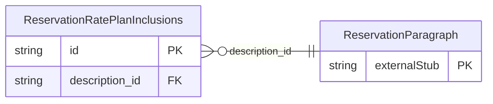

<!-- Code generated by protoc-gen-store. DO NOT EDIT. -->

# `ota/opentravel/hotel/booking/reservation/v1/types/rate_plan_inclusions/` — Prisma schema

Generated from Protobuf by protoc-gen-store. Source of truth is the `.proto` files — regenerate rather than editing.

| Models | Enums |
| ---: | ---: |
| 1 | 0 |

## Entity relationships

Schema file: [`rate_plan_inclusions.postgres.prisma`](./rate_plan_inclusions.postgres.prisma)

### `ReservationRatePlanInclusions` → `rate_plan_inclusions`

Defines charges that are included in this rate plan.

| Column | Type | Null |
| --- | --- | --- |
| `id` | `CHAR(26)` | not null |
| `tax_inclusive` | `BOOLEAN` | nullable |
| `service_fee_inclusive` | `BOOLEAN` | nullable |
| `description_id` | `CHAR(26)` | nullable |
