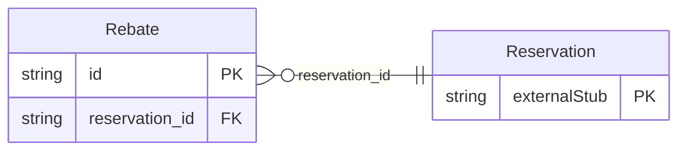

<!-- Code generated by protoc-gen-store. DO NOT EDIT. -->

# `ota/opentravel/hotel/booking/reservation/v1/types/rebate/` — Prisma schema

Generated from Protobuf by protoc-gen-store. Source of truth is the `.proto` files — regenerate rather than editing.

| Models | Enums |
| ---: | ---: |
| 1 | 1 |

## Entity relationships

Schema file: [`rebate.postgres.prisma`](./rebate.postgres.prisma)

### `Rebate` → `rebates`

Information about a suppliers participation in a rebate program, e.g. a VAT (value added tax) program.

| Column | Type | Null |
| --- | --- | --- |
| `id` | `CHAR(26)` | not null |
| `participation` | `BOOLEAN` | nullable |
| `program_display_name` | `VARCHAR(255)` | nullable |
| `trip_purpose` | `ReservationTripPurpose` | nullable |
| `trip_purpose_required` | `BOOLEAN` | nullable |
| `reservation_id` | `CHAR(26)` | not null |

### Enums

- `ReservationTripPurpose`: BUSINESS, BUSINESS_AND_PLEASURE, PLEASURE, UNKNOWN
