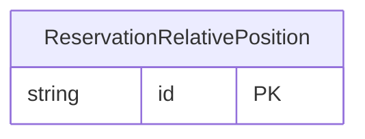

<!-- Code generated by protoc-gen-store. DO NOT EDIT. -->

# `ota/opentravel/hotel/booking/reservation/v1/types/relative_position/` — Prisma schema

Generated from Protobuf by protoc-gen-store. Source of truth is the `.proto` files — regenerate rather than editing.

| Models | Enums |
| ---: | ---: |
| 1 | 1 |

## Entity relationships

Schema file: [`relative_position.postgres.prisma`](./relative_position.postgres.prisma)

### `ReservationRelativePosition` → `relative_positions`

The RelativePosition object contains information about the direction, distance and travel time to/from a facility (hotel, car rental location, or airport) or to/from a designated location.

| Column | Type | Null |
| --- | --- | --- |
| `id` | `CHAR(26)` | not null |
| `direction` | `VARCHAR(255)` | nullable |
| `distance` | `VARCHAR(255)` | nullable |
| `unit_code` | `ReservationUnitOfMeasureCode` | nullable |
| `nearest` | `BOOLEAN` | nullable |
| `index_point_code` | `ReservationIndexPointCode` | nullable |
| `display_name` | `VARCHAR(255)` | nullable |
| `primary_indicator` | `BOOLEAN` | nullable |
| `facility_direction` | `ReservationToFrom` | nullable |
| `approximate_distance` | `BOOLEAN` | nullable |
| `position_accuracy` | `ReservationPositionAccuracy` | nullable |

### Enums

- `ReservationToFrom`: TO_FACILITY, FROM_FACILITY
