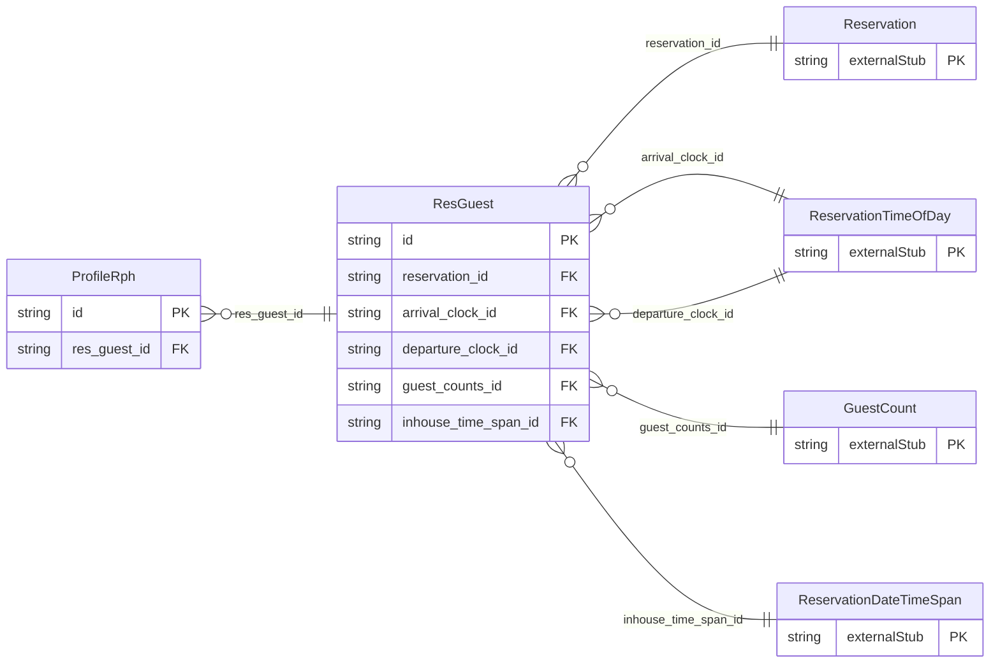

<!-- Code generated by protoc-gen-store. DO NOT EDIT. -->

# `ota/opentravel/hotel/booking/reservation/v1/types/res_guest/` — Prisma schema

Generated from Protobuf by protoc-gen-store. Source of truth is the `.proto` files — regenerate rather than editing.

| Models | Enums |
| ---: | ---: |
| 2 | 0 |

## Entity relationships

Schema file: [`res_guest.postgres.prisma`](./res_guest.postgres.prisma)

### `ResGuest` → `res_guests`

A collection of ResGuest objects, identifying the guests associated with this reservation. Which guests are in which room is determined by each RoomStays ResGuestRPHs collection.

| Column | Type | Null |
| --- | --- | --- |
| `id` | `CHAR(26)` | not null |
| `res_guest_rph` | `VARCHAR(255)` | nullable |
| `age_qualifying_code` | `ReservationAgeQualifyingCode` | nullable |
| `group_event_code` | `VARCHAR(255)` | nullable |
| `vip` | `BOOLEAN` | nullable |
| `primary_indicator` | `BOOLEAN` | nullable |
| `age` | `INTEGER` | nullable |
| `location_code` | `VARCHAR(255)` | nullable |
| `code_context` | `VARCHAR(255)` | nullable |
| `action` | `ReservationAction` | nullable |
| `reservation_id` | `CHAR(26)` | not null |
| `arrival_clock_id` | `CHAR(26)` | nullable |
| `departure_clock_id` | `CHAR(26)` | nullable |
| `guest_counts_id` | `CHAR(26)` | nullable |
| `inhouse_time_span_id` | `CHAR(26)` | nullable |

### `ProfileRph` → `profile_rphs`

Used to reference a profile found in the Profile element in ResGlobablInfo.

| Column | Type | Null |
| --- | --- | --- |
| `id` | `CHAR(26)` | not null |
| `rph` | `VARCHAR(255)` | nullable |
| `res_guest_id` | `CHAR(26)` | not null |
