<!-- Code generated by protoc-gen-store. DO NOT EDIT. -->

# `ota/opentravel/hotel/booking/reservation/v1/types/room_stay/` — Prisma schema

Generated from Protobuf by protoc-gen-store. Source of truth is the `.proto` files — regenerate rather than editing.

| Models | Enums |
| ---: | ---: |
| 21 | 0 |

## Entity relationships

```mermaid
erDiagram
    direction LR
    AdvanceBookingRestriction {
        string id PK
        string start_id FK
        string end_id FK
    }
    Availability {
        string id PK
        string room_rate_id FK
    }
    ContactNumber {
        string id PK
        string basic_property_info_id FK
    }
    HotelFeature {
        string id PK
        string basic_property_info_id FK
    }
    HotelMeetingFacility {
        string id PK
        string basic_property_info_id FK
    }
    MapUrl {
        string id PK
        string bottom_right_latitude_id FK
        string bottom_right_longitude_id FK
        string top_left_latitude_id FK
        string top_left_longitude_id FK
    }
    Reference {
        string id PK
        string company_display_name_id FK
    }
    ReservationAward {
        string id PK
        string basic_property_info_id FK
    }
    ReservationFeature {
        string id PK
        string room_rate_id FK
    }
    ReservationHotelAmenity {
        string id PK
        string basic_property_info_id FK
    }
    ReservationPolicy {
        string id PK
        string checkin_clock_id FK
        string check_out_clock_id FK
    }
    ReservationRecreation {
        string id PK
        string basic_property_info_id FK
    }
    ReservationRestriction {
        string id PK
        string room_rate_id FK
        string effective_day_id FK
        string expire_day_id FK
        string dow_restrictions_id FK
    }
    RoomRate {
        string id PK
        string room_rates_id FK
        string effective_day_id FK
        string expire_day_id FK
        string total_id FK
        string advance_booking_restriction_id FK
    }
    RoomRates {
        string id PK
    }
    RoomStay {
        string id PK
        string reservation_id FK
        string room_stay_status_id FK
        string room_rates_id FK
        string guest_counts_id FK
        string time_span_id FK
        string cancel_penalties_id FK
        string discount_id FK
        string total_id FK
        string basic_property_info_id FK
        string map_uri_id FK
        string reference_id FK
    }
    RoomStayBasicPropertyInfo {
        string id PK
        string position_id FK
        string address_id FK
        string relative_position_id FK
        string policy_id FK
        string user_generated_content_id FK
    }
    RoomStayBasicPropertyInfoPosition {
        string id PK
    }
    RoomStayBasicPropertyInfoService {
        string id PK
        string basic_property_info_id FK
    }
    RoomStayRoomRatesRoomRateGuestCount {
        string id PK
        string room_rate_id FK
    }
    UserGeneratedContent {
        string id PK
    }
    GuestCount {
        string externalStub PK
    }
    HotelResStatus {
        string externalStub PK
    }
    Reservation {
        string externalStub PK
    }
    ReservationAddressInfo {
        string externalStub PK
    }
    ReservationCancelPenalties {
        string externalStub PK
    }
    ReservationCompanyName {
        string externalStub PK
    }
    ReservationDate {
        string externalStub PK
    }
    ReservationDateOrTimeOrDateTime {
        string externalStub PK
    }
    ReservationDateTimeSpan {
        string externalStub PK
    }
    ReservationDecimal {
        string externalStub PK
    }
    ReservationDiscount {
        string externalStub PK
    }
    ReservationDowRestrictions {
        string externalStub PK
    }
    ReservationRelativePosition {
        string externalStub PK
    }
    ReservationTimeOfDay {
        string externalStub PK
    }
    ReservationTotal {
        string externalStub PK
    }
    AdvanceBookingRestriction }o--|| ReservationDateOrTimeOrDateTime : "start_id"
    AdvanceBookingRestriction }o--|| ReservationDateOrTimeOrDateTime : "end_id"
    Availability }o--|| RoomRate : "room_rate_id"
    ContactNumber }o--|| RoomStayBasicPropertyInfo : "basic_property_info_id"
    HotelFeature }o--|| RoomStayBasicPropertyInfo : "basic_property_info_id"
    HotelMeetingFacility }o--|| RoomStayBasicPropertyInfo : "basic_property_info_id"
    MapUrl }o--|| ReservationDecimal : "bottom_right_latitude_id"
    MapUrl }o--|| ReservationDecimal : "bottom_right_longitude_id"
    MapUrl }o--|| ReservationDecimal : "top_left_latitude_id"
    MapUrl }o--|| ReservationDecimal : "top_left_longitude_id"
    Reference }o--|| ReservationCompanyName : "company_display_name_id"
    ReservationAward }o--|| RoomStayBasicPropertyInfo : "basic_property_info_id"
    ReservationFeature }o--|| RoomRate : "room_rate_id"
    ReservationHotelAmenity }o--|| RoomStayBasicPropertyInfo : "basic_property_info_id"
    ReservationPolicy }o--|| ReservationTimeOfDay : "checkin_clock_id"
    ReservationPolicy }o--|| ReservationTimeOfDay : "check_out_clock_id"
    ReservationRecreation }o--|| RoomStayBasicPropertyInfo : "basic_property_info_id"
    ReservationRestriction }o--|| RoomRate : "room_rate_id"
    ReservationRestriction }o--|| ReservationDate : "effective_day_id"
    ReservationRestriction }o--|| ReservationDate : "expire_day_id"
    ReservationRestriction }o--|| ReservationDowRestrictions : "dow_restrictions_id"
    RoomRate }o--|| RoomRates : "room_rates_id"
    RoomRate }o--|| ReservationDate : "effective_day_id"
    RoomRate }o--|| ReservationDate : "expire_day_id"
    RoomRate }o--|| ReservationTotal : "total_id"
    RoomRate }o--|| AdvanceBookingRestriction : "advance_booking_restriction_id"
    RoomStay }o--|| Reservation : "reservation_id"
    RoomStay }o--|| HotelResStatus : "room_stay_status_id"
    RoomStay }o--|| RoomRates : "room_rates_id"
    RoomStay }o--|| GuestCount : "guest_counts_id"
    RoomStay }o--|| ReservationDateTimeSpan : "time_span_id"
    RoomStay }o--|| ReservationCancelPenalties : "cancel_penalties_id"
    RoomStay }o--|| ReservationDiscount : "discount_id"
    RoomStay }o--|| ReservationTotal : "total_id"
    RoomStay }o--|| RoomStayBasicPropertyInfo : "basic_property_info_id"
    RoomStay }o--|| MapUrl : "map_uri_id"
    RoomStay }o--|| Reference : "reference_id"
    RoomStayBasicPropertyInfo }o--|| RoomStayBasicPropertyInfoPosition : "position_id"
    RoomStayBasicPropertyInfo }o--|| ReservationAddressInfo : "address_id"
    RoomStayBasicPropertyInfo }o--|| ReservationRelativePosition : "relative_position_id"
    RoomStayBasicPropertyInfo }o--|| ReservationPolicy : "policy_id"
    RoomStayBasicPropertyInfo }o--|| UserGeneratedContent : "user_generated_content_id"
    RoomStayBasicPropertyInfoService }o--|| RoomStayBasicPropertyInfo : "basic_property_info_id"
    RoomStayRoomRatesRoomRateGuestCount }o--|| RoomRate : "room_rate_id"
```

Schema file: [`room_stay.postgres.prisma`](./room_stay.postgres.prisma)

### `RoomStay` → `room_stays`

Details on the Room Stay including Guest Counts, Time Span of this Room Stay, pointers to Res Guests, guest Memberships, Comments and Special Requests pertaining to this particular Room Stay and finally finacial information related to the Room Stay, including Guarantee, Deposit and Payment and Cancellation Penalties. A collection of reference place holders. This is a reference placeholder, used as an index for the reservation guests. A collection of Hotel Service reference placeholders.

| Column | Type | Null |
| --- | --- | --- |
| `id` | `CHAR(26)` | not null |
| `market_code` | `VARCHAR(255)` | nullable |
| `business_source` | `VARCHAR(255)` | nullable |
| `discount_code` | `VARCHAR(255)` | nullable |
| `promotion_code` | `VARCHAR(255)` | nullable |
| `promotion_vendor_codes` | `VARCHAR(255)[]` | nullable |
| `warning_rphs` | `VARCHAR(255)[]` | nullable |
| `room_stay_language` | `VARCHAR(255)` | nullable |
| `room_stay_group_id` | `VARCHAR(255)` | nullable |
| `index_number` | `INTEGER` | nullable |
| `res_guest_rphs` | `VARCHAR(255)[]` | nullable |
| `reservation_id` | `CHAR(26)` | not null |
| `room_stay_status_id` | `CHAR(26)` | nullable |
| `room_rates_id` | `CHAR(26)` | nullable |
| `guest_counts_id` | `CHAR(26)` | nullable |
| `time_span_id` | `CHAR(26)` | nullable |
| `cancel_penalties_id` | `CHAR(26)` | nullable |
| `discount_id` | `CHAR(26)` | nullable |
| `total_id` | `CHAR(26)` | nullable |
| `basic_property_info_id` | `CHAR(26)` | nullable |
| `map_uri_id` | `CHAR(26)` | nullable |
| `reference_id` | `VARCHAR(255)` | nullable |

### `RoomRates` → `room_rates`

A collection of Room Rates associated with a particular Room Stay. Each Room Rate combination can have multiple rates. Example King room, Rack rate plan, Monday through Thursday, weekday amount, Friday and Saturday, weekend amount. The combination of a given Rate Plan and Room Type. This allows for support for systems where Rate Plans are child of Room Type as well as systems which Room Types are child of Rate Plans.

| Column | Type | Null |
| --- | --- | --- |
| `id` | `CHAR(26)` | not null |
| `more_rates_exist` | `BOOLEAN` | nullable |

### `RoomStayBasicPropertyInfo` → `room_stay_basic_property_infos`

Property Information for the Room Stay.

| Column | Type | Null |
| --- | --- | --- |
| `id` | `CHAR(26)` | not null |
| `chain_code` | `VARCHAR(255)` | nullable |
| `brand_code` | `VARCHAR(255)` | nullable |
| `hotel_code` | `VARCHAR(255)` | nullable |
| `hotel_city_code` | `VARCHAR(255)` | nullable |
| `hotel_display_name` | `VARCHAR(255)` | nullable |
| `hotel_code_context` | `VARCHAR(255)` | nullable |
| `chain_display_name` | `VARCHAR(255)` | nullable |
| `brand_display_name` | `VARCHAR(255)` | nullable |
| `area_id` | `VARCHAR(255)` | nullable |
| `tt_icode` | `INTEGER` | nullable |
| `hotel_segment_category_code` | `ReservationSegmentCategoryCode` | nullable |
| `supplier_integration_level` | `INTEGER` | nullable |
| `max_group_room_quantity` | `INTEGER` | nullable |
| `currency_code` | `VARCHAR(255)` | nullable |
| `master_chain_code` | `VARCHAR(255)` | nullable |
| `position_id` | `CHAR(26)` | nullable |
| `address_id` | `CHAR(26)` | nullable |
| `relative_position_id` | `CHAR(26)` | nullable |
| `policy_id` | `CHAR(26)` | nullable |
| `user_generated_content_id` | `CHAR(26)` | nullable |

### `MapUrl` → `map_urls`

When requested, a link to a map is returned in the response which indicates the position of the matching hotel(s).

| Column | Type | Null |
| --- | --- | --- |
| `id` | `CHAR(26)` | not null |
| `height` | `INTEGER` | nullable |
| `width` | `INTEGER` | nullable |
| `zoom_factor` | `INTEGER` | nullable |
| `value` | `VARCHAR(255)` | nullable |
| `bottom_right_latitude_id` | `CHAR(26)` | nullable |
| `bottom_right_longitude_id` | `CHAR(26)` | nullable |
| `top_left_latitude_id` | `CHAR(26)` | nullable |
| `top_left_longitude_id` | `CHAR(26)` | nullable |

### `Reference` → `references`

Information identifying an earlier availability quote.

| Column | Type | Null |
| --- | --- | --- |
| `uri` | `VARCHAR(255)` | nullable |
| `type` | `ReservationUniqueIdType` | not null |
| `instance` | `VARCHAR(255)` | nullable |
| `id` | `VARCHAR(255)` | not null |
| `id_context` | `VARCHAR(255)` | nullable |
| `date_time` | `TIMESTAMPTZ` | nullable |
| `company_display_name_id` | `CHAR(26)` | nullable |

### `RoomRate` → `room_rate`

Room rate.

| Column | Type | Null |
| --- | --- | --- |
| `id` | `CHAR(26)` | not null |
| `booking_code` | `VARCHAR(255)` | nullable |
| `expire_date_exclusive` | `BOOLEAN` | nullable |
| `room_type_code` | `VARCHAR(255)` | nullable |
| `inv_block_code` | `VARCHAR(255)` | nullable |
| `unit_count` | `INTEGER` | nullable |
| `rate_plan_type` | `ReservationRatePlanType` | nullable |
| `rate_plan_code` | `VARCHAR(255)` | nullable |
| `rate_plan_id` | `VARCHAR(255)` | nullable |
| `rate_plan_qualifier` | `BOOLEAN` | nullable |
| `promotion_code` | `VARCHAR(255)` | nullable |
| `promotion_vendor_codes` | `VARCHAR(255)[]` | nullable |
| `rate_plan_category` | `VARCHAR(255)` | nullable |
| `availability_status` | `RateIndicator` | nullable |
| `room_id` | `VARCHAR(255)` | nullable |
| `room_rates_id` | `CHAR(26)` | not null |
| `effective_day_id` | `CHAR(26)` | nullable |
| `expire_day_id` | `CHAR(26)` | nullable |
| `total_id` | `CHAR(26)` | nullable |
| `advance_booking_restriction_id` | `CHAR(26)` | nullable |

### `RoomStayBasicPropertyInfoPosition` → `room_stay_basic_property_info_positions`

An element that identifies the geographic position of the hotel. The Position element uses the representation defined by ISO Standard 6709 to define a geographic point location.

| Column | Type | Null |
| --- | --- | --- |
| `id` | `CHAR(26)` | not null |
| `latitude` | `VARCHAR(255)` | nullable |
| `longitude` | `VARCHAR(255)` | nullable |
| `altitude` | `VARCHAR(255)` | nullable |
| `altitude_unit_code` | `ReservationUnitOfMeasureCode` | nullable |
| `position_accuracy_code` | `ReservationPositionAccuracy` | nullable |
| `map_uri` | `VARCHAR(255)` | nullable |

### `ContactNumber` → `contact_numbers`

Contact numbers of the hotel property. Examples are telephone and fax numbers.

| Column | Type | Null |
| --- | --- | --- |
| `id` | `CHAR(26)` | not null |
| `rph` | `VARCHAR(255)` | nullable |
| `share_synch_ind` | `ReservationPaymentCardTelephoneShareSynchInd` | nullable |
| `share_market_ind` | `ReservationPaymentCardTelephoneShareMarketInd` | nullable |
| `phone_location_type` | `ReservationPhoneLocationType` | nullable |
| `phone_tech_type` | `ReservationPhoneTechnologyType` | nullable |
| `phone_use_type` | `ReservationPhoneUseType` | nullable |
| `country_access_code` | `VARCHAR(255)` | nullable |
| `area_city_code` | `VARCHAR(255)` | nullable |
| `phone_number` | `VARCHAR(255)` | not null |
| `extension` | `VARCHAR(255)` | nullable |
| `pin` | `VARCHAR(255)` | nullable |
| `remark` | `VARCHAR(255)` | nullable |
| `formatted` | `BOOLEAN` | nullable |
| `default_value` | `BOOLEAN` | nullable |
| `basic_property_info_id` | `CHAR(26)` | not null |

### `ReservationAward` → `awards`

An element that identifies the hotel ratings.

| Column | Type | Null |
| --- | --- | --- |
| `id` | `CHAR(26)` | not null |
| `provider` | `VARCHAR(255)` | nullable |
| `rating` | `VARCHAR(255)` | nullable |
| `basic_property_info_id` | `CHAR(26)` | not null |

### `ReservationHotelAmenity` → `hotel_amenities`

Hotel-level amenities (pool, etc) for searching.

| Column | Type | Null |
| --- | --- | --- |
| `id` | `CHAR(26)` | not null |
| `code` | `ReservationHotelAmenityCode` | nullable |
| `basic_property_info_id` | `CHAR(26)` | not null |

### `HotelFeature` → `hotel_features`

Identifies features of a property.

| Column | Type | Null |
| --- | --- | --- |
| `id` | `CHAR(26)` | not null |
| `security_feature_code` | `ReservationSecurityFeatureCode` | nullable |
| `accessibility_code` | `ReservationDisabilityFeatureCode` | nullable |
| `basic_property_info_id` | `CHAR(26)` | not null |

### `ReservationRecreation` → `recreations`

Identifies recreation facilities or amenities of interest.

| Column | Type | Null |
| --- | --- | --- |
| `id` | `CHAR(26)` | not null |
| `code` | `ReservationRecreationSrvcType` | nullable |
| `basic_property_info_id` | `CHAR(26)` | not null |

### `RoomStayBasicPropertyInfoService` → `room_stay_basic_property_info_services`

Identifies business services of interest.

| Column | Type | Null |
| --- | --- | --- |
| `id` | `CHAR(26)` | not null |
| `business_service_code` | `ReservationBusinessSrvcType` | nullable |
| `basic_property_info_id` | `CHAR(26)` | not null |

### `ReservationPolicy` → `policies`

Policy information for this hotel.

| Column | Type | Null |
| --- | --- | --- |
| `id` | `CHAR(26)` | not null |
| `checkin_clock_id` | `CHAR(26)` | nullable |
| `check_out_clock_id` | `CHAR(26)` | nullable |

### `HotelMeetingFacility` → `hotel_meeting_facilities`

Identifies hotel meeting facility information for a property.

| Column | Type | Null |
| --- | --- | --- |
| `id` | `CHAR(26)` | not null |
| `meeting_room_count` | `INTEGER` | nullable |
| `largest_seating_capacity` | `INTEGER` | nullable |
| `largest_room_space` | `INTEGER` | nullable |
| `unit_code` | `ReservationUnitOfMeasureCode` | nullable |
| `meeting_room_code` | `ReservationMeetingRoomCode` | nullable |
| `basic_property_info_id` | `CHAR(26)` | not null |

### `UserGeneratedContent` → `user_generated_contents`

Information linked to user content.

| Column | Type | Null |
| --- | --- | --- |
| `id` | `CHAR(26)` | not null |
| `rating` | `INTEGER` | nullable |

### `ReservationFeature` → `features`

Allows for the description of any features and/or amenities that are made available as part of this specific room and this specifiic rate plan, for example, large screen television, video/DVD player in room, room service breakfast, and details about that breakfast.

| Column | Type | Null |
| --- | --- | --- |
| `id` | `CHAR(26)` | not null |
| `room_amenity` | `ReservationRoomAmenityType` | nullable |
| `quantity` | `INTEGER` | nullable |
| `room_view_code` | `ReservationRoomViewType` | nullable |
| `accessibility_code` | `VARCHAR(255)` | nullable |
| `room_rate_id` | `CHAR(26)` | not null |

### `Availability` → `availabilities`

Provides information on the availability of the room rate.

| Column | Type | Null |
| --- | --- | --- |
| `id` | `CHAR(26)` | not null |
| `availability_status` | `RateIndicator` | nullable |
| `room_rate_id` | `CHAR(26)` | not null |

### `AdvanceBookingRestriction` → `advance_booking_restrictions`

The period during which the booking must be made.

| Column | Type | Null |
| --- | --- | --- |
| `id` | `CHAR(26)` | not null |
| `duration` | `VARCHAR(255)` | nullable |
| `min_advance_booking_offset` | `VARCHAR(255)` | nullable |
| `max_advance_booking_offset` | `VARCHAR(255)` | nullable |
| `weekdays` | `` | nullable |
| `start_id` | `CHAR(26)` | nullable |
| `end_id` | `CHAR(26)` | nullable |

### `ReservationRestriction` → `restrictions`

Information on the restriction associated with the RoomRate element.

| Column | Type | Null |
| --- | --- | --- |
| `id` | `CHAR(26)` | not null |
| `expire_date_exclusive` | `BOOLEAN` | nullable |
| `room_rate_id` | `CHAR(26)` | not null |
| `effective_day_id` | `CHAR(26)` | nullable |
| `expire_day_id` | `CHAR(26)` | nullable |
| `dow_restrictions_id` | `CHAR(26)` | not null |

### `RoomStayRoomRatesRoomRateGuestCount` → `room_stay_room_rates_room_rate_guest_counts`

A recurring element that identifies the number of guests and ages of the guests.

| Column | Type | Null |
| --- | --- | --- |
| `id` | `CHAR(26)` | not null |
| `age_qualifying_code` | `ReservationAgeQualifyingCode` | nullable |
| `age` | `INTEGER` | nullable |
| `count` | `INTEGER` | nullable |
| `age_bucket` | `VARCHAR(255)` | nullable |
| `room_rate_id` | `CHAR(26)` | not null |
