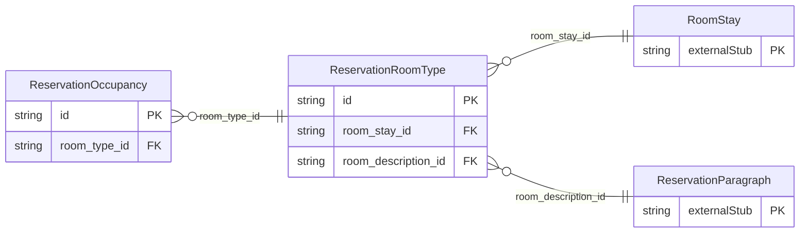

<!-- Code generated by protoc-gen-store. DO NOT EDIT. -->

# `ota/opentravel/hotel/booking/reservation/v1/types/room_type/` — Prisma schema

Generated from Protobuf by protoc-gen-store. Source of truth is the `.proto` files — regenerate rather than editing.

| Models | Enums |
| ---: | ---: |
| 2 | 1 |

## Entity relationships

Schema file: [`room_type.postgres.prisma`](./room_type.postgres.prisma)

### `ReservationRoomType` → `room_types`

Provides details regarding rooms, usually guest rooms.

| Column | Type | Null |
| --- | --- | --- |
| `id` | `CHAR(26)` | not null |
| `unit_count` | `INTEGER` | nullable |
| `room` | `BOOLEAN` | nullable |
| `converted` | `BOOLEAN` | nullable |
| `alternate` | `BOOLEAN` | nullable |
| `reqd_guarantee_type` | `VARCHAR(255)` | nullable |
| `room_type` | `VARCHAR(255)` | nullable |
| `room_type_code` | `VARCHAR(255)` | nullable |
| `room_category` | `ReservationSegmentCategoryCode` | nullable |
| `room_id` | `VARCHAR(255)` | nullable |
| `floor` | `INTEGER` | nullable |
| `inv_block_code` | `VARCHAR(255)` | nullable |
| `promotion_code` | `VARCHAR(255)` | nullable |
| `promotion_vendor_codes` | `VARCHAR(255)[]` | nullable |
| `room_location_code` | `ReservationRoomLocationType` | nullable |
| `room_view_code` | `ReservationRoomViewType` | nullable |
| `bed_type_codes` | `` | nullable |
| `non_smoking` | `BOOLEAN` | nullable |
| `config` | `VARCHAR(255)` | nullable |
| `size_measurement` | `VARCHAR(255)` | nullable |
| `quantity` | `INTEGER` | nullable |
| `composite` | `BOOLEAN` | nullable |
| `room_classification_code` | `ReservationGuestRoomInfo` | nullable |
| `room_architecture_code` | `ReservationArchitecturalStyleCode` | nullable |
| `room_gender` | `RoomTypeRoomGender` | nullable |
| `shared_room` | `BOOLEAN` | nullable |
| `room_stay_id` | `CHAR(26)` | not null |
| `room_description_id` | `CHAR(26)` | nullable |

### `ReservationOccupancy` → `occupancies`

Provides parameters of occupancy limits.

| Column | Type | Null |
| --- | --- | --- |
| `id` | `CHAR(26)` | not null |
| `min_occupancy` | `INTEGER` | nullable |
| `max_occupancy` | `INTEGER` | nullable |
| `age_qualifying_code` | `ReservationAgeQualifyingCode` | nullable |
| `min_age` | `INTEGER` | nullable |
| `max_age` | `INTEGER` | nullable |
| `age_time_unit` | `ReservationTimeUnit` | nullable |
| `age_bucket` | `VARCHAR(255)` | nullable |
| `room_type_id` | `CHAR(26)` | not null |

### Enums

- `RoomTypeRoomGender`: MALE, FEMALE, MALE_AND_FEMALE, UNKNOWN
