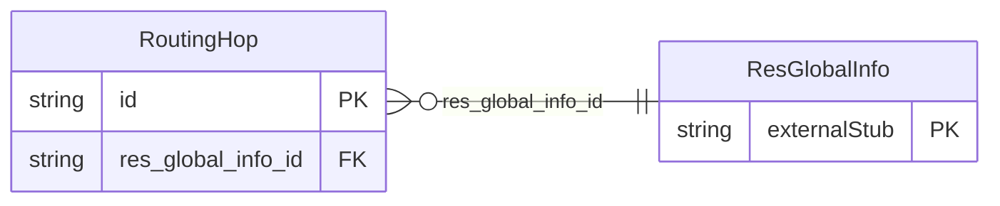

<!-- Code generated by protoc-gen-store. DO NOT EDIT. -->

# `ota/opentravel/hotel/booking/reservation/v1/types/routing_hop/` — Prisma schema

Generated from Protobuf by protoc-gen-store. Source of truth is the `.proto` files — regenerate rather than editing.

| Models | Enums |
| ---: | ---: |
| 1 | 0 |

## Entity relationships

Schema file: [`routing_hop.postgres.prisma`](./routing_hop.postgres.prisma)

### `RoutingHop` → `routing_hops`

A RoutingHop object conveys information about the path that this notification update took (e.g. how many and which systems it passed through).

| Column | Type | Null |
| --- | --- | --- |
| `id` | `CHAR(26)` | not null |
| `system_code` | `VARCHAR(255)` | nullable |
| `local_ref_id` | `VARCHAR(255)` | nullable |
| `time_stamp_time` | `TIMESTAMPTZ` | nullable |
| `comment` | `VARCHAR(255)` | nullable |
| `sequence_nmbr` | `INTEGER` | nullable |
| `data` | `VARCHAR(255)` | nullable |
| `res_global_info_id` | `CHAR(26)` | not null |
