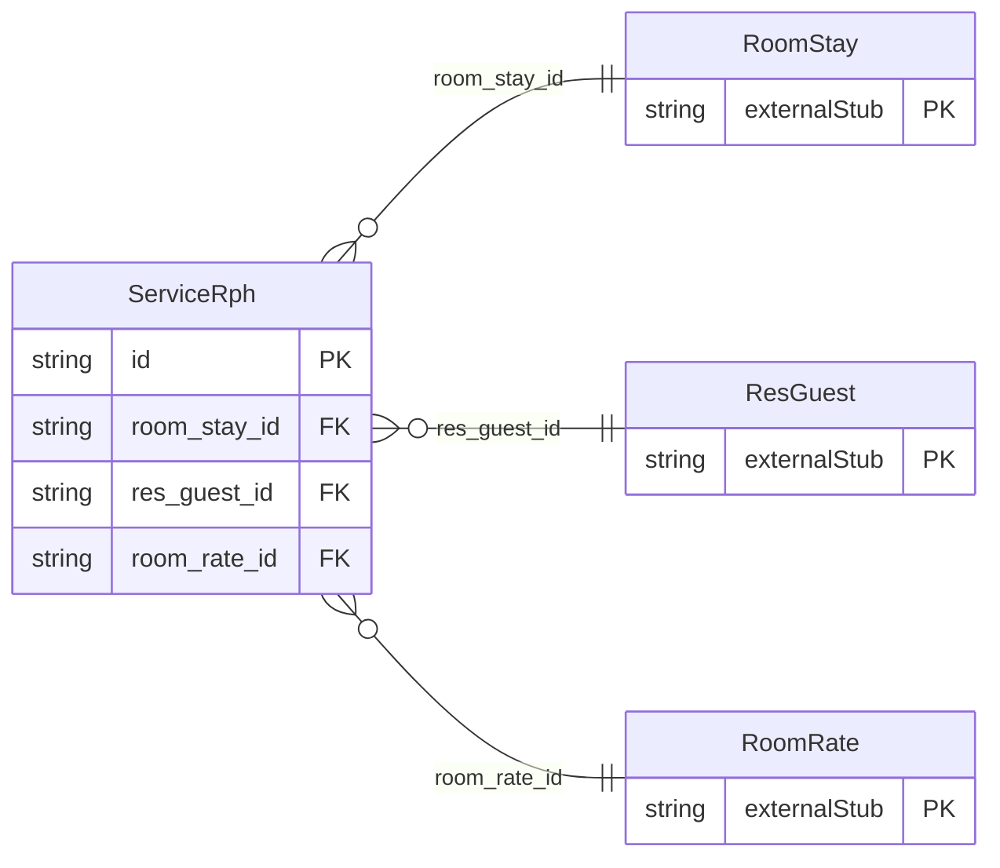

<!-- Code generated by protoc-gen-store. DO NOT EDIT. -->

# `ota/opentravel/hotel/booking/reservation/v1/types/service_rph/` — Prisma schema

Generated from Protobuf by protoc-gen-store. Source of truth is the `.proto` files — regenerate rather than editing.

| Models | Enums |
| ---: | ---: |
| 1 | 0 |

## Entity relationships

Schema file: [`service_rph.postgres.prisma`](./service_rph.postgres.prisma)

### `ServiceRph` → `service_rphs`

This is a reference placeholder used as an index for a service to be associated with this stay

| Column | Type | Null |
| --- | --- | --- |
| `id` | `CHAR(26)` | not null |
| `rph` | `VARCHAR(255)` | nullable |
| `per_room` | `BOOLEAN` | nullable |
| `room_stay_id` | `CHAR(26)` | not null |
| `res_guest_id` | `CHAR(26)` | not null |
| `room_rate_id` | `CHAR(26)` | not null |
