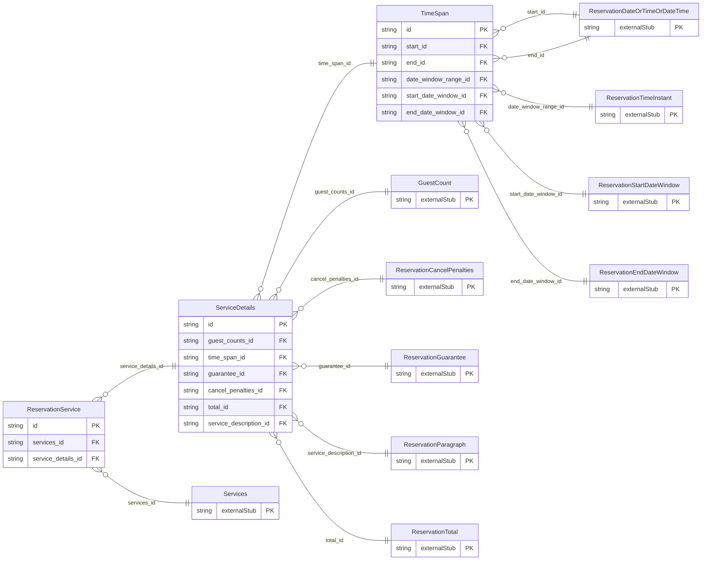

<!-- Code generated by protoc-gen-store. DO NOT EDIT. -->

# `ota/opentravel/hotel/booking/reservation/v1/types/service_type/` — Prisma schema

Generated from Protobuf by protoc-gen-store. Source of truth is the `.proto` files — regenerate rather than editing.

| Models | Enums |
| ---: | ---: |
| 3 | 0 |

## Entity relationships

Schema file: [`service_type.postgres.prisma`](./service_type.postgres.prisma)

### `ReservationService` → `service`

A ServiceType class.

| Column | Type | Null |
| --- | --- | --- |
| `service_pricing_type` | `Pricing` | nullable |
| `reservation_status_type` | `PmsReservationState` | nullable |
| `service_rph` | `VARCHAR(255)` | nullable |
| `service_inventory_code` | `VARCHAR(255)` | nullable |
| `rate_plan_code` | `VARCHAR(255)` | nullable |
| `inventory_block_code` | `VARCHAR(255)` | nullable |
| `price_guaranteed` | `BOOLEAN` | nullable |
| `inclusive` | `BOOLEAN` | nullable |
| `quantity` | `INTEGER` | nullable |
| `requested_indicator` | `BOOLEAN` | nullable |
| `uri` | `VARCHAR(255)` | nullable |
| `type` | `ReservationUniqueIdType` | not null |
| `instance` | `VARCHAR(255)` | nullable |
| `id` | `VARCHAR(255)` | not null |
| `id_context` | `VARCHAR(255)` | nullable |
| `required` | `BOOLEAN` | nullable |
| `service_category_code` | `VARCHAR(255)` | nullable |
| `services_id` | `CHAR(26)` | not null |
| `service_details_id` | `CHAR(26)` | nullable |

### `TimeSpan` → `time_spans`

The Time Span which covers the Reservation, Room Stay or Service.

| Column | Type | Null |
| --- | --- | --- |
| `id` | `CHAR(26)` | not null |
| `duration` | `VARCHAR(255)` | nullable |
| `increment` | `VARCHAR(255)` | nullable |
| `start_id` | `CHAR(26)` | nullable |
| `end_id` | `CHAR(26)` | nullable |
| `date_window_range_id` | `CHAR(26)` | nullable |
| `start_date_window_id` | `CHAR(26)` | nullable |
| `end_date_window_id` | `CHAR(26)` | nullable |

### `ServiceDetails` → `service_details`

Details on the Service including Guest Counts, Time Span of this Service, pointers to Res Guests, guest Memberships, Comments and Special Requests pertaining to this particular Service and finally financial information related to the Service, including Guarantee, Deposit and Payment and Cancellation Penalties.

| Column | Type | Null |
| --- | --- | --- |
| `id` | `CHAR(26)` | not null |
| `res_guest_rphs` | `VARCHAR(255)[]` | nullable |
| `guest_counts_id` | `CHAR(26)` | nullable |
| `time_span_id` | `CHAR(26)` | nullable |
| `guarantee_id` | `CHAR(26)` | nullable |
| `cancel_penalties_id` | `CHAR(26)` | nullable |
| `total_id` | `CHAR(26)` | nullable |
| `service_description_id` | `CHAR(26)` | nullable |
