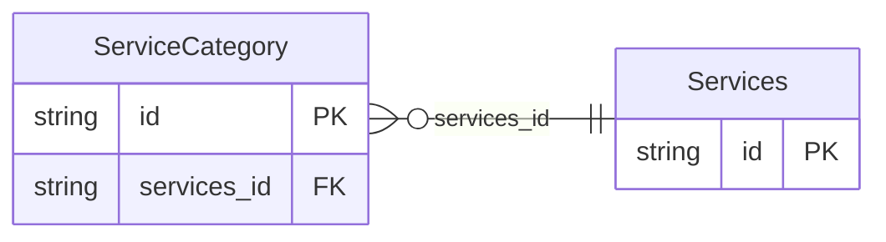

<!-- Code generated by protoc-gen-store. DO NOT EDIT. -->

# `ota/opentravel/hotel/booking/reservation/v1/types/services/` — Prisma schema

Generated from Protobuf by protoc-gen-store. Source of truth is the `.proto` files — regenerate rather than editing.

| Models | Enums |
| ---: | ---: |
| 2 | 0 |

## Entity relationships

Schema file: [`services.postgres.prisma`](./services.postgres.prisma)

### `Services` → `services`

A collection of Service objects. This is the collection of all services associated with any part of this reservation (the reservation in its entirety, one or more guests, or one or more room stays). Which services are attributable to which part is determined by each object's ServiceRPHs collection.

| Column | Type | Null |
| --- | --- | --- |
| `id` | `CHAR(26)` | not null |

### `ServiceCategory` → `service_categories`

Hotel systems often group multiple services into a single category. This refers to that category that is specific to the hotel CRS/PMS.

| Column | Type | Null |
| --- | --- | --- |
| `id` | `CHAR(26)` | not null |
| `service_catetory_code` | `VARCHAR(255)` | not null |
| `required` | `BOOLEAN` | nullable |
| `services_id` | `CHAR(26)` | not null |
