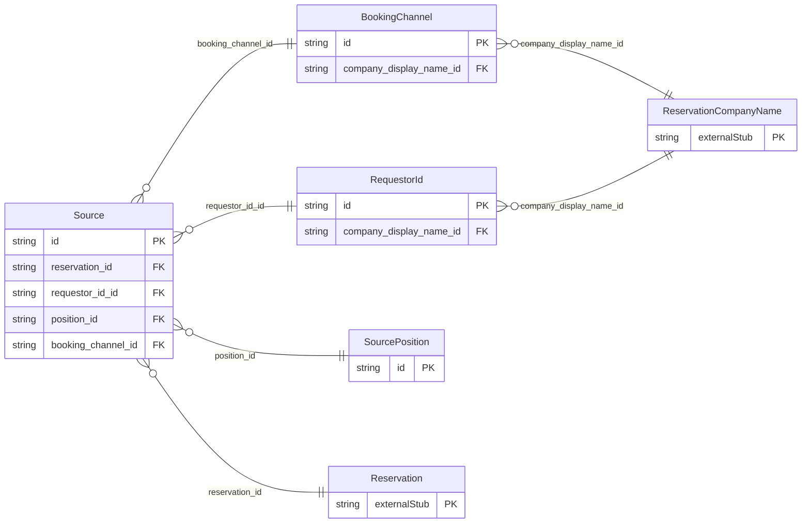

<!-- Code generated by protoc-gen-store. DO NOT EDIT. -->

# `ota/opentravel/hotel/booking/reservation/v1/types/source/` — Prisma schema

Generated from Protobuf by protoc-gen-store. Source of truth is the `.proto` files — regenerate rather than editing.

| Models | Enums |
| ---: | ---: |
| 4 | 0 |

## Entity relationships

Schema file: [`source.postgres.prisma`](./source.postgres.prisma)

### `Source` → `sources`

Provides information on the source of a request.

| Column | Type | Null |
| --- | --- | --- |
| `id` | `CHAR(26)` | not null |
| `agent_sine` | `VARCHAR(255)` | nullable |
| `pseudo_city_code` | `VARCHAR(255)` | nullable |
| `region_code` | `VARCHAR(255)` | nullable |
| `iso_currency` | `VARCHAR(255)` | nullable |
| `agent_duty_code` | `VARCHAR(255)` | nullable |
| `airline_vendor_id` | `VARCHAR(255)` | nullable |
| `airport_code` | `VARCHAR(255)` | nullable |
| `first_depart_point` | `VARCHAR(255)` | nullable |
| `ersp_user_id` | `VARCHAR(255)` | nullable |
| `terminal_id` | `VARCHAR(255)` | nullable |
| `reservation_id` | `CHAR(26)` | not null |
| `requestor_id_id` | `VARCHAR(255)` | nullable |
| `position_id` | `CHAR(26)` | nullable |
| `booking_channel_id` | `CHAR(26)` | nullable |

### `RequestorId` → `requestor_ids`

An identifier of the entity making the request (e.g. ATA/IATA/ID number, Electronic Reservation Service Provider (ERSP), Association of British Travel Agents.(ABTA)).

| Column | Type | Null |
| --- | --- | --- |
| `uri` | `VARCHAR(255)` | nullable |
| `type` | `ReservationUniqueIdType` | not null |
| `instance` | `VARCHAR(255)` | nullable |
| `id` | `VARCHAR(255)` | not null |
| `id_context` | `VARCHAR(255)` | nullable |
| `message_password` | `VARCHAR(255)` | nullable |
| `name` | `VARCHAR(255)` | nullable |
| `company_display_name_id` | `CHAR(26)` | nullable |

### `SourcePosition` → `source_positions`

Specifies the latitude and longitude of a source.

| Column | Type | Null |
| --- | --- | --- |
| `id` | `CHAR(26)` | not null |
| `latitude` | `VARCHAR(255)` | nullable |
| `longitude` | `VARCHAR(255)` | nullable |
| `altitude` | `VARCHAR(255)` | nullable |
| `altitude_unit_code` | `ReservationUnitOfMeasureCode` | nullable |
| `position_accuracy_code` | `ReservationPositionAccuracy` | nullable |

### `BookingChannel` → `booking_channels`

Specifies the booking channel type and whether it is the primary means of connectivity of the source.

| Column | Type | Null |
| --- | --- | --- |
| `id` | `CHAR(26)` | not null |
| `type` | `BookingChannelType` | not null |
| `primary` | `BOOLEAN` | nullable |
| `company_display_name_id` | `CHAR(26)` | nullable |
