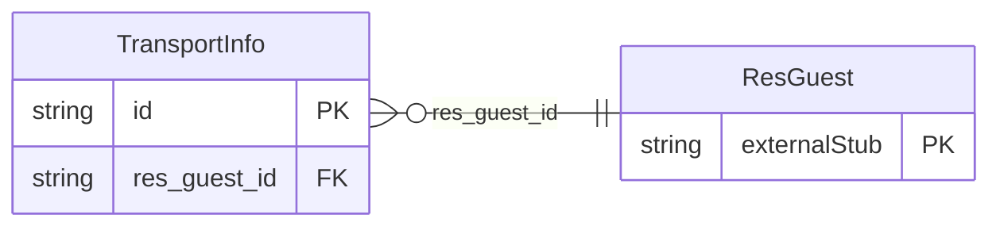

<!-- Code generated by protoc-gen-store. DO NOT EDIT. -->

# `ota/opentravel/hotel/booking/reservation/v1/types/transport_info/` — Prisma schema

Generated from Protobuf by protoc-gen-store. Source of truth is the `.proto` files — regenerate rather than editing.

| Models | Enums |
| ---: | ---: |
| 1 | 0 |

## Entity relationships

Schema file: [`transport_info.postgres.prisma`](./transport_info.postgres.prisma)

### `TransportInfo` → `transport_infos`

Transport info.

| Column | Type | Null |
| --- | --- | --- |
| `type` | `VARCHAR(255)` | nullable |
| `id` | `VARCHAR(255)` | not null |
| `location_code` | `VARCHAR(255)` | nullable |
| `transport_time` | `TIMESTAMPTZ` | nullable |
| `transportation_code` | `ReservationTransportationCode` | nullable |
| `description` | `VARCHAR(255)` | nullable |
| `notification_required` | `VARCHAR(255)` | nullable |
| `transportation_id` | `VARCHAR(255)` | nullable |
| `res_guest_id` | `CHAR(26)` | not null |
