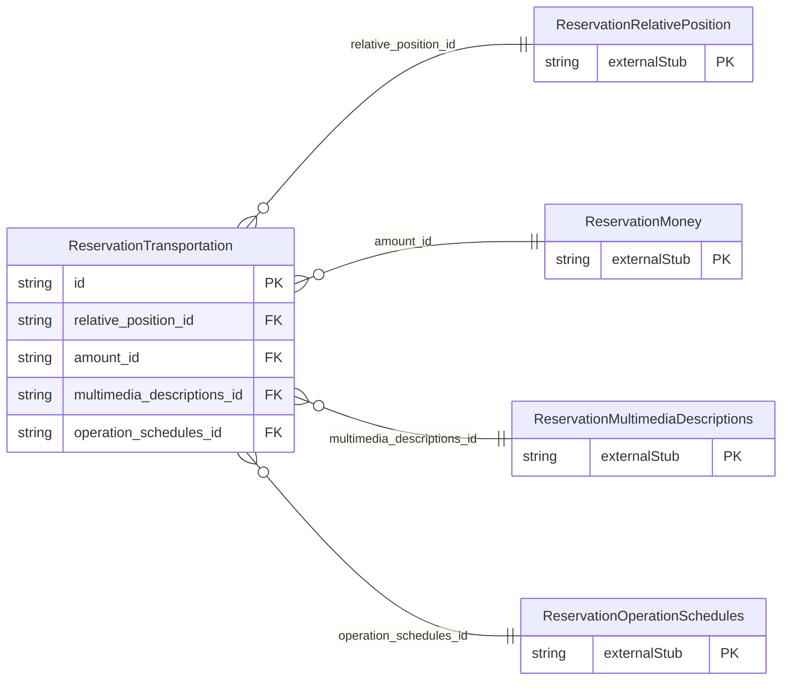

<!-- Code generated by protoc-gen-store. DO NOT EDIT. -->

# `ota/opentravel/hotel/booking/reservation/v1/types/transportation/` — Prisma schema

Generated from Protobuf by protoc-gen-store. Source of truth is the `.proto` files — regenerate rather than editing.

| Models | Enums |
| ---: | ---: |
| 1 | 0 |

## Entity relationships

Schema file: [`transportation.postgres.prisma`](./transportation.postgres.prisma)

### `ReservationTransportation` → `transportations`

Detailed transportation information.

| Column | Type | Null |
| --- | --- | --- |
| `notification_required` | `VARCHAR(255)` | nullable |
| `transportation_code` | `ReservationTransportationCode` | nullable |
| `charge_unit` | `ReservationChargeType` | nullable |
| `included` | `BOOLEAN` | nullable |
| `code_detail` | `VARCHAR(255)` | nullable |
| `description` | `VARCHAR(255)` | nullable |
| `typical_travel_duration` | `VARCHAR(255)` | nullable |
| `exists_code` | `ReservationOptionTypeCode` | nullable |
| `id` | `VARCHAR(255)` | not null |
| `descriptive_text` | `VARCHAR(255)` | nullable |
| `relative_position_id` | `CHAR(26)` | not null |
| `amount_id` | `CHAR(26)` | nullable |
| `multimedia_descriptions_id` | `CHAR(26)` | nullable |
| `operation_schedules_id` | `CHAR(26)` | nullable |
