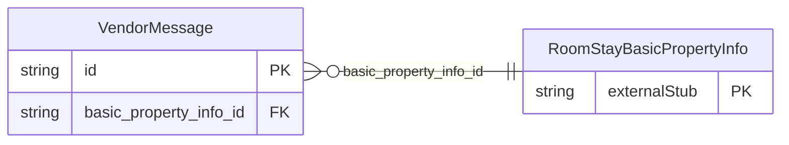

<!-- Code generated by protoc-gen-store. DO NOT EDIT. -->

# `ota/opentravel/hotel/booking/reservation/v1/types/vendor_message/` — Prisma schema

Generated from Protobuf by protoc-gen-store. Source of truth is the `.proto` files — regenerate rather than editing.

| Models | Enums |
| ---: | ---: |
| 1 | 0 |

## Entity relationships

Schema file: [`vendor_message.postgres.prisma`](./vendor_message.postgres.prisma)

### `VendorMessage` → `vendor_messages`

Provides formatted textual information that a vendor wishes to make known. The type of information is indicated.

| Column | Type | Null |
| --- | --- | --- |
| `id` | `CHAR(26)` | not null |
| `title` | `VARCHAR(255)` | nullable |
| `language_code` | `VARCHAR(255)` | nullable |
| `info_type` | `ReservationInfoType` | not null |
| `basic_property_info_id` | `CHAR(26)` | not null |
