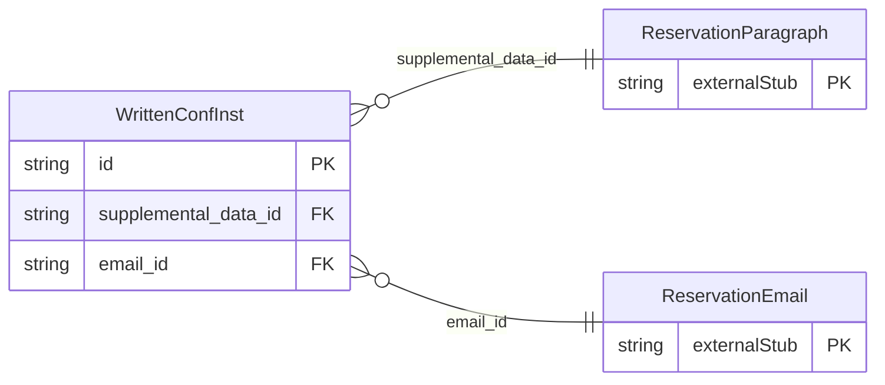

<!-- Code generated by protoc-gen-store. DO NOT EDIT. -->

# `ota/opentravel/hotel/booking/reservation/v1/types/written_conf_inst/` — Prisma schema

Generated from Protobuf by protoc-gen-store. Source of truth is the `.proto` files — regenerate rather than editing.

| Models | Enums |
| ---: | ---: |
| 1 | 0 |

## Entity relationships

Schema file: [`written_conf_inst.postgres.prisma`](./written_conf_inst.postgres.prisma)

### `WrittenConfInst` → `written_conf_insts`

Method by which confirmations should be delivered.

| Column | Type | Null |
| --- | --- | --- |
| `id` | `CHAR(26)` | not null |
| `language_id` | `VARCHAR(255)` | nullable |
| `addressee_display_name` | `VARCHAR(255)` | nullable |
| `address` | `VARCHAR(255)` | nullable |
| `telephone` | `VARCHAR(255)` | nullable |
| `confirm` | `BOOLEAN` | nullable |
| `supplemental_data_id` | `CHAR(26)` | nullable |
| `email_id` | `CHAR(26)` | nullable |
