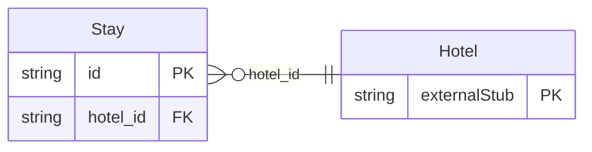

<!-- Code generated by protoc-gen-store. DO NOT EDIT. -->

# `ota/opentravel/hotel/booking/stay/stay/` — Prisma schema

Generated from Protobuf by protoc-gen-store. Source of truth is the `.proto` files — regenerate rather than editing.

| Models | Enums |
| ---: | ---: |
| 1 | 0 |

## Entity relationships

Schema file: [`stay.postgres.prisma`](./stay.postgres.prisma)

### `Stay` → `resource`

Provides details of a guest's stay. A singleton (AIP-156 <https://aip.dev/156>) resource, named "hotels/{hotel}/reservations/{reservation}/stay". OTA: OTA_HotelStayInfoNotifRQ/StayInfos/StayInfo.

| Column | Type | Null |
| --- | --- | --- |
| `id` | `CHAR(26)` | not null |
| `name` | `VARCHAR(255)` | not null |
| `uid` | `VARCHAR(255)` | nullable |
| `etag` | `VARCHAR(255)` | nullable |
| `create_time` | `TIMESTAMPTZ` | not null |
| `update_time` | `TIMESTAMPTZ` | not null |
| `sequence_number` | `INTEGER` | nullable |
| `room_stay_rph` | `INTEGER` | nullable |
| `hotel_id` | `CHAR(26)` | not null |
