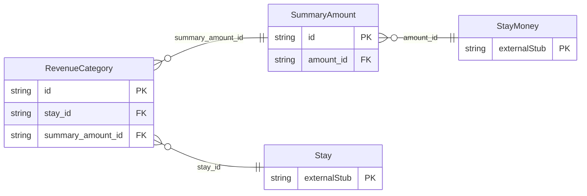

<!-- Code generated by protoc-gen-store. DO NOT EDIT. -->

# `ota/opentravel/hotel/booking/stay/v1/types/revenue_category/` — Prisma schema

Generated from Protobuf by protoc-gen-store. Source of truth is the `.proto` files — regenerate rather than editing.

| Models | Enums |
| ---: | ---: |
| 2 | 0 |

## Entity relationships

Schema file: [`revenue_category.postgres.prisma`](./revenue_category.postgres.prisma)

### `RevenueCategory` → `revenue_categories`

The classifications of revenue data associated with the StayInfo report. A RevenueCategory provide a way to classify guest financial stay data and analyze guest spending for a certain category (e.g., food and beverage, room, etc.)

| Column | Type | Null |
| --- | --- | --- |
| `id` | `CHAR(26)` | not null |
| `revenue_category_code` | `StayRevenueCategoryCode` | nullable |
| `stay_id` | `CHAR(26)` | not null |
| `summary_amount_id` | `CHAR(26)` | nullable |

### `SummaryAmount` → `summary_amounts`

Summary amount.

| Column | Type | Null |
| --- | --- | --- |
| `id` | `CHAR(26)` | not null |
| `amount_id` | `CHAR(26)` | nullable |
