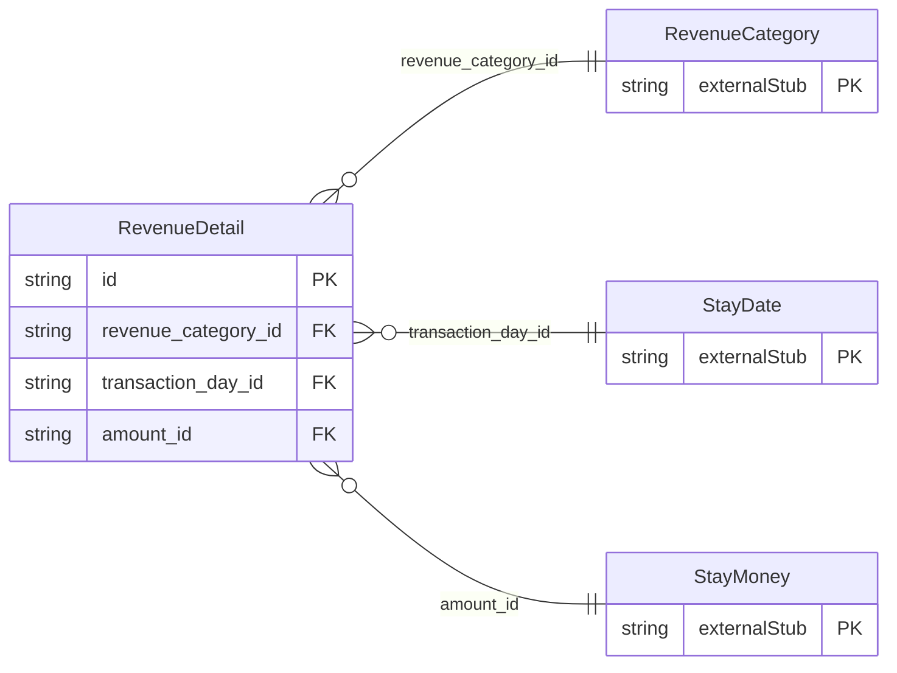

<!-- Code generated by protoc-gen-store. DO NOT EDIT. -->

# `ota/opentravel/hotel/booking/stay/v1/types/revenue_detail/` — Prisma schema

Generated from Protobuf by protoc-gen-store. Source of truth is the `.proto` files — regenerate rather than editing.

| Models | Enums |
| ---: | ---: |
| 1 | 0 |

## Entity relationships

Schema file: [`revenue_detail.postgres.prisma`](./revenue_detail.postgres.prisma)

### `RevenueDetail` → `revenue_details`

The RevenueDetail class contains line item detail about specific revenue transactions.

| Column | Type | Null |
| --- | --- | --- |
| `id` | `CHAR(26)` | not null |
| `reference_id` | `VARCHAR(255)` | nullable |
| `rate_plan_code` | `VARCHAR(255)` | nullable |
| `description` | `VARCHAR(255)` | nullable |
| `pms_revenue_code` | `VARCHAR(255)` | nullable |
| `folio_ids` | `VARCHAR(255)[]` | not null |
| `revenue_category_id` | `CHAR(26)` | not null |
| `transaction_day_id` | `CHAR(26)` | nullable |
| `amount_id` | `CHAR(26)` | nullable |
