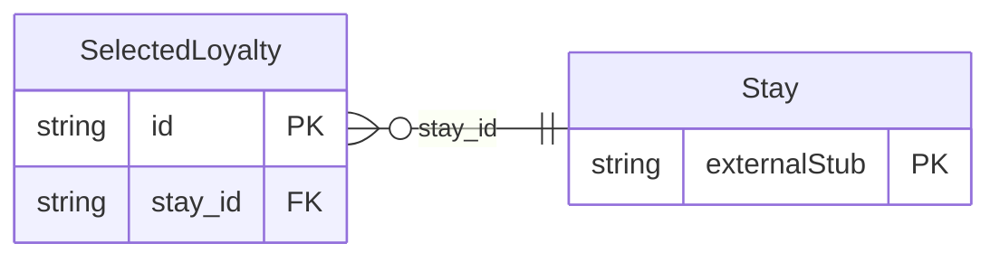

<!-- Code generated by protoc-gen-store. DO NOT EDIT. -->

# `ota/opentravel/hotel/booking/stay/v1/types/selected_loyalty/` — Prisma schema

Generated from Protobuf by protoc-gen-store. Source of truth is the `.proto` files — regenerate rather than editing.

| Models | Enums |
| ---: | ---: |
| 1 | 0 |

## Entity relationships

Schema file: [`selected_loyalty.postgres.prisma`](./selected_loyalty.postgres.prisma)

### `SelectedLoyalty` → `selected_loyalties`

Provides the guest's loyalty point accruals for a given stay.

| Column | Type | Null |
| --- | --- | --- |
| `id` | `CHAR(26)` | not null |
| `reservation_action_type` | `VARCHAR(255)` | nullable |
| `selected_loyalty_rph` | `VARCHAR(255)` | nullable |
| `program_code` | `VARCHAR(255)` | nullable |
| `bonus_code` | `VARCHAR(255)` | nullable |
| `account_id` | `VARCHAR(255)` | nullable |
| `points_earned` | `VARCHAR(255)` | nullable |
| `stay_id` | `CHAR(26)` | not null |
