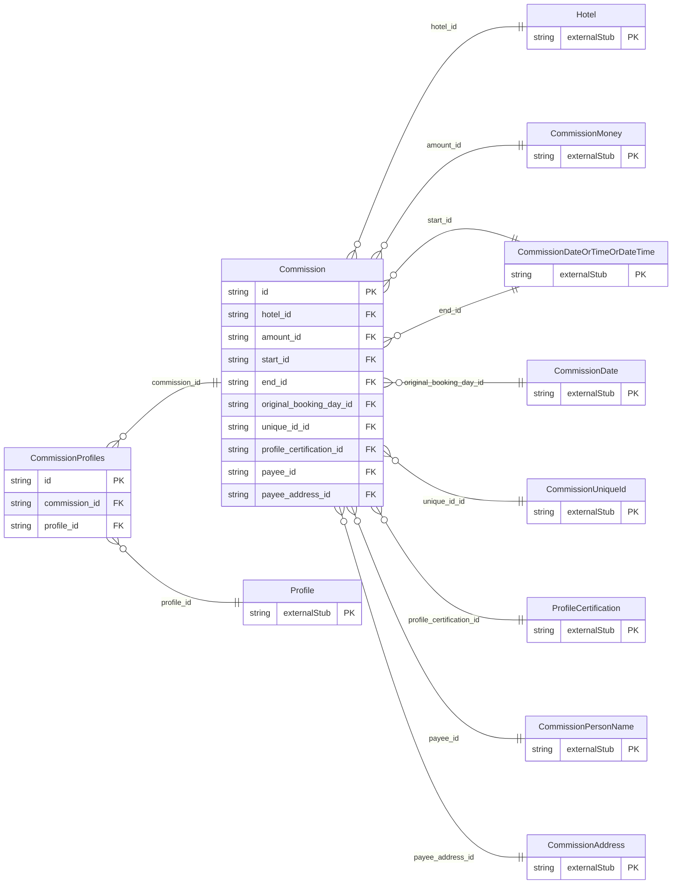

<!-- Code generated by protoc-gen-store. DO NOT EDIT. -->

# `ota/opentravel/hotel/finance/commission/commission/` — Prisma schema

Generated from Protobuf by protoc-gen-store. Source of truth is the `.proto` files — regenerate rather than editing.

| Models | Enums |
| ---: | ---: |
| 2 | 0 |

## Entity relationships

Schema file: [`commission.postgres.prisma`](./commission.postgres.prisma)

### `Commission` → `resource`

The CommissionEvent element is used to identify the commission to be paid to a central server. The Commission Event is initiated on the schedule that the hotel typically pays commissions (e.g.: following night audit), and a CommissionEvent occurs for every check out. A collection resource, named "hotels/{hotel}/commissions/{commission}". OTA: OTA_HotelCommNotifRQ/CommissionEvents/CommissionEvent.

| Column | Type | Null |
| --- | --- | --- |
| `id` | `CHAR(26)` | not null |
| `name` | `VARCHAR(255)` | not null |
| `uid` | `VARCHAR(255)` | nullable |
| `etag` | `VARCHAR(255)` | nullable |
| `delete_time` | `TIMESTAMPTZ` | nullable |
| `expire_time` | `TIMESTAMPTZ` | nullable |
| `create_time` | `TIMESTAMPTZ` | not null |
| `update_time` | `TIMESTAMPTZ` | not null |
| `duration` | `VARCHAR(255)` | nullable |
| `confirmation_id` | `VARCHAR(255)` | nullable |
| `confirmation_originator_code` | `VARCHAR(255)` | nullable |
| `commission_originator_code` | `VARCHAR(255)` | nullable |
| `reservation_id` | `VARCHAR(255)` | nullable |
| `preferred_payment_currency` | `VARCHAR(255)` | nullable |
| `market_code` | `VARCHAR(255)` | nullable |
| `booking_source` | `VARCHAR(255)` | nullable |
| `room_count` | `INTEGER` | nullable |
| `room_inventory_code` | `VARCHAR(255)` | nullable |
| `promotion_code` | `VARCHAR(255)` | nullable |
| `hotel_id` | `CHAR(26)` | not null |
| `amount_id` | `CHAR(26)` | nullable |
| `start_id` | `CHAR(26)` | nullable |
| `end_id` | `CHAR(26)` | nullable |
| `original_booking_day_id` | `CHAR(26)` | nullable |
| `unique_id_id` | `VARCHAR(255)` | nullable |
| `profile_certification_id` | `CHAR(26)` | nullable |
| `payee_id` | `CHAR(26)` | nullable |
| `payee_address_id` | `CHAR(26)` | nullable |

### `CommissionProfiles` → `profiles`

Join table for the many-to-many relation Commission.profiles ↔ Profile.

| Column | Type | Null |
| --- | --- | --- |
| `id` | `CHAR(26)` | not null |
| `commission_id` | `CHAR(26)` | not null |
| `profile_id` | `CHAR(26)` | not null |
