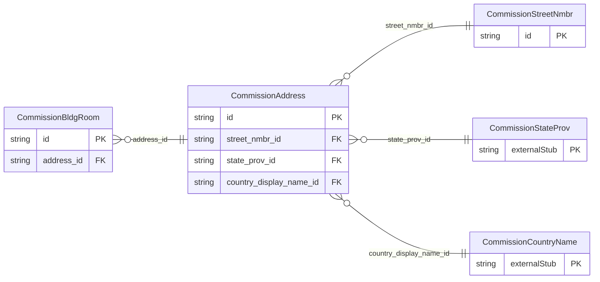

<!-- Code generated by protoc-gen-store. DO NOT EDIT. -->

# `ota/opentravel/hotel/finance/commission/v1/types/address/` — Prisma schema

Generated from Protobuf by protoc-gen-store. Source of truth is the `.proto` files — regenerate rather than editing.

| Models | Enums |
| ---: | ---: |
| 3 | 0 |

## Entity relationships

Schema file: [`address.postgres.prisma`](./address.postgres.prisma)

### `CommissionAddress` → `address`

Provides address information.

| Column | Type | Null |
| --- | --- | --- |
| `id` | `CHAR(26)` | not null |
| `formatted` | `BOOLEAN` | nullable |
| `share_synch_ind` | `ShareSynchInd` | nullable |
| `share_market_ind` | `ShareMarketInd` | nullable |
| `type` | `CommissionCommunicationLocationType` | nullable |
| `remark` | `VARCHAR(255)` | nullable |
| `language_code` | `VARCHAR(255)` | nullable |
| `valid` | `BOOLEAN` | nullable |
| `address_lines` | `VARCHAR(255)[]` | nullable |
| `city_display_name` | `VARCHAR(255)` | nullable |
| `postal_code` | `VARCHAR(255)` | nullable |
| `county` | `VARCHAR(255)` | nullable |
| `street_nmbr_id` | `CHAR(26)` | nullable |
| `state_prov_id` | `CHAR(26)` | nullable |
| `country_display_name_id` | `CHAR(26)` | nullable |

### `CommissionStreetNmbr` → `street_nmbrs`

May contain the street number and optionally the street name.

| Column | Type | Null |
| --- | --- | --- |
| `id` | `CHAR(26)` | not null |
| `po_box` | `VARCHAR(255)` | nullable |
| `street_nmbr_suffix` | `VARCHAR(255)` | nullable |
| `street_direction` | `VARCHAR(255)` | nullable |
| `rural_route_nmbr` | `VARCHAR(255)` | nullable |
| `value` | `VARCHAR(255)` | nullable |

### `CommissionBldgRoom` → `bldg_rooms`

Building name, room, apartment, or suite number.

| Column | Type | Null |
| --- | --- | --- |
| `id` | `CHAR(26)` | not null |
| `bldg_name_indicator` | `BOOLEAN` | nullable |
| `value` | `VARCHAR(255)` | nullable |
| `address_id` | `CHAR(26)` | not null |
