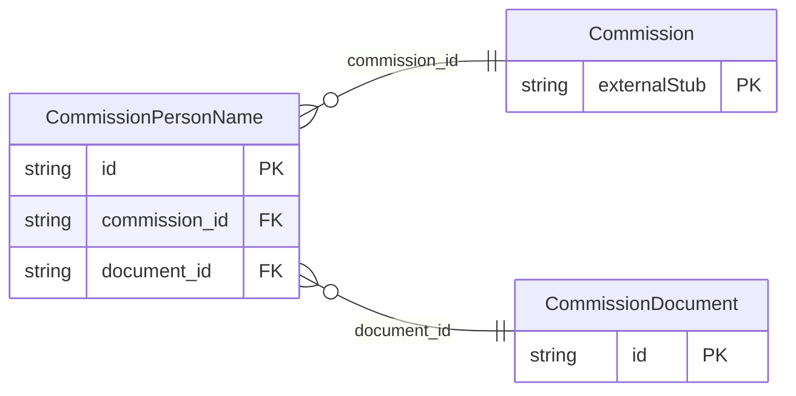

<!-- Code generated by protoc-gen-store. DO NOT EDIT. -->

# `ota/opentravel/hotel/finance/commission/v1/types/person_name/` — Prisma schema

Generated from Protobuf by protoc-gen-store. Source of truth is the `.proto` files — regenerate rather than editing.

| Models | Enums |
| ---: | ---: |
| 2 | 2 |

## Entity relationships

Schema file: [`person_name.postgres.prisma`](./person_name.postgres.prisma)

### `CommissionPersonName` → `person_names`

This provides name information for a person.

| Column | Type | Null |
| --- | --- | --- |
| `id` | `CHAR(26)` | not null |
| `share_synch_ind` | `ShareSynchInd` | nullable |
| `share_market_ind` | `ShareMarketInd` | nullable |
| `name_type` | `CommissionNameType` | nullable |
| `language_code` | `VARCHAR(255)` | nullable |
| `default_value` | `BOOLEAN` | nullable |
| `name_prefixes` | `VARCHAR(255)[]` | nullable |
| `given_names` | `VARCHAR(255)[]` | nullable |
| `middle_names` | `VARCHAR(255)[]` | nullable |
| `surname_prefix` | `VARCHAR(255)` | nullable |
| `surname` | `VARCHAR(255)` | not null |
| `name_suffixes` | `VARCHAR(255)[]` | nullable |
| `name_titles` | `VARCHAR(255)[]` | nullable |
| `commission_id` | `CHAR(26)` | not null |
| `document_id` | `CHAR(26)` | nullable |

### `CommissionDocument` → `documents`

Document information for verification purposes and also used for additional filtering for common names.

| Column | Type | Null |
| --- | --- | --- |
| `id` | `CHAR(26)` | not null |
| `doc_id` | `VARCHAR(255)` | nullable |
| `doc_type` | `CommissionDocumentType` | nullable |

### Enums

- `ShareSynchInd`: YES, NO, INHERIT
- `ShareMarketInd`: YES, NO, INHERIT
