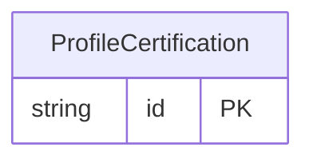

<!-- Code generated by protoc-gen-store. DO NOT EDIT. -->

# `ota/opentravel/hotel/finance/commission/v1/types/profile_certification/` — Prisma schema

Generated from Protobuf by protoc-gen-store. Source of truth is the `.proto` files — regenerate rather than editing.

| Models | Enums |
| ---: | ---: |
| 1 | 0 |

## Entity relationships

Schema file: [`profile_certification.postgres.prisma`](./profile_certification.postgres.prisma)

### `ProfileCertification` → `profile_certifications`

The ProfileCertification element identifies the travel agency to be paid by providing the IATA number or ARC certifying number. (Implementation note: This attribute is optional, but if it is not set, the Profile attribute must be set.)

| Column | Type | Null |
| --- | --- | --- |
| `id` | `CHAR(26)` | not null |
| `certification_type` | `VARCHAR(255)` | nullable |
| `certification_id` | `VARCHAR(255)` | nullable |
