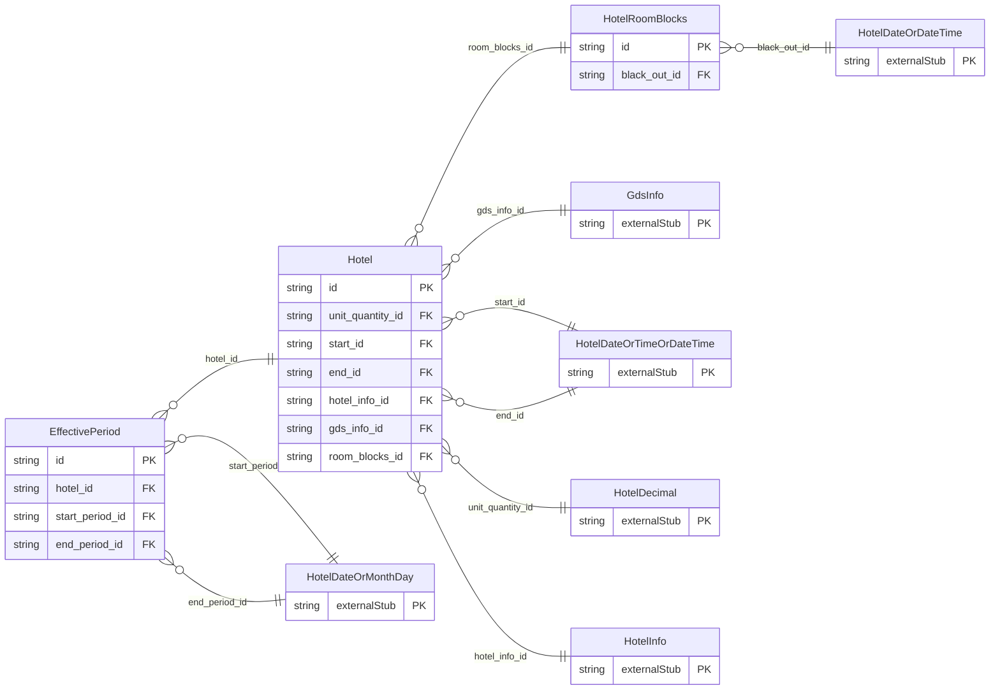

<!-- Code generated by protoc-gen-store. DO NOT EDIT. -->

# `ota/opentravel/hotel/hotel/hotel/` — Prisma schema

Generated from Protobuf by protoc-gen-store. Source of truth is the `.proto` files — regenerate rather than editing.

| Models | Enums |
| ---: | ---: |
| 3 | 1 |

## Entity relationships

Schema file: [`hotel.postgres.prisma`](./hotel.postgres.prisma)

### `Hotel` → `resource`

Hotel descriptive information. A collection resource, named "hotels/{hotel}". OTA: OTA_HotelDescriptiveContentNotifRQ/HotelDescriptiveContents/HotelDescriptiveContent.

| Column | Type | Null |
| --- | --- | --- |
| `id` | `CHAR(26)` | not null |
| `name` | `VARCHAR(255)` | not null |
| `uid` | `VARCHAR(255)` | nullable |
| `etag` | `VARCHAR(255)` | nullable |
| `delete_time` | `TIMESTAMPTZ` | nullable |
| `expire_time` | `TIMESTAMPTZ` | nullable |
| `create_time` | `TIMESTAMPTZ` | not null |
| `update_time` | `TIMESTAMPTZ` | not null |
| `currency_code` | `VARCHAR(255)` | nullable |
| `decimal_places` | `INTEGER` | nullable |
| `language_code` | `VARCHAR(255)` | nullable |
| `unit` | `VARCHAR(255)` | nullable |
| `unit_code` | `HotelUnitOfMeasureCode` | nullable |
| `time_zone` | `VARCHAR(255)` | nullable |
| `duration` | `VARCHAR(255)` | nullable |
| `distance_unit_code` | `HotelUnitOfMeasureCode` | nullable |
| `area_unit_code` | `HotelUnitOfMeasureCode` | nullable |
| `weight_unit_code` | `HotelUnitOfMeasureCode` | nullable |
| `rph` | `VARCHAR(255)` | nullable |
| `chain_code` | `VARCHAR(255)` | nullable |
| `brand_code` | `VARCHAR(255)` | nullable |
| `hotel_city_code` | `VARCHAR(255)` | nullable |
| `display_name` | `VARCHAR(255)` | nullable |
| `hotel_code_context` | `VARCHAR(255)` | nullable |
| `chain_display_name` | `VARCHAR(255)` | nullable |
| `brand_display_name` | `VARCHAR(255)` | nullable |
| `area_id` | `VARCHAR(255)` | nullable |
| `tt_icode` | `INTEGER` | nullable |
| `ota_uid` | `VARCHAR(255)` | nullable |
| `destination_systems_code` | `VARCHAR(255)[]` | nullable |
| `unit_quantity_id` | `CHAR(26)` | nullable |
| `start_id` | `CHAR(26)` | nullable |
| `end_id` | `CHAR(26)` | nullable |
| `hotel_info_id` | `CHAR(26)` | nullable |
| `gds_info_id` | `CHAR(26)` | nullable |
| `room_blocks_id` | `CHAR(26)` | nullable |

### `EffectivePeriod` → `effective_periods`

The period for which content is visible. This may be either specific times of year that repeat annually or actual dates.

| Column | Type | Null |
| --- | --- | --- |
| `id` | `CHAR(26)` | not null |
| `duration` | `VARCHAR(255)` | nullable |
| `hotel_id` | `CHAR(26)` | not null |
| `start_period_id` | `CHAR(26)` | nullable |
| `end_period_id` | `CHAR(26)` | nullable |

### `HotelRoomBlocks` → `room_blocks`

Describes room block information accepted by the hotel.

| Column | Type | Null |
| --- | --- | --- |
| `id` | `CHAR(26)` | not null |
| `available` | `BOOLEAN` | nullable |
| `total_room_qty` | `INTEGER` | nullable |
| `cancel_period_days` | `INTEGER` | nullable |
| `rate_type` | `RateType` | nullable |
| `room_type` | `VARCHAR(255)` | nullable |
| `black_out_id` | `CHAR(26)` | nullable |

### Enums

- `RateType`: NOT_APPLICABLE, CORPORATE, PREFERRED, RACK
