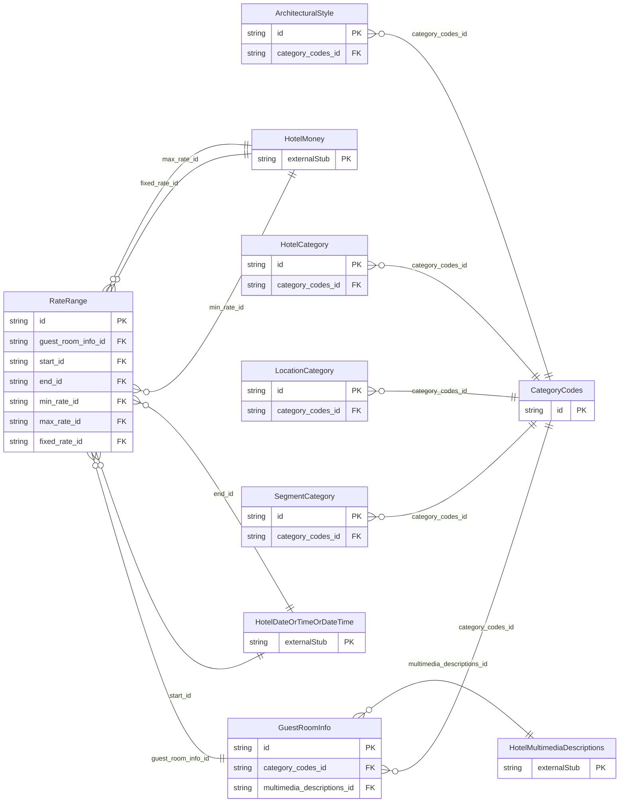

<!-- Code generated by protoc-gen-store. DO NOT EDIT. -->

# `ota/opentravel/hotel/hotel/v1/types/category_codes/` — Prisma schema

Generated from Protobuf by protoc-gen-store. Source of truth is the `.proto` files — regenerate rather than editing.

| Models | Enums |
| ---: | ---: |
| 7 | 0 |

## Entity relationships

Schema file: [`category_codes.postgres.prisma`](./category_codes.postgres.prisma)

### `CategoryCodes` → `category_codes`

Used to define specific hotel information such as the type, location and architectural style.

| Column | Type | Null |
| --- | --- | --- |
| `id` | `CHAR(26)` | not null |

### `LocationCategory` → `location_categories`

Defines the general location of the hotel such as airport, suburban, downtown.

| Column | Type | Null |
| --- | --- | --- |
| `id` | `CHAR(26)` | not null |
| `code` | `HotelLocationCategoryCodes` | nullable |
| `code_detail` | `VARCHAR(255)` | nullable |
| `exists_code` | `HotelOptionTypeCode` | nullable |
| `category_codes_id` | `CHAR(26)` | not null |

### `SegmentCategory` → `segment_categories`

Defines the type of hotel such as luxury, extended stay, economy.

| Column | Type | Null |
| --- | --- | --- |
| `id` | `CHAR(26)` | not null |
| `code` | `HotelSegmentCategoryCode` | nullable |
| `code_detail` | `VARCHAR(255)` | nullable |
| `exists_code` | `HotelOptionTypeCode` | nullable |
| `category_codes_id` | `CHAR(26)` | not null |

### `HotelCategory` → `categories`

Defines the particular type of hotel (e.g., golf, ski, bed and breakfast).

| Column | Type | Null |
| --- | --- | --- |
| `id` | `CHAR(26)` | not null |
| `code` | `HotelPropertyClassType` | nullable |
| `code_detail` | `VARCHAR(255)` | nullable |
| `exists_code` | `HotelOptionTypeCode` | nullable |
| `category_codes_id` | `CHAR(26)` | not null |

### `ArchitecturalStyle` → `architectural_styles`

Describes the appearance of the building such as art deco, modern, historic.

| Column | Type | Null |
| --- | --- | --- |
| `id` | `CHAR(26)` | not null |
| `code` | `HotelArchitecturalStyleCode` | nullable |
| `code_detail` | `VARCHAR(255)` | nullable |
| `exists_code` | `HotelOptionTypeCode` | nullable |
| `category_codes_id` | `CHAR(26)` | not null |

### `GuestRoomInfo` → `guest_room_infos`

The types and quantities of guest rooms at a hotel.

| Column | Type | Null |
| --- | --- | --- |
| `id` | `CHAR(26)` | not null |
| `code` | `CodesGuestRoomInfo` | nullable |
| `code_detail` | `VARCHAR(255)` | nullable |
| `quantity` | `INTEGER` | nullable |
| `exists_code` | `HotelOptionTypeCode` | nullable |
| `descriptive_text` | `VARCHAR(255)` | nullable |
| `category_codes_id` | `CHAR(26)` | not null |
| `multimedia_descriptions_id` | `CHAR(26)` | nullable |

### `RateRange` → `rate_ranges`

Provides rate range information.

| Column | Type | Null |
| --- | --- | --- |
| `id` | `CHAR(26)` | not null |
| `duration` | `VARCHAR(255)` | nullable |
| `rate_time_unit` | `HotelTimeUnit` | nullable |
| `guest_room_info_id` | `CHAR(26)` | not null |
| `start_id` | `CHAR(26)` | nullable |
| `end_id` | `CHAR(26)` | nullable |
| `min_rate_id` | `CHAR(26)` | nullable |
| `max_rate_id` | `CHAR(26)` | nullable |
| `fixed_rate_id` | `CHAR(26)` | nullable |
