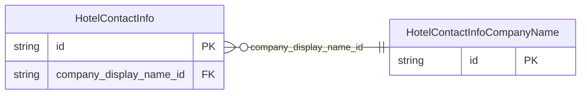

<!-- Code generated by protoc-gen-store. DO NOT EDIT. -->

# `ota/opentravel/hotel/hotel/v1/types/contact_info/` — Prisma schema

Generated from Protobuf by protoc-gen-store. Source of truth is the `.proto` files — regenerate rather than editing.

| Models | Enums |
| ---: | ---: |
| 2 | 0 |

## Entity relationships

Schema file: [`contact_info.postgres.prisma`](./contact_info.postgres.prisma)

### `HotelContactInfo` → `contact_infos`

Allows multiple pieces of information to be repeated for a single contact (e.g. one employee has mutliple e-mail addresses) and also allows multiple contacts to be associated to a single or multiple piece of information (e.g. all employees working in a restaurant can be reached at the same phone number).

| Column | Type | Null |
| --- | --- | --- |
| `id` | `CHAR(26)` | not null |
| `location` | `HotelContactLocation` | nullable |
| `company_display_name_id` | `VARCHAR(255)` | nullable |

### `HotelContactInfoCompanyName` → `contact_info_company_names`

The name of the company with which this contact is associated.

| Column | Type | Null |
| --- | --- | --- |
| `company_short_display_name` | `VARCHAR(255)` | nullable |
| `travel_sector` | `HotelTravelSector` | nullable |
| `code` | `VARCHAR(255)` | nullable |
| `code_context` | `VARCHAR(255)` | nullable |
| `region_code` | `VARCHAR(255)` | nullable |
| `division` | `VARCHAR(255)` | nullable |
| `department` | `VARCHAR(255)` | nullable |
| `id` | `VARCHAR(255)` | not null |
| `value` | `VARCHAR(255)` | nullable |
