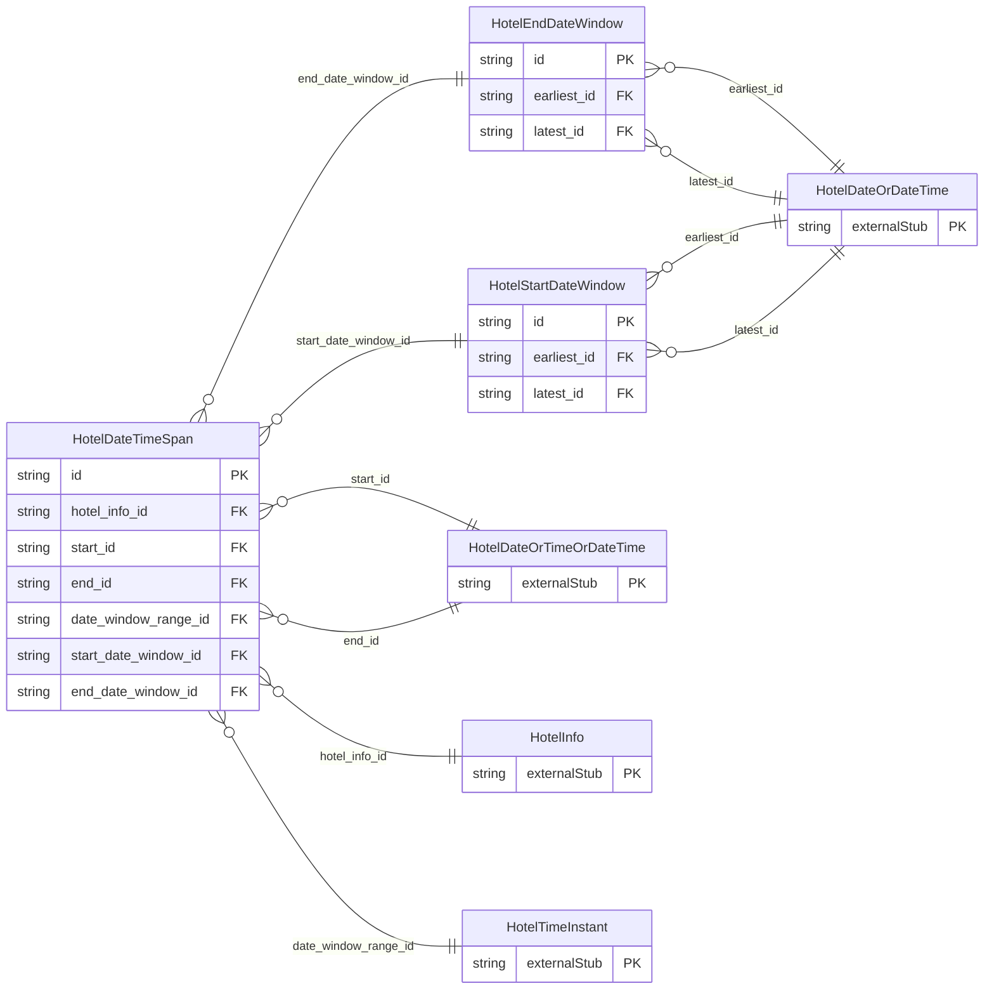

<!-- Code generated by protoc-gen-store. DO NOT EDIT. -->

# `ota/opentravel/hotel/hotel/v1/types/date_time_span/` — Prisma schema

Generated from Protobuf by protoc-gen-store. Source of truth is the `.proto` files — regenerate rather than editing.

| Models | Enums |
| ---: | ---: |
| 3 | 0 |

## Entity relationships

Schema file: [`date_time_span.postgres.prisma`](./date_time_span.postgres.prisma)

### `HotelDateTimeSpan` → `date_time_spans`

Used to specify a time window range by either specifying an earliest and latest date for the start date and end date or by giving a date with a time period that can be applied before and/or after the start date.

| Column | Type | Null |
| --- | --- | --- |
| `id` | `CHAR(26)` | not null |
| `duration` | `VARCHAR(255)` | nullable |
| `hotel_info_id` | `CHAR(26)` | not null |
| `start_id` | `CHAR(26)` | nullable |
| `end_id` | `CHAR(26)` | nullable |
| `date_window_range_id` | `CHAR(26)` | nullable |
| `start_date_window_id` | `CHAR(26)` | nullable |
| `end_date_window_id` | `CHAR(26)` | nullable |

### `HotelStartDateWindow` → `start_date_windows`

The earliest and latest dates acceptable for the start date.

| Column | Type | Null |
| --- | --- | --- |
| `id` | `CHAR(26)` | not null |
| `dow` | `HotelDayOfWeek` | nullable |
| `earliest_id` | `CHAR(26)` | nullable |
| `latest_id` | `CHAR(26)` | nullable |

### `HotelEndDateWindow` → `end_date_windows`

The earliest and latest dates acceptable for the end date.

| Column | Type | Null |
| --- | --- | --- |
| `id` | `CHAR(26)` | not null |
| `dow` | `HotelDayOfWeek` | nullable |
| `earliest_id` | `CHAR(26)` | nullable |
| `latest_id` | `CHAR(26)` | nullable |
