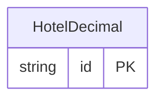

<!-- Code generated by protoc-gen-store. DO NOT EDIT. -->

# `ota/opentravel/hotel/hotel/v1/types/decimal/` — Prisma schema

Generated from Protobuf by protoc-gen-store. Source of truth is the `.proto` files — regenerate rather than editing.

| Models | Enums |
| ---: | ---: |
| 1 | 0 |

## Entity relationships

Schema file: [`decimal.postgres.prisma`](./decimal.postgres.prisma)

### `HotelDecimal` → `decimals`

An exact decimal number, after google.type.Decimal. OTA's xs:decimal values -- percentages, rates, measurements -- are carried as their decimal string so no precision is lost to binary floating point.

| Column | Type | Null |
| --- | --- | --- |
| `id` | `CHAR(26)` | not null |
| `value` | `VARCHAR(255)` | nullable |
