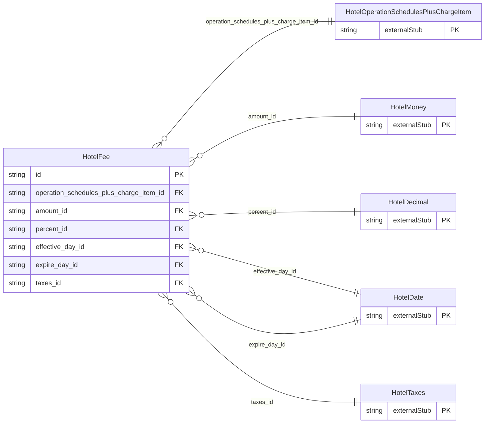

<!-- Code generated by protoc-gen-store. DO NOT EDIT. -->

# `ota/opentravel/hotel/hotel/v1/types/fee/` — Prisma schema

Generated from Protobuf by protoc-gen-store. Source of truth is the `.proto` files — regenerate rather than editing.

| Models | Enums |
| ---: | ---: |
| 1 | 0 |

## Entity relationships

Schema file: [`fee.postgres.prisma`](./fee.postgres.prisma)

### `HotelFee` → `fees`

Used for non-tax fees and charges (e.g. service charges) .

| Column | Type | Null |
| --- | --- | --- |
| `id` | `CHAR(26)` | not null |
| `tax_inclusive` | `BOOLEAN` | nullable |
| `type` | `HotelAmountDetermination` | nullable |
| `code` | `HotelFeeTaxType` | nullable |
| `expire_date_exclusive` | `BOOLEAN` | nullable |
| `mandatory` | `BOOLEAN` | nullable |
| `rph` | `VARCHAR(255)` | nullable |
| `charge_unit` | `HotelChargeType` | nullable |
| `charge_frequency` | `HotelChargeType` | nullable |
| `charge_unit_exempt` | `INTEGER` | nullable |
| `charge_frequency_exempt` | `INTEGER` | nullable |
| `max_charge_unit_applies` | `INTEGER` | nullable |
| `max_charge_frequency_applies` | `INTEGER` | nullable |
| `taxable_indicator` | `BOOLEAN` | nullable |
| `min_age` | `INTEGER` | nullable |
| `max_age` | `INTEGER` | nullable |
| `operation_schedules_plus_charge_item_id` | `CHAR(26)` | not null |
| `amount_id` | `CHAR(26)` | nullable |
| `percent_id` | `CHAR(26)` | nullable |
| `effective_day_id` | `CHAR(26)` | nullable |
| `expire_day_id` | `CHAR(26)` | nullable |
| `taxes_id` | `CHAR(26)` | nullable |
