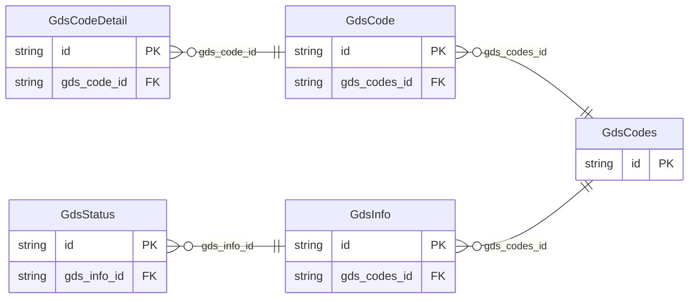

<!-- Code generated by protoc-gen-store. DO NOT EDIT. -->

# `ota/opentravel/hotel/hotel/v1/types/gds_info/` — Prisma schema

Generated from Protobuf by protoc-gen-store. Source of truth is the `.proto` files — regenerate rather than editing.

| Models | Enums |
| ---: | ---: |
| 5 | 0 |

## Entity relationships

Schema file: [`gds_info.postgres.prisma`](./gds_info.postgres.prisma)

### `GdsInfo` → `gds_infos`

This defines codes used by individual GDS's, which can be used to upload rate information.

| Column | Type | Null |
| --- | --- | --- |
| `id` | `CHAR(26)` | not null |
| `master_chain_code` | `VARCHAR(255)` | nullable |
| `gds_codes_id` | `CHAR(26)` | nullable |

### `GdsCodes` → `gds_codes`

The element acts as a container for GDS_Code. It is used to send item for each GDS.

| Column | Type | Null |
| --- | --- | --- |
| `id` | `CHAR(26)` | not null |
| `load_gds_indicator` | `BOOLEAN` | nullable |

### `GdsStatus` → `gds_status`

Hotel status per GDS.

| Column | Type | Null |
| --- | --- | --- |
| `id` | `CHAR(26)` | not null |
| `code` | `VARCHAR(255)` | nullable |
| `name` | `VARCHAR(255)` | nullable |
| `hotel_status_code` | `HotelStatusCode` | nullable |
| `gds_info_id` | `CHAR(26)` | not null |

### `GdsCode` → `gds_code`

Provides detailed information regarding the specified GDS.

| Column | Type | Null |
| --- | --- | --- |
| `id` | `CHAR(26)` | not null |
| `chain_code` | `VARCHAR(255)` | nullable |
| `gds_property_code` | `VARCHAR(255)` | nullable |
| `gds_display_name` | `VARCHAR(255)` | not null |
| `load_gds_indicator` | `BOOLEAN` | nullable |
| `gds_property_long_display_name` | `VARCHAR(255)` | nullable |
| `gds_property_short_display_name` | `VARCHAR(255)` | nullable |
| `gds_room_type_code` | `VARCHAR(255)` | nullable |
| `gds_codes_id` | `CHAR(26)` | not null |

### `GdsCodeDetail` → `gds_code_details`

This holds detailed information pertaining to the agencies authorized to book this rate.

| Column | Type | Null |
| --- | --- | --- |
| `id` | `CHAR(26)` | not null |
| `pseudo_city_code` | `VARCHAR(255)` | nullable |
| `agency_display_name` | `VARCHAR(255)` | nullable |
| `gds_code_id` | `CHAR(26)` | not null |
