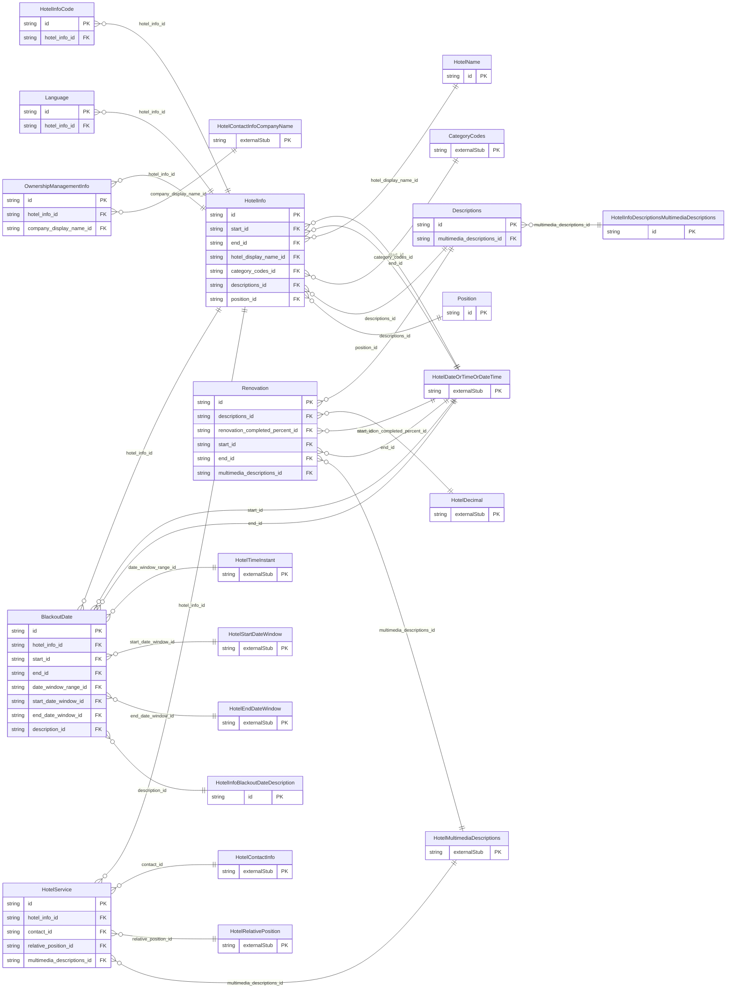

<!-- Code generated by protoc-gen-store. DO NOT EDIT. -->

# `ota/opentravel/hotel/hotel/v1/types/hotel_info/` — Prisma schema

Generated from Protobuf by protoc-gen-store. Source of truth is the `.proto` files — regenerate rather than editing.

| Models | Enums |
| ---: | ---: |
| 12 | 0 |

## Entity relationships

Schema file: [`hotel_info.postgres.prisma`](./hotel_info.postgres.prisma)

### `HotelInfo` → `infos`

The HotelInfo class that describes general information about the hotel.

| Column | Type | Null |
| --- | --- | --- |
| `id` | `CHAR(26)` | not null |
| `when_built` | `VARCHAR(255)` | nullable |
| `last_update_time` | `TIMESTAMPTZ` | nullable |
| `area_weather` | `VARCHAR(255)` | nullable |
| `interface_compliance` | `VARCHAR(255)` | nullable |
| `pms_system` | `VARCHAR(255)` | nullable |
| `duration` | `VARCHAR(255)` | nullable |
| `hotel_status` | `VARCHAR(255)` | nullable |
| `hotel_status_code` | `VARCHAR(255)` | nullable |
| `tax_id` | `VARCHAR(255)` | nullable |
| `daylight_saving_indicator` | `BOOLEAN` | nullable |
| `iso9000_certified` | `BOOLEAN` | nullable |
| `start_id` | `CHAR(26)` | nullable |
| `end_id` | `CHAR(26)` | nullable |
| `hotel_display_name_id` | `CHAR(26)` | nullable |
| `category_codes_id` | `CHAR(26)` | nullable |
| `descriptions_id` | `CHAR(26)` | nullable |
| `position_id` | `CHAR(26)` | nullable |

### `HotelName` → `names_link`

The full name of the hotel.

| Column | Type | Null |
| --- | --- | --- |
| `id` | `CHAR(26)` | not null |
| `hotel_short_display_name` | `VARCHAR(255)` | nullable |
| `value` | `VARCHAR(255)` | nullable |

### `BlackoutDate` → `blackout_dates`

A Blackout Date during which the hotel cannot guarantee rates and rooms availability due to peak occupancy.

| Column | Type | Null |
| --- | --- | --- |
| `id` | `CHAR(26)` | not null |
| `duration` | `VARCHAR(255)` | nullable |
| `name` | `VARCHAR(255)` | nullable |
| `hotel_info_id` | `CHAR(26)` | not null |
| `start_id` | `CHAR(26)` | nullable |
| `end_id` | `CHAR(26)` | nullable |
| `date_window_range_id` | `CHAR(26)` | nullable |
| `start_date_window_id` | `CHAR(26)` | nullable |
| `end_date_window_id` | `CHAR(26)` | nullable |
| `description_id` | `CHAR(26)` | not null |

### `Descriptions` → `descriptions`

Collection of hotel and/or renovation information.

| Column | Type | Null |
| --- | --- | --- |
| `id` | `CHAR(26)` | not null |
| `descriptive_text` | `VARCHAR(255)` | nullable |
| `multimedia_descriptions_id` | `CHAR(26)` | nullable |

### `HotelInfoCode` → `info_codes`

Contains code information about the hotel.

| Column | Type | Null |
| --- | --- | --- |
| `id` | `CHAR(26)` | not null |
| `code` | `CodesHotelInfoCode` | nullable |
| `code_detail` | `VARCHAR(255)` | nullable |
| `quantity` | `INTEGER` | nullable |
| `option_code` | `HotelOptionTypeCode` | nullable |
| `hotel_info_id` | `CHAR(26)` | not null |

### `Position` → `positions`

Describes the geocoded location of the hotel.

| Column | Type | Null |
| --- | --- | --- |
| `id` | `CHAR(26)` | not null |
| `latitude` | `VARCHAR(255)` | nullable |
| `longitude` | `VARCHAR(255)` | nullable |
| `altitude` | `VARCHAR(255)` | nullable |
| `altitude_unit_code` | `HotelUnitOfMeasureCode` | nullable |
| `position_accuracy_code` | `HotelPositionAccuracy` | nullable |

### `HotelService` → `services`

A hotel service or amenity available to the guest such as a business center, concierge, valet parking, massage, newspapers, etc.

| Column | Type | Null |
| --- | --- | --- |
| `included` | `BOOLEAN` | nullable |
| `code` | `HotelHotelAmenityCode` | nullable |
| `business_service_code` | `HotelBusinessSrvcType` | nullable |
| `exists_code` | `HotelOptionTypeCode` | nullable |
| `code_detail` | `VARCHAR(255)` | nullable |
| `available_all_guests` | `BOOLEAN` | nullable |
| `inv_code` | `VARCHAR(255)` | nullable |
| `proximity_code` | `VARCHAR(255)` | nullable |
| `meal_plan_code` | `VARCHAR(255)` | nullable |
| `quantity` | `INTEGER` | nullable |
| `sort` | `INTEGER` | nullable |
| `meeting_room_code` | `HotelMeetingRoomCode` | nullable |
| `id` | `VARCHAR(255)` | not null |
| `featured` | `BOOLEAN` | nullable |
| `descriptive_text` | `VARCHAR(255)` | nullable |
| `hotel_info_id` | `CHAR(26)` | not null |
| `contact_id` | `CHAR(26)` | nullable |
| `relative_position_id` | `CHAR(26)` | nullable |
| `multimedia_descriptions_id` | `CHAR(26)` | nullable |

### `OwnershipManagementInfo` → `ownership_management_infos`

Provides details of the ownership or management.

| Column | Type | Null |
| --- | --- | --- |
| `id` | `CHAR(26)` | not null |
| `location` | `HotelContactLocation` | nullable |
| `relationship_type_code` | `Relationship` | nullable |
| `hotel_info_id` | `CHAR(26)` | not null |
| `company_display_name_id` | `VARCHAR(255)` | nullable |

### `Language` → `languages`

Language details pertaining to the hotel.

| Column | Type | Null |
| --- | --- | --- |
| `id` | `CHAR(26)` | not null |
| `language_code` | `VARCHAR(255)` | nullable |
| `primary_lang` | `BOOLEAN` | nullable |
| `hotel_info_id` | `CHAR(26)` | not null |

### `HotelInfoBlackoutDateDescription` → `info_blackout_date_descriptions`

A description of the Blackout Date, which may be multilingual.

| Column | Type | Null |
| --- | --- | --- |
| `id` | `CHAR(26)` | not null |
| `language_code` | `VARCHAR(255)` | nullable |

### `Renovation` → `renovations`

Details of the hotel renovation.

| Column | Type | Null |
| --- | --- | --- |
| `id` | `CHAR(26)` | not null |
| `immediate_plans` | `BOOLEAN` | nullable |
| `duration` | `VARCHAR(255)` | nullable |
| `area_text` | `VARCHAR(255)` | nullable |
| `renovation_completion` | `VARCHAR(255)` | nullable |
| `descriptive_text` | `VARCHAR(255)` | nullable |
| `descriptions_id` | `CHAR(26)` | not null |
| `renovation_completed_percent_id` | `CHAR(26)` | nullable |
| `start_id` | `CHAR(26)` | nullable |
| `end_id` | `CHAR(26)` | nullable |
| `multimedia_descriptions_id` | `CHAR(26)` | nullable |

### `HotelInfoDescriptionsMultimediaDescriptions` → `info_descriptions_multimedia_descriptions`

Multimedia information about the hotel.

| Column | Type | Null |
| --- | --- | --- |
| `id` | `CHAR(26)` | not null |
| `last_update_time` | `TIMESTAMPTZ` | nullable |
| `info_code` | `HotelInfoType` | nullable |
| `additional_detail_code` | `HotelAdditionalDetailType` | nullable |
