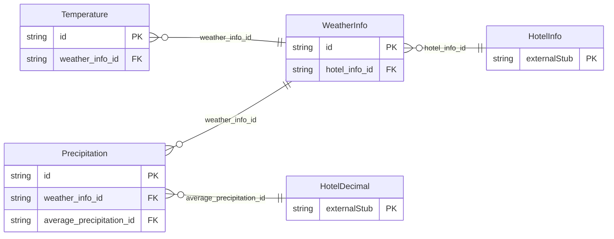

<!-- Code generated by protoc-gen-store. DO NOT EDIT. -->

# `ota/opentravel/hotel/hotel/v1/types/weather_info/` — Prisma schema

Generated from Protobuf by protoc-gen-store. Source of truth is the `.proto` files — regenerate rather than editing.

| Models | Enums |
| ---: | ---: |
| 3 | 1 |

## Entity relationships

Schema file: [`weather_info.postgres.prisma`](./weather_info.postgres.prisma)

### `WeatherInfo` → `weather_infos`

Provides detailed information regarding weather.

| Column | Type | Null |
| --- | --- | --- |
| `id` | `CHAR(26)` | not null |
| `period` | `VARCHAR(255)` | nullable |
| `hotel_info_id` | `CHAR(26)` | not null |

### `Precipitation` → `precipitations`

Provides average precipitation and the unit in which it is measured for a Period.

| Column | Type | Null |
| --- | --- | --- |
| `id` | `CHAR(26)` | not null |
| `unit` | `VARCHAR(255)` | nullable |
| `weather_info_id` | `CHAR(26)` | not null |
| `average_precipitation_id` | `CHAR(26)` | nullable |

### `Temperature` → `temperatures`

Provides average temperatures and the unit in which they are measured for a Period.

| Column | Type | Null |
| --- | --- | --- |
| `id` | `CHAR(26)` | not null |
| `average_high_temp` | `INTEGER` | nullable |
| `average_low_temp` | `INTEGER` | nullable |
| `temp_unit` | `TempUnit` | nullable |
| `weather_info_id` | `CHAR(26)` | not null |

### Enums

- `TempUnit`: CELSIUS, FAHRENHEIT
