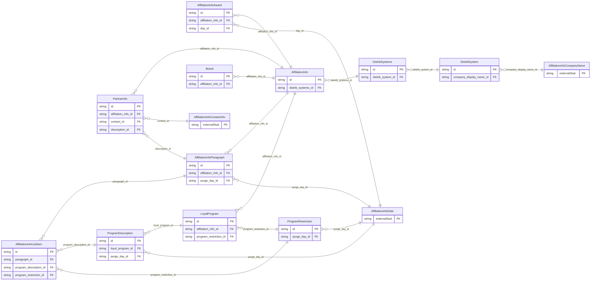

<!-- Code generated by protoc-gen-store. DO NOT EDIT. -->

# `ota/opentravel/hotel/property/affiliation_info/affiliation_info/` — Prisma schema

Generated from Protobuf by protoc-gen-store. Source of truth is the `.proto` files — regenerate rather than editing.

| Models | Enums |
| ---: | ---: |
| 11 | 1 |

## Entity relationships

Schema file: [`affiliation_info.postgres.prisma`](./affiliation_info.postgres.prisma)

### `AffiliationInfo` → `resource`

Provides information regarding affiliations, loyalty programs and award ratings. A singleton (AIP-156 <https://aip.dev/156>) resource, named "hotels/{hotel}/affiliationInfo". OTA: OTA_HotelDescriptiveContentNotifRQ/HotelDescriptiveContents/HotelDescriptiveContent/AffiliationInfo.

| Column | Type | Null |
| --- | --- | --- |
| `id` | `CHAR(26)` | not null |
| `name` | `VARCHAR(255)` | not null |
| `uid` | `VARCHAR(255)` | nullable |
| `etag` | `VARCHAR(255)` | nullable |
| `create_time` | `TIMESTAMPTZ` | not null |
| `update_time` | `TIMESTAMPTZ` | not null |
| `distrib_systems_id` | `CHAR(26)` | nullable |

### `DistribSystems` → `distrib_systems`

A collection of DistribSystem elements.

| Column | Type | Null |
| --- | --- | --- |
| `id` | `CHAR(26)` | not null |
| `distrib_system_id` | `CHAR(26)` | not null |

### `Brand` → `brands`

The Brand class defines the brand affiliations of this hotel.

| Column | Type | Null |
| --- | --- | --- |
| `id` | `CHAR(26)` | not null |
| `uri` | `VARCHAR(255)` | nullable |
| `category_code` | `VARCHAR(255)` | nullable |
| `code_detail` | `VARCHAR(255)` | nullable |
| `marketing` | `VARCHAR(255)` | nullable |
| `affiliation_info_id` | `CHAR(26)` | not null |

### `LoyalProgram` → `loyal_programs`

The LoyalProgram class defines the loyalty programs that this hotel participates in.

| Column | Type | Null |
| --- | --- | --- |
| `id` | `CHAR(26)` | not null |
| `program_display_name` | `VARCHAR(255)` | nullable |
| `secondary_program_display_name` | `VARCHAR(255)` | nullable |
| `affiliate_program_display_name` | `VARCHAR(255)` | nullable |
| `hotel_level` | `VARCHAR(255)` | nullable |
| `program_code` | `VARCHAR(255)` | nullable |
| `travel_sector` | `AffiliationinfoTravelSector` | nullable |
| `primary_program` | `BOOLEAN` | nullable |
| `affiliation_info_id` | `CHAR(26)` | not null |
| `program_restriction_id` | `CHAR(26)` | nullable |

### `AffiliationinfoAward` → `awards`

Provides detailed information regarding each award for this hotel.

| Column | Type | Null |
| --- | --- | --- |
| `id` | `CHAR(26)` | not null |
| `provider` | `VARCHAR(255)` | nullable |
| `rating` | `VARCHAR(255)` | nullable |
| `official_appointment` | `BOOLEAN` | nullable |
| `rating_symbol` | `RatingSymbol` | nullable |
| `rph` | `VARCHAR(255)` | nullable |
| `affiliation_info_id` | `CHAR(26)` | not null |
| `day_id` | `CHAR(26)` | nullable |

### `PartnerInfo` → `partner_infos`

Provides information on marketing and service partnerships (e.g., a theme park that offers discounts if you book this hotel). This is not a loyalty partnership.

| Column | Type | Null |
| --- | --- | --- |
| `id` | `CHAR(26)` | not null |
| `affiliation_info_id` | `CHAR(26)` | not null |
| `contact_id` | `CHAR(26)` | nullable |
| `description_id` | `CHAR(26)` | nullable |

### `AffiliationinfoParagraph` → `paragraphs`

An indication of a new paragraph for a sub-section of a formatted text message.

| Column | Type | Null |
| --- | --- | --- |
| `id` | `CHAR(26)` | not null |
| `display_name` | `VARCHAR(255)` | nullable |
| `paragraph_number` | `INTEGER` | nullable |
| `create_date_time` | `TIMESTAMPTZ` | nullable |
| `creator_id` | `VARCHAR(255)` | nullable |
| `last_modify_date_time` | `TIMESTAMPTZ` | nullable |
| `last_modifier_id` | `VARCHAR(255)` | nullable |
| `language_code` | `VARCHAR(255)` | nullable |
| `images` | `VARCHAR(255)[]` | nullable |
| `uris` | `VARCHAR(255)[]` | nullable |
| `affiliation_info_id` | `CHAR(26)` | not null |
| `purge_day_id` | `CHAR(26)` | nullable |

### `DistribSystem` → `distrib_system`

The DistribSystem objects defining the affiliated distribution systems for a hotel.

| Column | Type | Null |
| --- | --- | --- |
| `id` | `CHAR(26)` | not null |
| `chain_code` | `VARCHAR(255)` | nullable |
| `brand_code` | `VARCHAR(255)` | nullable |
| `hotel_code` | `VARCHAR(255)` | nullable |
| `hotel_city_code` | `VARCHAR(255)` | nullable |
| `hotel_display_name` | `VARCHAR(255)` | nullable |
| `hotel_code_context` | `VARCHAR(255)` | nullable |
| `chain_display_name` | `VARCHAR(255)` | nullable |
| `brand_display_name` | `VARCHAR(255)` | nullable |
| `area_id` | `VARCHAR(255)` | nullable |
| `tt_icode` | `INTEGER` | nullable |
| `company_display_name_id` | `CHAR(26)` | nullable |

### `ProgramDescription` → `program_descriptions`

Provides description information for the loyal program.

| Column | Type | Null |
| --- | --- | --- |
| `id` | `CHAR(26)` | not null |
| `name` | `VARCHAR(255)` | nullable |
| `paragraph_number` | `INTEGER` | nullable |
| `create_date_time` | `TIMESTAMPTZ` | nullable |
| `creator_id` | `VARCHAR(255)` | nullable |
| `last_modify_date_time` | `TIMESTAMPTZ` | nullable |
| `last_modifier_id` | `VARCHAR(255)` | nullable |
| `language_code` | `VARCHAR(255)` | nullable |
| `images` | `VARCHAR(255)[]` | nullable |
| `uris` | `VARCHAR(255)[]` | nullable |
| `loyal_program_id` | `CHAR(26)` | not null |
| `purge_day_id` | `CHAR(26)` | nullable |

### `ProgramRestriction` → `program_restrictions`

Provides information regarding restrictions that apply to the loyal program.

| Column | Type | Null |
| --- | --- | --- |
| `id` | `CHAR(26)` | not null |
| `name` | `VARCHAR(255)` | nullable |
| `paragraph_number` | `INTEGER` | nullable |
| `create_date_time` | `TIMESTAMPTZ` | nullable |
| `creator_id` | `VARCHAR(255)` | nullable |
| `last_modify_date_time` | `TIMESTAMPTZ` | nullable |
| `last_modifier_id` | `VARCHAR(255)` | nullable |
| `language_code` | `VARCHAR(255)` | nullable |
| `images` | `VARCHAR(255)[]` | nullable |
| `uris` | `VARCHAR(255)[]` | nullable |
| `purge_day_id` | `CHAR(26)` | nullable |

### `AffiliationinfoListItem` → `list_items`

Formatted text content and an associated item or sequence number.

| Column | Type | Null |
| --- | --- | --- |
| `id` | `CHAR(26)` | not null |
| `formatted` | `BOOLEAN` | nullable |
| `language_code` | `VARCHAR(255)` | nullable |
| `text_format` | `AffiliationinfoFormattedTextTextTextFormat` | nullable |
| `list_item` | `INTEGER` | nullable |
| `value` | `VARCHAR(255)` | nullable |
| `paragraph_id` | `CHAR(26)` | not null |
| `program_description_id` | `CHAR(26)` | not null |
| `program_restriction_id` | `CHAR(26)` | not null |

### Enums

- `RatingSymbol`: DIAMOND, STAR
