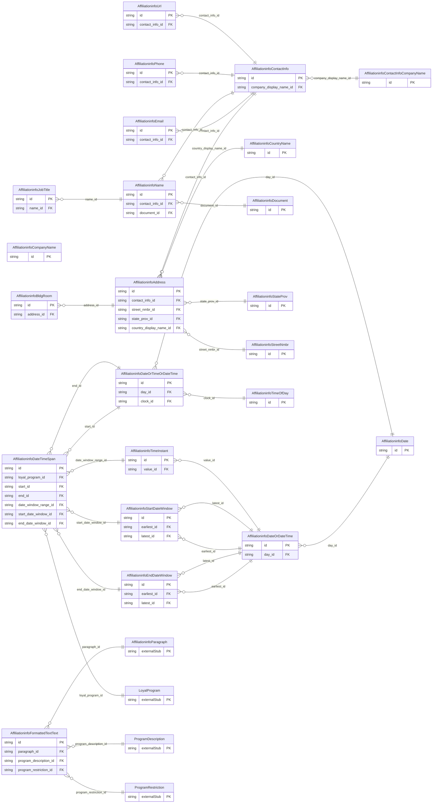

<!-- Code generated by protoc-gen-store. DO NOT EDIT. -->

# `ota/opentravel/hotel/property/affiliation_info/v1/types/` — Prisma schema

Generated from Protobuf by protoc-gen-store. Source of truth is the `.proto` files — regenerate rather than editing.

| Models | Enums |
| ---: | ---: |
| 23 | 9 |

## Entity relationships

## Subfolders

- [`address/`](./address/README.md)
- [`company_name/`](./company_name/README.md)
- [`contact_info/`](./contact_info/README.md)
- [`country_name/`](./country_name/README.md)
- [`date/`](./date/README.md)
- [`date_or_date_time/`](./date_or_date_time/README.md)
- [`date_or_time_or_date_time/`](./date_or_time_or_date_time/README.md)
- [`date_time_span/`](./date_time_span/README.md)
- [`email/`](./email/README.md)
- [`formatted_text_text/`](./formatted_text_text/README.md)
- [`name/`](./name/README.md)
- [`phone/`](./phone/README.md)
- [`state_prov/`](./state_prov/README.md)
- [`time_instant/`](./time_instant/README.md)
- [`time_of_day/`](./time_of_day/README.md)
- [`url/`](./url/README.md)
